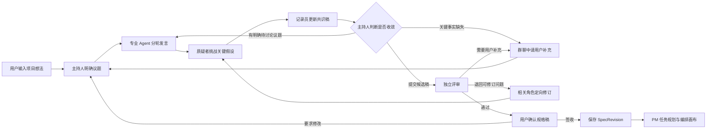
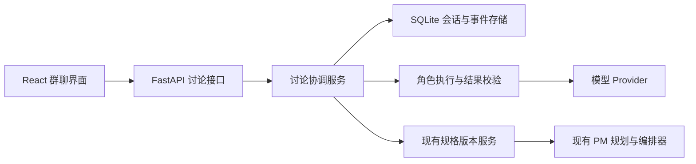

# FlowStudio 多 Agent 群聊与设计规格生成

架构评审稿 v1.2 · 对接 FlowStudio v3.1

用户在项目群聊中输入想法，多个专业 Agent 围绕同一项目分轮发言、相互引用和质疑。记录员把讨论整理为持续更新的共识稿，独立评审 Agent 检查证据、范围、技术风险及验收条件。用户确认通过评审的规格稿后，FlowStudio 保存正式规格版本，进入现有的 PM 任务规划、确定性编排和流程画布。[当前设计基线](BASELINE.md)

## 1 用户工作流



用户可在群聊里补充资料、回答澄清问题、纠正假设或要求重新讨论。系统把用户的关键补充记录为新输入版本，只按当前输入版本生成可签收草稿。用户也可从已有结构化规格直接进入现有工作台。

### 1.1 附件工作流与人工决策

《第六组-多Agent需求工作流设计方案》v2.0 的六阶段作为讨论工作台内部流程。群聊负责展示发言与决策卡，服务端以持久化议题、论点、风险、草稿和评审记录驱动流程。

| 附件阶段 | 工作台行为 | 人工决策 |
|---|---|---|
| 想法孵化 | 主持人整理目标、用户、痛点、范围和约束，区分用户陈述、假设与缺失信息 | 用户确认结构化摘要，或补充关键事实 |
| 多体讨论 | 按既有专业角色并行发言，质疑者引用具体观点并发起定向回应。记录员保留共识、少数派意见、风险与待验证假设 | 出现需要用户取舍的高风险或重要遗漏时，请用户确认风险处理方向 |
| 方案构建 | 记录员整理取舍及理由，将已解决的痛点与风险关联到拟定需求，并生成候选规格 | 可查看来源和取舍依据 |
| 多方评审 | 独立评审对冻结候选稿逐项检查覆盖、依据、技术风险和验收。多个评审维度可由同一独立角色覆盖 | 修订额度耗尽或关键争议仍未解决时，用户补充证据、指定修订方向或终止 |
| 需求规格 | 对已评审草稿整理最终需求、约束和验收口径。发生实质修改时生成新版本并重新评审 | 用户可比较版本并要求修改 |
| 校验交付 | 用 FlowStudio 契约执行结构校验，校验需求 ID、来源引用和整改项覆盖，核对通过的评审与当前输入版本 | 用户明确签收通过评审的当前版本 |

超时、重试与修订上限沿用本设计的讨论预算。人工裁决作为新输入或决策记录进入后续修订。评审附带的整改条件进入可验证的需求或验收项，经复审后关闭阻断问题。

## 2 群成员与职责

首版配置八个讨论角色和一个独立评审角色。同一模型可以承担多个角色，每次调用由服务端固定角色、可读上下文及输出契约。

| 角色 | 关注点 | 在群聊或共识稿中产生的内容 |
|---|---|---|
| 主持人 | 流程控制、防跑题、判断是否收敛 | 发布本轮议题，点名回应，提出澄清问题，说明继续、等待或送审的理由 |
| 产品经理 | 价值主张、范围、优先级 | 目标、首版范围、优先级、范围外事项 |
| 用户研究员 | 用户画像、场景、痛点是否真实 | 用户场景与证据，区分用户陈述、已有资料和待验证假设 |
| 技术架构师 | 可行性、成本、技术风险 | 技术约束、依赖、成本假设、关键风险和可行性取舍 |
| 设计师 | 体验、交互 | 用户旅程、关键交互、失败和空状态 |
| 商业／市场分析 | 竞品、商业模式、定价 | 已知信息与验证问题。无来源的竞品、定价、市场规模标为假设，需要时记录该议题不适用的理由 |
| 质疑者 Devil’s Advocate | 主动挑战假设、发现漏洞 | **必有角色，每轮送整合前必有有效输出**。针对具体消息提出反例、遗漏和验证办法 |
| 记录员／整合者 | 去重聚类、维护共识文档 | 汇总已达成共识、备选项、分歧、假设、风险和对应消息，产出版本化规格草稿 |
| 独立评审 Agent | 证据、需求覆盖、技术约束、风险与可验收性 | 对冻结草稿给出通过、需修改或需用户补充的结论，逐项引用条目并说明通过条件 |

主持人提交下一步建议，服务端检查阶段、角色结果、预算和确认条件后执行迁移。记录员负责写稿，评审 Agent 只针对冻结版本写评审结果。质疑者在讨论中发掘问题，评审 Agent 在定稿前检查问题是否得到处理。下游 `PM Agent` 根据已确认规格拆开发任务，和群聊中的产品经理承担不同职责。[现有 PM Agent 的输入与输出](architecture/PM_AGENT_DESIGN.md)

## 3 调度与评审规则

### 3.1 分轮讨论

1. **明确议题。** 主持人从用户输入提取目标、场景和约束，形成议题 ID、问题清单和必需发言者。关键事实缺失时在群聊集中提问。可暂用的假设标注来源、影响和验证方式。
2. **首轮并行发言。** 产品经理、用户研究员、技术架构师、设计师和商业／市场分析读取同一个议题快照。每条结果校验通过即落库并显示。质量检查和后续调度以必需结果是否齐全为准，与消息到达顺序无关。商业分析对内部项目可提交有理由的「不适用」。
3. **质疑与定向回应。** 质疑者读取本轮已提交发言，至少提出一条指向具体发言或用户输入的反例、潜在故障或可检验问题。主持人在同一条讨论下点名相关角色回应，并为每个问题指定提交者或请用户补充。关键议题只在回应给出证据、可验证处理方式或用户裁决后关闭。
4. **整合与收敛。** 记录员根据本轮发言和回应更新共识、分歧、待确认假设和拟定需求。主持人检查必需视角是否齐全、范围内条目是否有验收条件、关键分歧是否已处理。还有可解决的议题时开定向补充轮。需要用户决定时暂停并发澄清卡。条件满足时提交候选稿。

主持人的输出使用「动作、议题 ID、目标角色、待处理问题 ID、理由」描述调度建议。服务端校验阶段、目标角色、引用和预算。点名范围限于议题涉及的角色，质疑者和记录员仍参与每个形成新共识的回合。自由评论和用户补充都可保存在群聊中，只有新增事实、约束或取舍等实质修改才创建输入版本。

建议默认一轮全员发言、最多两轮定向补充、最多两次评审退回后的修订。服务端在派发前预留调用预算。单次传输重试沿用逻辑任务 ID，单独记录尝试和真实用量。轮次和修订计数只在正式创建相应回合时增加。额度耗尽后保持待处理状态，由用户补资料、明确授权追加额度或结束讨论，历史用量继续归集。

### 3.2 独立评审与用户签收

先使用现有规格契约对草稿做结构校验。通过后冻结草稿并交给独立评审 Agent。评审覆盖目标与范围、需求依据、体验边界、技术可行性、风险与验收可观察性。请求包含草稿版本、相关来源、未决问题及上轮问题处理记录。每条发现包含稳定问题 ID、严重度、目标条目、依据、负责角色和关闭条件。

| 评审结果 | 服务端行为 | 用户看到的内容 |
|---|---|---|
| `NEEDS_INPUT` | 暂停，等待用户补充关键事实或裁决。恢复时以最新输入版本重建受影响的议题快照 | 需要回答的问题、原因及涉及条目 |
| `REVISE` | 按开放问题派发定向修订，生成子版本并重新送审。保留未关闭的问题 ID 与处理状态 | 问题、负责角色、改动内容和关闭条件 |
| `PASS` | 校验草稿仍为当前版本，且无开放阻断项，再开放用户签收 | 审查通过的版本、版本差异和仍可接受的非阻断问题 |

关键分歧未解决、关键断言无依据或必需需求无法验收时，服务端禁止签收。评审退回后只重做受影响议题，无需重跑首轮。旧评审继续可查，改动需求、约束或验收条件时必须新建草稿并针对该版本评审。签收要求结构校验通过、同版本评审通过和用户明确确认；成功后生成正式 `SpecRevision`。[规格输入模型](architecture/DESIGN_SPEC_MODEL.md)

## 4 前端群聊

| 区域 | 行为 |
|---|---|
| 群聊消息列表 | 以头像、角色名和消息气泡显示用户与 Agent 发言。引用消息可点击跳转。主持人发议题卡，记录员发共识更新卡，评审发包含问题和结论的卡片 |
| 参与者与进度 | 展示当前议题、回合和正在发言的角色。并行阶段分别显示等待、完成或失败，并给出当前阻塞原因 |
| 消息输入区 | 支持补充项目要求和引用某条发言回复。等待澄清时置顶问题；讨论运行中说明新输入会进入下一轮，并立即记录已收到 |
| 共识稿侧栏 | 按已确认、待验证、未决分歧呈现条目，显示稳定需求 ID 与版本。条目可跳到来源消息，消息中的共识或评审卡也可打开对应条目。窄屏通过抽屉打开 |
| 审查与签收 | 主聊天流出现评审卡，展示草稿版本、问题严重程度与修复要求，可展开版本差异。等待用户补充时在卡片发起回复。当前版本通过评审后可「确认并保存规格」，也可「要求修改」并说明理由 |

会议室预约案例展示一次评审退回。以下消息同时用于前端交互演示和端到端验收，消息编号仅用于示意。

| 消息 | 内容与可操作项 |
|---|---|
| 01 用户 | 「做一个内部会议室预约工具，首版先解决查空闲和预约。」 |
| 02 技术架构师 | 「预约服务需要处理同一会议室的时段重叠。」 |
| 03 质疑者，回复 02 | 「两个人同时看到空闲并提交，是否会双重占用？」 |
| 04 设计师，回复 03 | 「第二个请求收到冲突提示，并可回到可用时段列表。」 |
| 05 记录员 | 草稿 v1 新增 FR-02「有效预约不得重叠」，可从条目回到 02–04。 |
| 06 独立评审 | 退回 v1。FR-02 需写明两个并发请求只产生一个有效预约，并能观察另一个请求的冲突结果。 |
| 07 记录员 | 草稿 v2 更新 FR-02 验收条件，评审问题关联 06，条目 ID 保持稳定。 |
| 08 独立评审、用户 | 独立评审通过 v2。用户查看差异后签收，进入任务规划。 |

首版按整条发言呈现，由服务端持久化后立即可查询。浏览器按消息序号增量轮询，状态栏显示正在发言和已提交。可见内容包括角色观点、简明理由、来源和评审结论。断线重连按最后序号补齐，刷新后恢复同一会话。需要低延迟推送时，可在同一事件序列上增加 SSE。

## 5 服务端结构与数据



讨论协调服务使用普通状态机，实现 `CLARIFYING → DISCUSSING → REVIEWING → AWAITING_CONFIRMATION → COMPLETED`。评审可回到讨论或澄清。可恢复故障进入 `PAUSED` 并记录恢复点，取消进入 `CANCELED`。角色状态独立记录为排队、运行、成功或失败。Agent 响应通过角色输出契约校验后，由协调服务决定如何提交发言、更新草稿或调度下一步。模型调用在数据库事务之外。Provider 复用现有传输与模型配置，讨论服务独立维护角色指令、预算和轮次状态。[现有 PM 模型适配](architecture/PM_AGENT_DESIGN.md)

| 记录 | 必要字段与用途 |
|---|---|
| DiscussionSession | `id, project_id, status, input_version, round, config_snapshot, active_draft_id, last_seq`。记录阶段、已冻结配置、当前输入和游标 |
| DiscussionMessage | `session_id, seq, role, kind, text, reply_to_seq, source_seqs, item_refs, input_version, round`。序号在会话内单调递增，回复及来源指向同会话的已提交消息，条目引用包括草稿版本与条目 ID |
| RoleAttempt | `logical_task_id, attempt_no, role, snapshot_ref, status, usage, error`。支持恢复、去重及成本归集 |
| DraftRevision | `id, parent_id, input_version, content, source_map, open_issues`。按条目保存依据消息与相关质疑，区分事实、假设、决策。条目改写沿用 ID，拆分或合并以变更记录说明关系 |
| ReviewResult | `id, draft_revision_id, verdict, findings`。问题按 ID 跨版本追踪，关闭时保存处理说明和复核依据 |
| SpecHandoff | `draft_revision_id, review_id, confirmed_at, spec_revision_id`。记录确认与现有版本的关联 |

角色运行上下文包含当前用户输入、议题快照、已确认共识、未决问题及引用的原始消息。只有被点名的问题使用相关历史片段，节省模型上下文并保留可核验依据。页面可继续展示完整历史。

同一轮并行任务各自提交结果，协调服务在单次事务中校验尝试身份和输入版本、追加发言、更新状态。相同逻辑任务只合并一个有效结果。用户补充关键输入时，旧版本的在途结果可留在历史记录，当前汇合只计算与快照版本一致的有效结果。刷新不触发模型重跑。进程重启后恢复已提交的消息和检查点，调用结果不明时提示用户确认重试。暂停、预算耗尽及取消后停止派发新任务。

## 6 与现有工作台对接

以下为**拟新增**的讨论操作，前缀为 `/api/v1`。落实接口时将请求、响应和操作一并纳入仓库共享契约与 OpenAPI 生成流程。

| 操作 | 建议接口 | 关键行为 |
|---|---|---|
| 创建群聊并提交项目想法 | `POST /projects/{id}/discussions` | 保存初始用户消息并返回会话标识 |
| 查看阶段和当前草稿 | `GET /discussions/{id}` | 返回状态、回合、参与者状态、草稿、评审与最新序号 |
| 增量读取群聊 | `GET /discussions/{id}/messages?after_seq=...` | 按序返回已提交消息和下一游标 |
| 用户补充或回复 | `POST /discussions/{id}/messages` | 接收上下文版本与可选引用，追加用户发言并触发相应讨论 |
| 重试、继续、取消或要求修订 | `POST /discussions/{id}/actions` | 对当前状态检查动作是否合法，保留处理记录 |
| 确认并保存规格 | `POST /discussions/{id}/confirm` | 校验草稿 ID、输入版本、评审与规格期望版本，复用规格保存和幂等规则 |

### 6.1 FlowStudio 上游输出契约

工作台的正式交付物是当前 `schema_version: "1.0"` 的 `DesignSpecContent`。草稿中的候选正文与签收后导出的 UTF-8 JSON 共用仓库现有的 [FlowStudio Design Spec Schema](tech/artifacts/schema/design-spec.schema.json)，也遵循服务端的规格语义校验。所有必填字段都显式输出，需求 ID 唯一且跨修订稳定。除结构校验外，交付前检查引用真实存在、已确认的范围内痛点有需求覆盖、须处理的关键风险和整改项有可观察的验收条件。

| 讨论资料 | 写入 FlowStudio 正文的位置 |
|---|---|
| 用户确认的背景、目标和角色 | `background`、`goals`、`target_users` |
| 已确认的用户故事、业务规则和异常流 | `requirements[]`，使用 `kind: "functional"` |
| 已确认且可验收的性能、安全、可用性等质量要求 | `requirements[]`，使用 `kind: "nonfunctional"` |
| 需求优先级与 Given / When / Then 场景 | 使用现有 `must / should / could` 枚举，将场景写入该条需求的 `acceptance_criteria` 字符串数组 |
| 已确认的技术边界、开发约束、交付物和整体验收 | `technical_constraints`、`development_constraints`、`delivery_requirements`、顶层 `acceptance_criteria` |
| 用户明确认可的假设和规划所需补充说明 | `confirmed_assumptions`、`supplemental_text` |

项目名称写入 `product_name`。痛点、风险、方案、讨论消息、来源映射、人工决策、评审和修订记录作为工作台内部记录保存，由稳定需求 ID 关联。附件中的 PRD 模板和追溯矩阵用于整理内部材料，导出 JSON 只包含现有 Schema 允许的字段。

### 6.2 本地导入与 API 交接

首版可将签收后的正式规格正文导出为 JSON，经 FlowStudio 现有规格导入入口验证。直接联通时，由交接适配器提交 `POST /api/v1/projects/{project_id}/spec-revisions`，请求体为 `{ expected_revision, content }`，其中 `content` 是同一份已签收正文。FlowStudio 返回正式 `SpecRevision` 后，工作台记录其 ID 与草稿、评审和确认时间的关联。首次保存使用 `expected_revision: 0`，后续保存使用读取到的目标版本。

共用存储的实现可将确认和保存放在同一事务。独立本地进程通过 REST 交接时，工作台先持久化待提交的正文、目标版本与幂等键，成功后再标记交接完成。响应丢失时原样重发并复用幂等键。遇到版本冲突时保留草稿和评审，提示用户查看目标版本后重新发起交接。下游 PM Agent、任务规划和编排沿用 FlowStudio 现有入口。[接口说明](architecture/API_SPECIFICATION.md) · [编排器](architecture/ORCHESTRATION_ENGINE.md)

## 7 交付顺序与验收

1. 先交付角色契约、状态机、消息持久化和明确标注的模拟群聊，验证分轮、质疑者、独立评审及人工补充。
2. 接上现有模型配置，验证真实群聊的响应、收敛、失败和消耗。群聊每次发言落库后增量展示。
3. 启用草稿签收与兼容 JSON 导出，先用 FlowStudio 现有导入入口验收。接入 API 时验证同一签收请求的幂等写入和版本冲突处理。

| 验收场景 | 预期结果 |
|---|---|
| 输入会议室预约项目 | 首轮消息逐条展示；质疑者引用架构师发言；架构师和设计师完成定向回应。消息与 FR-02 可相互跳转 |
| 评审退回 FR-02 | 草稿 v1 的签收不可用；只派发涉事角色处理问题；v2 沿用 FR-02 ID，显示验收条件的差异并重新送审 |
| 观点冲突或关键资料缺失 | 记录员保留分歧，主持人提出具体问题，用户回复后开启针对性补充 |
| 质疑者超时、评审阻断或额度耗尽 | 状态停在相应阶段，界面给出原因与可用操作，无法签收 |
| 刷新、重试或旧结果迟到 | 消息按序恢复；同一逻辑任务只产生一份有效结果；旧版本回调不能推进新版本 |
| 用户在评审后修改范围 | 创建新草稿，旧评审和旧确认不能签收新草稿 |
| 模型给出跨会话引用、无效目标角色或通过但有阻断项 | 服务端拒绝该输出或迁移，保留可诊断状态，界面给出下一步 |
| 用户确认通过评审的规格 | 生成一个 SpecRevision；同一请求重试不新增版本；可继续生成候选任务和查看编排画布 |
| 将签收的会议室预约规格导出并导入 FlowStudio | JSON 文档根节点是 `DesignSpecContent`，可通过现有导入和规格校验。需求 ID、优先级和验收项与签收版本一致 |
| 候选稿引用不存在的来源，或遗漏关键风险整改项的验收条件 | 交付校验返回具体需求 ID 或风险 ID，草稿退回修订，禁止签收 |

## 附录 会议室预约交接示例

以下 JSON 示意群聊形成的共识如何提交到现有规格契约，可独立用于工作台导入。议题与消息引用在运行时由来源映射保存。

```json
{
  "schema_version": "1.0",
  "product_name": "内部会议室预约",
  "background": "员工需要提前预约共享会议室，管理员需要管理可预约时段。",
  "goals": [
    "让员工查询空闲时段并完成预约，防止双重占用"
  ],
  "target_users": [
    "员工",
    "会议室管理员"
  ],
  "requirements": [
    {
      "id": "FR-01",
      "kind": "functional",
      "priority": "must",
      "text": "员工可查看会议室的可预约时段并发起预约。",
      "acceptance_criteria": [
        "选择会议室和时间段后，可用时段能成功预约并返回确认记录。"
      ]
    },
    {
      "id": "FR-02",
      "kind": "functional",
      "priority": "must",
      "text": "同一会议室的有效预约时段不得重叠。",
      "acceptance_criteria": [
        "两人同时请求同一房间的重叠时段时，只生成一个有效预约，另一人收到冲突提示。"
      ]
    }
  ],
  "technical_constraints": [],
  "development_constraints": [
    "首版面向单个办公地点"
  ],
  "delivery_requirements": [
    "交付预约界面、预约服务和时段冲突测试"
  ],
  "acceptance_criteria": [
    "能复现查询、预约及并发预约冲突场景"
  ],
  "supplemental_text": "演示用规格。FR-01 对应员工预约场景，FR-02 对应评审提出的重复预约风险。",
  "confirmed_assumptions": []
}
```

## 参考项目与设计取舍

| 参考 | 对 FlowStudio 的影响 |
|---|---|
| [LobeHub Agent Groups](https://landing-staging.lobehub.com/ja/docs/usage/agent/agent-team) | 采用统一消息流、并行首轮与协调者点名，后续按分歧推进讨论 |
| [Microsoft Agent Framework Group Chat](https://learn.microsoft.com/en-us/agent-framework/workflows/orchestrations/group-chat?pivots=programming-language-python) | 采用独立评审角色与有界循环。评审结论经服务端校验并绑定草稿版本 |
| [ChatDev 2.0 人工节点与条件边](https://github.com/OpenBMB/ChatDev/blob/main/frontend/public/tutorial-en.md) | 将澄清、退回和签收表达为群聊里的可操作卡片，并明确每种动作的后续状态 |
| [MetaGPT 的 PRD 生成](https://github.com/FoundationAgents/MetaGPT/blob/main/metagpt/actions/write_prd.py) | 把规格作为可交接的结构化产物，供现有任务规划消费 |

首版沿用现有 FastAPI、SQLite 与 React 编排实现讨论状态机和消息增量轮询。业务门槛、会话历史、草稿版本及确认均由 FlowStudio 管理，参考项目用于评估交互和编排机制。

## 设计来源

- 《第六组-多Agent需求工作流设计方案》v2.0 提供六阶段流程、人工决策卡、风险与需求追溯、回归评审及交付校验。
- 《第六组任务 2 设计输入与编排器设计规格 v1.0》提供阶段化讨论、共享记录、版本化人工确认与评审回退规则。
- 《开发任务编排系统详细设计方案》提供可追溯的规格条目、任务交付与可观察验收要求。
- [FlowStudio v3.1 基线](BASELINE.md)定义现有规格、规划、编排与展示入口。
