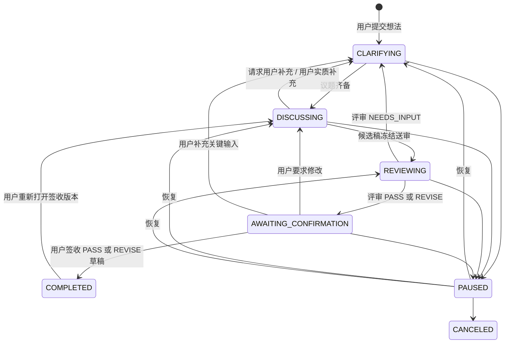

# 讨论编排内核

多 Agent 需求讨论的确定性编排层：负责会话状态机、议题调度、首轮并行发言、质疑与点名回应、人工澄清、定向修订，并校验阶段迁移与轮次上限。

本目录只回答两个问题——“这一步能不能走”“下一步派给谁”。它不调用模型、不访问数据库、不依赖 Web 框架，可以单独运行，也可以被后端协调服务当作纯函数内核复用。

## 1. 模块职责

| 模块 | 内容 |
| --- | --- |
| `enums.py` | 角色、阶段、回合、任务类型、消息类型、严重度、分歧类型、问题状态、评审结论、调度动作、原因码、轮次硬上限 |
| `models.py` | 议题、消息、问题、角色任务与结果、草稿版本、评审结果、主持人调度卡、编排决策 |
| `state_machine.py` | 允许的状态迁移表、暂停/恢复判定、非法迁移异常 |
| `validation.py` | 引用归属、议题结构、点名范围、成稿门禁等纯校验 |
| `scoring.py` | 权衡分歧的五维加权打分、权重归一化与确定性排名 |
| `engine.py` | 编排引擎，唯一的状态入口 |

## 2. 目录

```text
discussion_orchestration/
├── enums.py            # 枚举与角色分组
├── models.py           # 数据模型
├── state_machine.py    # 状态迁移表
├── validation.py       # 纯校验规则
└── engine.py           # 编排引擎
```

## 3. 状态机



迁移由服务端判定，主持人只能提交调度建议（`HostProposal`）。越过阶段、越权点名或超出预算的动作整卡拒绝，并写入 `session.rejections`。

## 4. 回合与阶段

| 回合 `RoundKind` | 阶段顺序 | 派发对象 |
| --- | --- | --- |
| `FIRST` 首轮 | `STATEMENTS → CHALLENGE → RESPONSES → INTEGRATION` | 五个专业角色并行，共用同一 `snapshot_ref` 与 `input_version` |
| `DIRECTED` 定向补充 | `RESPONSES → CHALLENGE → INTEGRATION` | 主持人点名的角色，之后质疑者复核、记录员整合 |
| `REVISION` 评审修订 | `RESPONSES → CHALLENGE → INTEGRATION` | 仅评审发现中 `responsible_role` 指定的角色 |

质疑者每回合至少给出一个指向具体发言或用户输入的问题；记录员在每个形成新共识的回合参与整合。因此“必需发言 + 质疑 + 整合”齐备后才允许成稿。

默认按收敛结果推进。可通过 `DISCUSSION_MAX_DIRECTED_ROUNDS` / `DISCUSSION_MAX_REVISION_ROUNDS` 为各输入版本启用轮次保护：定向补充轮超限返回 `ROUND_LIMIT`；评审再次退回且修订轮已用尽时直接转人工澄清，不进入下一轮修订。这样即使评审每轮换个措辞提新问题，也不会无限循环。

## 5. 校验规则

| 场景 | 规则 | 可观察结果 |
| --- | --- | --- |
| 成稿 | `validation.draft_blockers` 同时检查缺发言（`MISSING_REQUIRED_SPEAKERS`）、缺质疑（`CHALLENGE_MISSING`）、未关闭阻断问题（`OPEN_BLOCKING_ISSUES`），送稿与写稿共用此门禁 | 任一缺口存在时返回 `DRAFT_NOT_READY`，`detail.missing_statements` 给出议题与缺失角色，`detail.blocking_issues` 给出问题 ID |
| 人工退回 | PASS 或 REVISE 都先等待用户审阅。用户退回后按评审负责角色和补充意见派发定向修订 | 使用 `require_changes` 提交当前草稿 ID 和修订意见，REVISE 可直接采用评审意见 |
| 输入版本 | 用户实质补充时升级 `input_version` 与 `snapshot_ref`，在途任务移入 `stale_tasks`，旧草稿标记为非当前版本 | 旧版本结果返回 `STALE_INPUT_VERSION`，`input_version`、消息序号、草稿状态均不改变 |
| 结果归属 | `task_id + role + kind + round_no + topic_id + input_version + snapshot_ref` 全部匹配才合并 | 不匹配返回 `CROSS_SESSION_RESULT` / `CONTRACT_MISMATCH` / `STALE_ROUND` |
| 引用 | 来源与回复只能指向本会话已提交消息 | 跨会话引用返回 `CROSS_SESSION_REFERENCE` |
| 点名 | 目标角色必须落在当前议题 `role_scope` 内，主持人与评审不可被点名 | 越界返回 `INVALID_TARGET_ROLE` |
| 问题关闭 | 阻断问题必须带 `evidence` 才能由回应关闭 | 缺少证据返回 `MISSING_EVIDENCE` |
| 评审 | 通过结论不得附带阻断发现，签收要求同版本 PASS 评审 | `REVIEW_PASS_WITH_BLOCKING` / `REVIEW_NOT_PASSED` |
| 修订收敛 | 同一输入版本再次出现相同规格正文和同一组未解决评审项时，生成澄清问题 | `AWAITING_USER_INPUT` |
| 轮次上限 | 启用轮次保护后，超限时定向轮返回 `ROUND_LIMIT`，修订轮转人工澄清 | `detail.remaining_*_rounds` 给出余量；修订超限时 `detail.escalated="revision_limit"` |
| 价值分歧 | `Issue.kind=value` 的问题标记为待用户裁决，不允许点名角色回应，也不能成稿 | `ISSUE_NEEDS_USER` / `VALUE_DIVERGENCE_UNRESOLVED` |
| 权衡打分 | `Issue.kind=tradeoff` 的问题不能点名；成稿或切议题前必须由主持人提交评分卡，按用户价值/可行性/成本/差异化/风险加权，最高分方案被采纳，相关分歧自动关闭 | 缺评分卡时 `submit_candidate_draft` / `move_to_next_topic` 改为派发 `SCORING` 任务；`detail.ranking` 返回排名，不合格返回 `INVALID_SCORECARD` |

人工澄清与多议题调度的行为约定：

- 用户实质补充后升级输入版本，主持人重建议题快照，首轮任务全部带新版本与新快照；
- 需要关键事实时由用户补充，随后主持人基于新输入版本推进讨论；
- 多议题按顺序派发，前一议题未收敛不能切换，候选稿需全部议题的发言与质疑齐备。

## 6. 关键不变量

1. **消息序号单调**：`_append` 是唯一写入口，回复与来源只能指向本会话已提交序号。
2. **结果身份一致**：任务身份字段全部匹配才合并，同一逻辑任务只合并一份有效结果。
3. **点名范围受限**：目标角色必须落在议题 `role_scope` 内。
4. **问题关闭要有依据**：关闭阻断问题需要证据或可验证的处理方式。
5. **自动执行批次**：角色执行器每批最多调用 32 次。讨论仍需推进时，执行器自动开启下一批。
6. **草稿版本化**：每次送审生成新的 `DraftRevision`（`parent_id` 指向上一版），旧版本 `current=False`；签收只认当前版本 + 同版本 PASS 评审。
7. **分歧记录随稿留存**：记录员返回的 `agreements` / `alternatives` / `disagreements` 落到 `DraftRevision`，供界面展示与签收归档；导出 `DesignSpecContent` 时不含这些字段。
8. **轮次保护可配置**：新输入重新计算定向补充和修订轮次。
9. **打分确定性**：同一份评分卡与权重永远得到同一个排名（同分先比用户价值，再按 `option_id`），权重默认 0.30/0.25/0.15/0.15/0.15。
10. **决策可追溯**：`DraftRevision.scorecard_id` / `chosen_option_id` 记录该版本依据的评分卡与被采纳方案，导出正文不含这些字段。

## 7. 使用示例

```python
from discussion_orchestration import (
    Agenda, AgendaItem, DiscussionEngine, HostAction, HostProposal, Role,
)

engine = DiscussionEngine()
session = engine.create_session(
    session_id="s-1", project_id="p-1", idea="做一个内部会议室预约工具"
)

decision = engine.submit_agenda(session, Agenda(
    summary="明确首版范围与并发冲突处理",
    items=(AgendaItem(topic_id="T1", title="预约与冲突", question="如何避免重复预约？"),),
))
# decision.tasks 即首轮并行的 5 个角色任务

# 回灌角色结果
engine.submit_output(session, output)

# 主持人调度卡
engine.propose(session, HostProposal(
    action=HostAction.NAME_RESPONSES,
    assignments={Role.ARCHITECT: ("I-1",)},
    reason="并发写入由架构师回答",
))
```

角色任务、角色结果、评审结论、签收移交信息都是纯 dataclass，可直接映射到后端记录（`RoleAttempt`、`DiscussionMessage`、`ReviewResult`、`SpecHandoff`）。

## 8. 使用

本目录是纯 Python 模块（3.10+，无第三方依赖），按第 7 节导入即可，不需要单独启动进程。

## 9. 边界

本目录不包含以下能力：

- 角色提示词、模拟与真实模型适配、超时重试、用量采集（由角色执行层承担）；
- HTTP 接口、数据库持久化、事务与幂等（由后端协调服务承担）；
- 群聊界面、消息增量轮询、决策卡与差异视图（由前端承担）；
- 规格正文校验、`DesignSpecContent` 转换与签收后的版本保存（由交付层 [`spec_handoff/`](../spec_handoff/README.md) 承担）。

本包对外提供 `Decision`（含 `code`、`waiting_for`、`detail`）、`SpeakerTask`、`SpeakerOutput`、`ReviewResult` 与会话快照，以上各层在调用前后自行负责各自职责。
