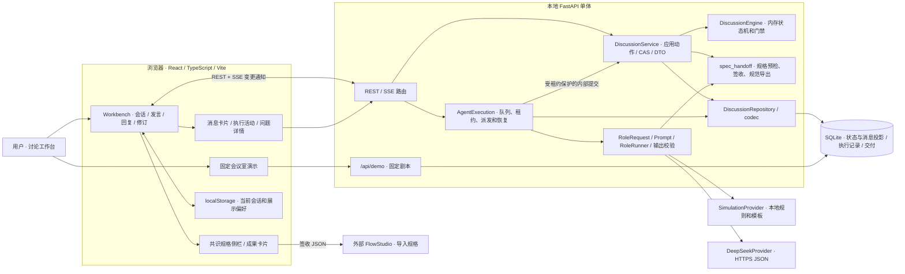
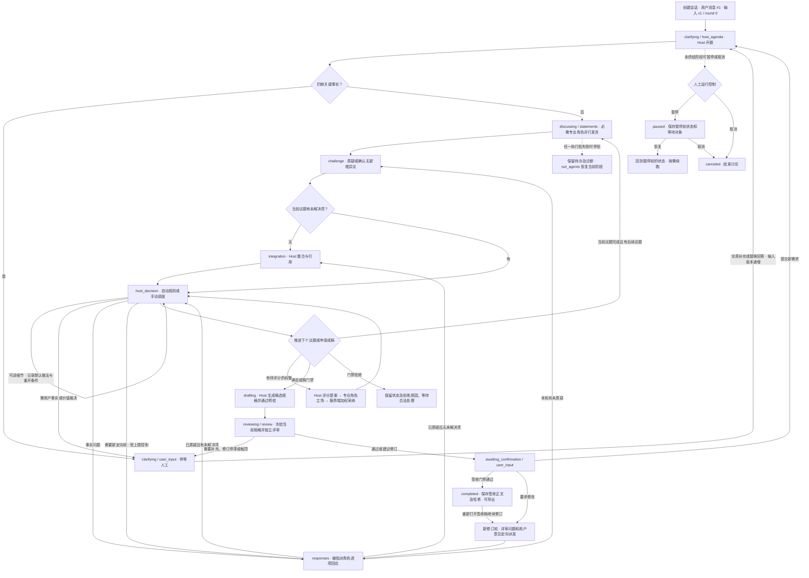

# muti-agent-discussion 架构审计与运行基线

审计日期为 2026-11-27（Asia/Shanghai），源码基准为 `32591b239ca9b0239d973969fdfb0edd53539e7e`。环境为 Windows、Python 3.14.6、Node.js v24.21.0。审计只读源码、运行既有测试、使用临时 SQLite 跑模拟，并以只读方式检查本地真实模式 API 和历史计量。本次只新增本报告。

## 1. 结论与项目边界

当前产品是**以讨论为主界面的结构化协作工作台**。讨论消息、任务、证据、议题及草稿在同一会话内编排。规格侧栏用于查看、比较、签收和导出成果。企业化最先面对的是角色与策略的可配置性、身份与租户隔离、运行可观测性和长会话成本。

仓库实现 FlowStudio 上游的需求讨论和 `DesignSpecContent` JSON 交接。FlowStudio 的工作流画布、下游任务规划和编排运行属于另一个系统，本仓库通过导出契约交接。`/api/demo` 则是单独的固定剧本，基线模拟使用正式 `/api/v1` 路径加 `SimulationProvider`。见 [项目说明](../README.md#flowstudio-交接)、[FastAPI 入口](../backend/main.py#L18) 和 [固定演示剧本](../backend/scenario.py#L50)。

## 2. 当前系统架构图



### 核心模块职责表

| 模块 | 职责和依赖 | 源码 |
| --- | --- | --- |
| Web 入口与接口 | FastAPI 安装正式路由、启动恢复循环并挂载 `frontend/dist`。路由负责输入校验、错误信封、SSE 和下载 | [main.py](../backend/main.py#L123)、[routes.py](../backend/discussions/routes.py#L145) |
| DiscussionService | 负责读模型、幂等回放、预期版本与引用校验、调用 Engine、交付预检和事务提交。接受人工接口与执行器结果 | [application.py](../backend/discussions/application.py#L29)、[动作分派](../backend/discussions/application.py#L465)、[提交](../backend/discussions/application.py#L513) |
| DiscussionEngine | 只修改传入的内存领域对象，处理轮次、问题、角色输出、门禁、评审及迁移。输入是领域信封，输出是 `Decision` 和任务 | [engine.py](../discussion_orchestration/engine.py#L77)、[领域模型](../discussion_orchestration/models.py#L296)、[状态机](../discussion_orchestration/state_machine.py#L13) |
| AgentExecution | 基于状态和 SQLite 持久任务组选工作，构建上下文，持租约调用 Runner，将合法输出映射为应用动作 | [执行与恢复](../backend/discussions/agent_execution.py#L46)、[调度规则](../backend/discussions/agent_execution.py#L174)、[输出映射](../backend/discussions/agent_execution.py#L431) |
| 角色运行层 | `contracts` 校验角色请求和响应，构建 Prompt。`RoleRunner` 负责限额、快照摘要、重试和脱敏诊断。Provider 协议连接模拟或真实调用 | [contracts.py](../backend/roles/contracts.py#L166)、[runner.py](../backend/roles/runner.py#L42)、[provider.py](../backend/roles/provider.py#L76)、[simulation.py](../backend/roles/simulation.py#L335) |
| 仓储与编解码 | 会话聚合的最新状态是写入依据。CAS 事务同时更新消息、草稿、评审、签收、审计等投影。`codec` 保留版本和旧格式兼容 | [repository.py](../backend/discussions/repository.py#L294)、[codec.py](../backend/discussions/codec.py#L251)、[schema.sql](../backend/discussions/schema.sql#L11) |
| 规格交接 | `DraftSpec` 归一化草稿，`build_report` 检查验收、证据、稳定 ID 和导出上限。签收固定正文及内容哈希 | [draft.py](../spec_handoff/draft.py#L104)、[validation.py](../spec_handoff/validation.py#L216)、[signoff.py](../spec_handoff/signoff.py#L89)、[export.py](../spec_handoff/export.py#L60) |

依赖方向总体为浏览器 → HTTP 接口 → 应用服务 → 领域和持久化。执行器与应用服务之间存在受控回调，执行器既读取领域状态，又通过服务提交决策。下游规格 Schema 同时被角色输出校验和交付层引用。领域引擎本身不需要 FastAPI、SQLite 或模型连接。`spec_handoff/handoff.py` 另有向下游提交规格版本的传输适配器，当前工作台的确认和下载链路落在本地签收记录。见 [角色契约](../backend/roles/contracts.py#L22)、[签收接口](../backend/discussions/routes.py#L362) 和 [下游适配器](../spec_handoff/handoff.py#L244)。

## 3. 状态机与完整讨论流程



- **三层状态**。`SessionStatus` 决定合法的大状态迁移，`round_kind`（first、directed、revision）决定回合起点，`Phase` 与 `waiting_for` 决定实际可提交的结果和下一批任务。`round_no` 是会话累计回合，回合内的发言、质疑、回应、整合和评分可走多步。首次轮从 `statements` 开始，定向轮和修订轮从 `responses` 开始。多议题推进还要求当前议题发言与质疑齐全、处理权衡和开放问题。见 [状态枚举](../discussion_orchestration/enums.py#L44)、[轮次与派发](../discussion_orchestration/engine.py#L866)、[阶段推进](../discussion_orchestration/engine.py#L961)、[下个议题](../discussion_orchestration/engine.py#L219)。
- **人工写入与中断**。随手备注仅写消息。实质补充递增 `input_version`、迁走在途任务、复位覆盖/质疑/轮次计数、清除当前稿标记并重新开题。旧记录还可追溯。暂停记录恢复前的状态与等待对象。恢复时可续跑，取消终止会话及其待办。`completed` 对一般写入是终态，存在专门的重新修订入口。任务失败保留诊断及待办，执行器停批，可由 `run_agents` 恢复。见 [补充输入](../discussion_orchestration/engine.py#L90)、[修订](../discussion_orchestration/engine.py#L755)、[暂停与取消](../discussion_orchestration/engine.py#L793)、[运行循环](../backend/discussions/agent_execution.py#L98)。
- **问题状态与审批**。`OPEN → ANSWERED` 代表已有回应。需复核的阻断项在当前冻结稿评审时须逐项报告或以证据验证，认可后可进入 `CLOSED`。价值分歧由用户裁决，产生 `USER_DECIDED`。常规 `REVISE` 与 `PASS` 都等待用户决定。`NEEDS_INPUT`、停滞或配置的修订上限进入澄清。应用层签收还调用交付门禁，`REVISE` 在门禁满足时可带着原评审意见被签收。见 [问题簿记](../discussion_orchestration/engine.py#L1168)、[评审](../discussion_orchestration/engine.py#L556)、[签收规则](../spec_handoff/signoff.py#L89)。

### 3.1 Host 与各角色

| 角色 | 当前职责 | 控制边界 |
| --- | --- | --- |
| Host | `agenda` 输出开题摘要或问题，`integration` 综合证据、共识和分歧，`scoring` 提交评分，`draft` 生成规格及映射 | 运行中 `host_decision` 通常由 `_next_jobs` 的规则直接提交，阶段和准入由 Engine 裁定。自动开题适配器实际构造一个议题，模型的目标角色未接入议题配置 |
| Product | 用户价值、范围、优先级、备选和业务成本，执行被指派的回应和立场 | 需要引用有效证据或明确假设 |
| Architect | 可行性、权限、一致性、依赖、异常和可验收条件，执行回应与立场 | 真实验证与待运行的验证计划在契约中区别表达 |
| Designer | 使用者场景、操作、失败和空态、可观察结果，执行回应与立场 | 在当前议题与角色范围内提交结果 |
| Challenger | 引用发言提出事实、价值、权衡或常规可逆问题，也可报告无新增异议 | 引用必须合法，问题去重；价值判断由人决定，权衡通过评分 |
| Reviewer | 对指定冻结稿独立评审，登记新发现并逐项复核历史问题 | 评审与草稿 ID、输入版本绑定，通过时不能有开放阻断项 |
| User | 提交目标、确认事实和价值取舍、退回或签收 | 通过应用动作触发版本或状态变化 |
| 历史角色 | `research`、`business`、`recorder` 保留旧记录和任务；模型角色别名包含 `market`、`critic`、`scribe` | 历史责任人可映射到现有专业角色，ID、消息作者和来源需要保留 |

对应 [角色指令](../backend/roles/contracts.py#L419)、[自动调度](../backend/discussions/agent_execution.py#L174)、[开题及历史角色映射](../backend/discussions/agent_execution.py#L431)、[角色范围](../discussion_orchestration/enums.py#L19) 与 [议题默认值](../discussion_orchestration/models.py#L43)。

### 3.2 第一版草稿的全部门禁

| 时点 | 条件 | 检查点 |
| --- | --- | --- |
| 进入讨论 | 有有效议题摘要、唯一非空议题 ID、标题、问题、必需发言者和合法点名范围。提供假设时须有来源、影响和验证方式。议题有缺失事实时先等待用户，再重新开题 | [议题校验](../discussion_orchestration/validation.py#L60)、[提交议题](../discussion_orchestration/engine.py#L181) |
| 申请成稿 | 状态为 `DISCUSSING`、等待 `HOST_DECISION`、无待提交任务。所有议题的必需发言与质疑覆盖齐备，当前版本无 `OPEN` 阻断项或价值分歧。引用合格的「无新增异议」计入质疑覆盖 | [申请成稿](../discussion_orchestration/engine.py#L430)、[四项门禁](../discussion_orchestration/validation.py#L197)、[质疑校验](../discussion_orchestration/engine.py#L1035) |
| 收敛分支 | 自动路径优先处理常规事项、需人工问题和非权衡问题。待评分权衡先产生评分、立场和最终选择，随后再次申请提交。自动路径在最后议题提交。整合通常发生于质疑或回应之后，但门禁没有要求必须存在整合消息，纯权衡路径可经评分直接进入成稿 | [规则](../backend/discussions/agent_execution.py#L174)、[评分](../discussion_orchestration/engine.py#L1223)、[评分完成](../discussion_orchestration/engine.py#L1295) |
| 成稿响应 | 对应已派发的 `DRAFT` 任务，匹配会话、角色、回合、议题、输入版本和快照，正文非空并重新通过成稿门禁。自动角色路径另校验 `ScribeOutput`、合法来源、覆盖映射和 ID 变更；应用层对自动及手动成稿做 `build_report` 预检 | [任务信封](../discussion_orchestration/engine.py#L462)、[角色校验](../backend/roles/contracts.py#L720)、[应用预检](../backend/discussions/application.py#L465) |
| 冻结与后续审批 | 草稿带版本、父版本、来源和评分等，写入后产生「候选稿 v1 已冻结送审」，此时首稿已存在。独立评审、人工签收和下游下载是后续动作。草稿可以含已回应但尚待复核的问题 | [冻结](../discussion_orchestration/engine.py#L1356)、[后续评审](../discussion_orchestration/engine.py#L556)、[签收](../spec_handoff/signoff.py#L89) |

## 4. 上下文、Prompt 与模型计量

1. **派发边界**。Engine 冻结 `SpeakerTask.message_seqs`、`input_version`、`snapshot_ref`。执行器按已派发序号上界选历史，剔除已替换回答、随手备注和空消息。发生修改回答时，旧版本的 Agent 消息也被排除，当前的实质用户输入重构成 `user_input`。Host 开题只收用户消息。一般角色不传完整规格，成稿、整合和评审按需传所选冻结稿、来源映射、父稿问题或旧需求 ID。评分与立场任务使用对应分歧和候选方案。见 [引擎快照](../discussion_orchestration/engine.py#L900)、[任务上下文恢复](../backend/discussions/agent_execution.py#L218)、[组装请求](../backend/discussions/agent_execution.py#L353)。
2. **保留策略**。强制保留可见用户信息、明确引用的证据和草稿关联来源。可选窗口 24 条、消息正文合计预算 16,000 字符，优先保留同议题决策和整合检查点，专业角色还保留上一轮自己的发言。额外传送最多 12 条选取出的共识，结构化按字段长度和条数限制。快照校验限制可见序号、角色和版本。Prompt 固定为系统指令加 JSON 数据消息，重试插入精简诊断。见 [窗口选择](../backend/discussions/agent_execution.py#L391)、[请求范围校验](../backend/roles/contracts.py#L166)、[Prompt 组装](../backend/roles/contracts.py#L432)、[重试反馈](../backend/roles/runner.py#L104)。
3. **真实调用**。环境可选 `simulation/real/off`。真实 Provider 读服务端密钥及 `DISCUSSION_MODEL`，执行器默认 `deepseek-flash` 和 `max_tokens=8192`，以非流式 JSON 模式请求固定 DeepSeek 地址，增量读取 HTTP 响应并限制至 1 MiB。Runner 默认每任务最多 2 次、每次 45 秒、每实例 32 次调用。旧实例余量不足就滚动新实例，32 次属于批内预算。进程最多处理 4 场讨论，租约 120 秒并在批次前续租，`gather` 等到整批返回再逐条提交。见 [执行器参数](../backend/discussions/agent_execution.py#L46)、[批次](../backend/discussions/agent_execution.py#L98)、[Runner](../backend/roles/runner.py#L42)、[Provider](../backend/roles/provider.py#L94)。
4. **Token 语义**。真实 Provider 从 `usage` 分别接受非负整数 `prompt_tokens / completion_tokens / total_tokens`，缺失记空。仓储保存每次尝试的 usage JSON、耗时和错误状态。会话 API `usage` 只聚合 `total_tokens`、calls、retries、invalid_outputs、耗时及按任务分类，缺未知量时会跳过计量或在总和按 0 处理。并行总耗时是各尝试耗时之和。活动接口只投影公开尝试元数据，输入与输出 Token 的分项要读取持久化记录。默认模拟只报告 `total_tokens: 0`。见 [Provider 用量](../backend/roles/provider.py#L38)、[固定模拟返回](../backend/roles/simulation.py#L335)、[聚合实现](../backend/discussions/application.py#L686)、[尝试表](../backend/discussions/schema.sql#L58)。

### 硬编码盘点

| 类型 | 当前代码中的决定 | 可配置性 |
| --- | --- | --- |
| 角色与职责 | 固定六角色组、三位必需专业角色、历史别名、评审负责人回退、角色及任务输出 Pydantic 类 | 新增角色横跨枚举、契约、执行器和 UI |
| 开题与收敛规则 | 自动开题的存储形态固定单议题及问题模板。自动调度按常规默认、人工裁决、事实回应与权衡评分的优先级运行 | 引擎支持手动多议题，当前自动入口缺少项目级策略定义 |
| 评分、轮次、评审 | 五个评分维度、权重 0.30/0.25/0.15/0.15/0.15、分值 0–5，引用充分的反对或有条件赞同每维最多扣 1。默认定向上限 2；实际服务修订上限默认空 | `DISCUSSION_MAX_DIRECTED_ROUNDS` 与 `DISCUSSION_MAX_REVISION_ROUNDS` 接受 1–50。注意枚举里还存在修订常量 2，服务默认为 `None` |
| Prompt 与上下文 | `ROLE_INSTRUCTIONS`、共用规则、任务指令、Schema 拼装、正文上限 800 字符、引用恢复与可见范围检查 | 代码随发布变化，持久化没有独立 Prompt 版本 |
| 模拟与前端 | 模拟场景用正则抽取字段及固定建议/评分；前端维护角色名称、模式规则及部分消息文案识别 | 适合作为可重复分支测试；生产配置与模拟应分别解读 |

锚点：[枚举和权重](../discussion_orchestration/enums.py#L106)、[评分收敛](../discussion_orchestration/engine.py#L1295)、[会话默认上限](../backend/discussions/application.py#L73)、[Prompt](../backend/roles/contracts.py#L419)、[模拟规则](../backend/roles/simulation.py#L9)、[展示投影](../frontend/src/discussionTimeline.ts#L18)。

## 5. 领域数据与规格交付

| 对象 | 主要字段和关系 |
| --- | --- |
| `DiscussionSession` | `session_id/project_id`、状态三层、输入/快照版本、消息、问题、任务/过期任务、轮结果、覆盖集合、草稿版本、评审及评分。SQLite 聚合使用独立 `state_version` 做并发控制 |
| `Message / SpeakerTask / SpeakerOutput` | 消息以 `session_id + seq` 定位，角色/类型/轮次/议题标明归属，`reply_to_seq / source_seqs / item_refs / issue_ids / task_id` 连到来源、问题或任务。公开摘要和较详细正文并存。任务与结果还绑定派发快照 |
| `Issue / IssueResponse / Scorecard` | 问题含类型、严重度、状态、提出者、负责人、依据、关闭条件、回应和关闭序号。回应携带处理方式、验证方法和来源。评分保存候选、权重、理由、立场和采纳选项 |
| `DraftRevision / DraftSpec` | 冻结源版本有 `draft_id/version/input_version/parent_id`、`source_seqs`、当前标记、评审/评分引用及共识风险。草稿正文以稳定需求 ID 组织文本、类别、优先级、验收标准及证据。`source_map` 在角色提交时校验，再映射到需求来源 |
| `ReviewResult / ReviewFinding` | `review_id/draft_id/session_id/input_version` 绑定冻结稿。结论、开放发现/已核验发现、目标条目、严重度、负责人、完成条件和来源可追溯。外部评审契约分别接收 `new_findings/reassessments`，合并时沿用历史身份和关闭标准 |
| `SpecHandoff` | 签收版本、评审、输入版本、时间、警告、规范正文、哈希、本地交接状态。草稿预览导出有独立路径。正式下载根节点为 `DesignSpecContent` 1.0，UTF-8、规范字段顺序和 1 MiB 上限。讨论内部的来源及分析留在上游 |

主要契约见 [领域模型](../discussion_orchestration/models.py#L79)、[评审和草稿](../discussion_orchestration/models.py#L231)、[评审契约](../backend/roles/contracts.py#L356)、[落库表](../backend/discussions/schema.sql#L35)、[签收回执](../spec_handoff/signoff.py#L30)、[下游 Schema](../tech/artifacts/schema/design-spec.schema.json)。API 的 `state_version` 是并发版本，`input_version` 是业务输入版本，草稿 `version` 是成果版本，三者不可互换。

## 6. 前端讨论工作台

| 层次 | 当前结构 |
| --- | --- |
| 入口 | `main.tsx/App` 在正式工作台与固定演示间切换。正式页面保留讨论中心、参与者/历史侧栏、可收起的共识规格侧栏 |
| 工作台容器 | `Workbench` 负责会话恢复、SSE + 轮询、游标拉取、写入幂等、任务详情、轮次导航、滚动跟随、统一发言框和互动 |
| 消息投影与呈现 | `discussionTimeline` 投影 `Message / Thinking / Progress / ToolCall / Decision / Artifact / Summary`。`DiscussionCards` 渲染卡片，`DiscussionMessageText` 渲染正文和可公开分析。简洁/标准/详细是本地视图，持久消息序号保留 |
| 活动与结果 | `DiscussionActivity` 显示角色状态、分页的调用元数据和结果跳转；`DiscussionSpec` 显示规格正文、版本差异、评审、评分、预览及签收下载 |
| 细节与输入 | `ReviewFindings` 展示评审依据和完成条件；`IssueReferenceDialog` 可查历史问题并跳到来源；`ClarificationForm` 提交结构化答案；同一底部发言框在普通、指定回复、待审阅时切换用途 |

见 [界面入口](../frontend/src/main.tsx#L245)、[工作台会话同步](../frontend/src/Workbench.tsx#L184)、[消息投影](../frontend/src/discussionTimeline.ts#L1)、[执行活动](../frontend/src/DiscussionActivity.tsx#L37)、[规格侧栏](../frontend/src/DiscussionSpec.tsx#L138)、[问题详情](../frontend/src/IssueReferenceDialog.tsx#L7)。SSE 发出数据库变更通知，正文在模型完整输出校验并落库后读取。前端批量追加按序消息，仅在跟随状态滚到底，详细分析由已有正文投影。见 [SSE](../backend/discussions/routes.py#L271)、[游标拉取与滚动](../frontend/src/Workbench.tsx#L184)。

## 7. 当前问题与源码位置

| 优先级 | 发现及影响 | 对应源码 |
| --- | --- | --- |
| 高 | **企业身份和租户边界缺失。** 当前是 localhost 优先的服务，可信 Host 校验只约束 Host 头。正式路由的依赖提供服务对象，未看到身份验证、资源所有权或按项目授权。项目 UUID 目前是数据键。对企业部署，讨论、历史、删除、活动、SSE、导出和手动派发都需要统一校验 | [可信 Host](../backend/main.py#L18)、[路由依赖](../backend/discussions/routes.py#L145)、[会话列表及详情](../backend/discussions/routes.py#L209) |
| 高 | **预算和 Token 的业务语义不足。** Runner 的 32 次预算可滚动重置，没有会话/租户持久硬额度或金额闸门。会话 API 混合重试和成功，用量缺失可表现为 0。尝试表缺少每条记录的模型、计费和 Prompt 版本列，历史样本无法可靠按部署分层 | [预算滚动](../backend/discussions/agent_execution.py#L113)、[用量汇总](../backend/discussions/application.py#L686)、[尝试表](../backend/discussions/schema.sql#L58) |
| 高 | **角色与流程策略散落在多个层。** 自动 Host 议题适配固定单议题、默认专业角色和问题模板，自动调度绕过模型的独立调度建议。增加可配置角色/多议题，会牵动请求校验、责任人、角色选择和前端模式 | [开题适配](../backend/discussions/agent_execution.py#L431)、[默认角色](../discussion_orchestration/models.py#L43)、[调度规则](../backend/discussions/agent_execution.py#L174)、[角色契约](../backend/roles/contracts.py#L419) |
| 高 | **后端既有路由验收失败。** 契约测试的精确路径集合还未加入 `activity`、`events`、`issues/{issue_id}`。这是本次实测失败，属于测试基线的一部分 | [预期路由与断言](../backend/tests/test_acceptance.py#L36)、[实际新增 GET 路由](../backend/discussions/routes.py#L258) |
| 中 | **上下文成本不是全局上限。** 16,000 字符只限制可选消息正文。全部用户历史同时出现在 `user_input` 与 `messages`，强制来源、引用草稿及 Schema/Prompt 另计。真实样本中可观测到输入显著高于输出，当前数据不足以把差异分解到单个来源 | [用户历史聚合](../backend/discussions/agent_execution.py#L218)、[窗口与强制保留](../backend/discussions/agent_execution.py#L353)、[Schema 拼装](../backend/roles/contracts.py#L528) |
| 中 | **异步执行与读取的规模边界。** 整批 `gather` 让快角色等慢角色才公布结果。SQLite CAS 每次重写会话 JSON，读取快照可扫描历史尝试并计算预检。每条 SSE 在服务端检查 SQLite 变更，客户端另拉快照与增量。会话/订阅数量变大时需要测写放大、轮询和重算 | [批次提交](../backend/discussions/agent_execution.py#L120)、[CAS 写入](../backend/discussions/repository.py#L294)、[快照渲染](../backend/discussions/application.py#L707)、[SSE 轮询](../backend/discussions/routes.py#L271) |
| 中 | **评审消息关联靠顺序，前端容器职责偏集中。** `reviewsByMessage` 按评审记录与 reviewer 消息出现顺序配对，缺少显式评审 ID 或消息序号 DTO。导入、重放或消息投影规则变化可能错配。`Workbench` 同时承载 API 同步、领域动作、过滤、输入和大量渲染，首拉分批取齐全历史，未见虚拟列表 | [评审配对](../frontend/src/Workbench.tsx#L151)、[渲染与同步](../frontend/src/Workbench.tsx#L184)、[分页累积](../frontend/src/discussions.ts#L197) |
| 中 | **人机确认与状态解释容易产生歧义。** README 开头描述只签收通过稿，而实现允许带 `REVISE` 意见签收满足门禁的稿件。前端的评审结论、规格导入预检状态和签收门禁来源不同。`retry` 和 `run_agents` 都返回待办，但只有后者负责安排自动执行 | [使用说明](../README.md#从想法到设计规格)、[签收门禁](../spec_handoff/signoff.py#L89)、[重试和调度](../backend/discussions/application.py#L505)、[前端状态显示](../frontend/src/DiscussionSpec.tsx#L45) |
| 中 | **SSE 与回放审计仍是状态投影。** 事件流推送的是变更信号，依据当前 marker 重新拉状态。`discussion_events` 用于动作审计，不能直接当可重放领域日志。采用新事件源前要确定消息序号、关联 ID、缺失补偿和租约冲突规则 | [变更标记](../backend/discussions/repository.py#L253)、[SSE](../backend/discussions/routes.py#L271)、[动作审计表](../backend/discussions/schema.sql#L138) |

## 8. 可保留的机制与渐进式重构风险

| 保留和复用 | 变更风险与需要锁定的行为 |
| --- | --- |
| 纯内存 Engine、独立校验器和三层状态 | 若将角色或流程策略外移，先固定 `input_version` 废弃规则、同轮覆盖、无新增质疑、阻断复核、评分与轮次上限。人工动作与自动动作共用门禁 |
| 幂等、CAS、租约、分批并发、恢复 | 替换队列或持久化层时，保护重放、重复提交、失败恢复、跨进程租约、按当前输入提交和顺序提交。为人工确认与任务调度建立独立的业务权限 |
| 角色请求/响应契约和真实/模拟 Provider 插槽 | 可复用输出校验及诊断。策略抽离须逐步版本化 Prompt、角色和工作流配置，旧会话继续使用原角色/责任人映射，真实模式成本指标要独立于模拟 |
| 消息序号、引用、问题 ID、父稿和签收哈希 | 改 DTO、检索或精简上下文时，证据与已签收版本必须持续可定位。新增较明确的关联只能前向添加，需要兼容历史。下游 1.0 JSON、哈希计算、导出大小上限应有回归 |
| 三种视图、折叠分析、执行活动、版本侧栏与发言框 | 保持讨论型主界面，以现有组件为切分边界。消息过滤只影响展示，签收/退回/回复/澄清不能被过滤器或滚动行为改变 |
| 模拟场景和请求契约测试 | 建议一开始先统一接口契约及计量基线，再逐步隔离角色策略和会话运行，再考虑企业授权与存储扩展的上线步骤。本文只记录风险和顺序，所有代码保持原状 |

## 9. 运行与测试基线

### 9.1 计数口径

- **首稿写作前**从创建到第一次 `draft` Provider 请求之前，排除初始用户提交，将提交成功的模型发言与全部非用户持久消息分别统计。前者包括带 `task_id` 的发言和独立的 `agenda/review`；后者还包含分配、冻结、系统和规则生成的消息。独立渲染的评审意见卡没有重复计入。
- **截至 v1 冻结**包含成功成稿的请求、成稿正文及「已冻结送审」消息，排除随后启动的独立评审。调用次数计尝试，包括校验失败重试。历史边界以第一条 `v1` 冻结消息和前一条带 `task_id` 的 `draft` 发言定位，按草稿任务的首尝试与成功尝试切分。`round_no` 取边界时的会话轮次。
- **人工次数**统计创建之后的补充、退回、签收各一次。等待但未提交单独记录。签收路径用于验证程序可达性，模拟测试选择对 `REVISE` 退回、对 `PASS` 签收。
- **Token**记为输入/输出/总数，区分服务端报告的实际用量、模拟零总量和缺失字段。本文没有用字符估计替换模型计量。

### 9.2 默认模拟与受控分支实测

每行使用新临时数据库和正式路由。明确预约、补货、模糊预约使用仓库默认 SimulationProvider。受控价值分歧沿用现有测试的注入方法，仅在质疑结果加入人工裁决分支。

| 场景 | Provider 尝试 写作前/冻结 | 模型发言 写作前/冻结 | 非用户消息 写作前/冻结 | 首稿轮次与输入版本 | 冻结前人工 | 后续人工及终点 |
| --- | ---: | ---: | ---: | --- | ---: | --- |
| 明确预约 | 7 / 8 | 7 / 8 | 9 / 11 | 1，v1，冻结 seq 12 | 0 | 退回 1、签收 1。第 2 轮完成，14 次总尝试 |
| 明确补货 | 7 / 8 | 7 / 8 | 9 / 11 | 1，v1，冻结 seq 12 | 0 | 退回 1、签收 1。第 2 轮完成，14 次总尝试 |
| 模糊预约 | 7 / 8 | 7 / 8 | 9 / 11 | 1，v1，冻结 seq 12 | 0 | v1 评审后补充 1、v2 签收 1。第 2 轮完成，18 次总尝试 |
| 受控价值分歧 | 5 / 未冻结 | 5 / 未冻结 | 6 / 未冻结 | 第 1 轮、输入 v1，停在 seq 7 | 已提交 0、等待 1 | 等待用户裁决，无成稿、无定向回应 |

三种冻结场景的调用序列为开题 1、专业发言 3、质疑 1、回应 1、整合 1、成稿 1。冻结处共有 11 条非用户消息，其中 8 条为模型发言，2 条为调度决定，1 条为冻结通知。所有模拟行的 Token 输入/输出均为 **N/A**，模拟器报告总量 **0**。模拟签收的三个完成场景均验证 HTTP 导出、Schema 1.0 和内容哈希。

### 9.3 真实 API 与历史模型用量

**本次实测的真实本地 HTTP**。对 `127.0.0.1:8002` 的运行实例执行只读 GET，真实模式下讨论详情、消息分页、活动分页、既有问题详情均返回 200；SSE 返回 `text/event-stream` 并收到 `event: change`。对两个既有已签收样本读取导出，均为 HTTP 200、Schema 1.0、带 `X-Content-Hash`。没有改动这些讨论，没有发起新的 DeepSeek 请求。

**历史真实模型记录**。将真实模式工作台的现存记录与 SQLite 中带 Provider usage 的尝试记录对齐。样本 A 使用六角色发言口径，B–D 含历史扩展角色。历史配置与执行版本并未逐条保存，数值用于建立观测边界，不能作为同版本模型性能对照。所有列有样本内完整分项，表中人工只统计首次冻结以前。

| 样本 | Provider 尝试 写作前/冻结 | 模型发言 写作前/冻结 | 非用户消息 写作前/冻结 | 首稿轮次 / 输入 | 写作前输入/输出/总 Token | 冻结时输入/输出/总 Token | 首稿前人工 |
| --- | ---: | ---: | ---: | --- | --- | --- | ---: |
| A · 六角色 | 15 / 16 | 15 / 16 | 20 / 22 | 2 / v2 | 45,394 / 11,687 / 57,081 | 56,251 / 15,028 / 71,279 | 1 |
| B · 旧角色扩展 | 57 / 58 | 24 / 25 | 31 / 33 | 2 / v3 | 343,010 / 48,582 / 391,592 | 357,715 / 51,740 / 409,455 | 2 |
| C · 旧角色扩展 | 9 / 10 | 9 / 10 | 11 / 13 | 1 / v1 | 18,064 / 6,319 / 24,383 | 23,993 / 9,228 / 33,221 | 0 |
| D · 旧角色扩展 | 11 / 12 | 9 / 10 | 11 / 13 | 1 / v1 | 19,989 / 9,026 / 29,015 | 24,587 / 11,726 / 36,313 | 0 |

冻结时 A、C 的计入尝试均成功，B 有 33 次失败，D 有 2 次失败。这些是历史调用的持久记录。现有 `test_real_provider_runs_revision_until_user_signoff` 通过 `httpx.MockTransport` 验证真实适配器、错误后重试和用量透传，固定 7/3/10 Token 是测试夹具。见 [真实适配器现有测试](../tests/test_discussion_agent_execution.py#L788)。

历史结果复核方法：以 SQLite 只读模式读取 `discussion_messages` 和 `role_attempts`。按每个会话定位文本为「候选稿 v1 已冻结送审」的 `draft` 消息，其前一条带任务 ID 的 `draft` 消息是正文。对同一 `logical_task_id` 确定首尝试与首个 `SUCCEEDED` 行，按 `started_at,id` 比较并累加 `usage` 三个字段。只有待比较样本的其他入选尝试都在冻结前完成时，才采用这个口径。本次四个样本通过该检查。真实样本以匿名标签呈现。

### 9.4 仓库测试结果

| 命令或项目 | 本次结果 |
| --- | --- |
| `python -m unittest discover -s tests` | 99 通过 |
| `python -m unittest discover -s backend/tests` | 82 执行，81 通过，1 失败。`test_route_set_matches_spec_section` 预期路由集合缺 3 条现行 GET |
| `python -m unittest discover -s spec_handoff/tests` | 53 通过 |
| `node --test frontend/tests/discussionTimeline.test.mjs` | 3 通过 |
| `node frontend/node_modules/typescript/bin/tsc --project frontend/tsconfig.json --noEmit` | 通过 |
| 从 `frontend` 运行 `node node_modules/vite/bin/vite.js build --configLoader native --outDir ../.tmp/architecture-audit-build` | 通过。输出留在临时目录，未覆盖现用前端 |

三套 Python 测试共 **234 项执行，233 通过、1 失败**。FastAPI TestClient 产生 HTTP 客户端弃用提示。未运行新的付费模型测试、真实租户隔离、长会话规模压测或外部 FlowStudio 画布导入。

### 9.5 可复现模拟探针

在仓库根目录使用项目虚拟环境，保存下述代码到系统临时目录并以 `python -` 从标准输入执行。探针包装 Provider 调用、记录首个已提交草稿的边界，走正式 FastAPI 路由。场景与 [既有质量用例](../tests/test_discussion_agent_execution.py#L646)、[价值分歧用例](../tests/test_discussion_agent_execution.py#L375) 对齐。

```python
from collections import Counter
from pathlib import Path
from tempfile import TemporaryDirectory
from unittest.mock import patch
from uuid import uuid4
import json, os
from fastapi import FastAPI
from fastapi.testclient import TestClient
from backend.discussions.routes import build_service, install
from backend.roles.provider import Completion
from backend.roles.simulation import SimulationProvider

SCENARIOS = [
 ("明确预约", "名称：会议室预约。用户：行政人员。目标：预约不得重叠。约束：首版仅覆盖总部。", False),
 ("明确补货", "名称：补货申请。用户：库房员工。目标：提交缺货申请。约束：仅支持内部试用。", False),
 ("模糊预约", "Build an internal tool for booking meeting rooms", False),
 ("受控价值分歧", "名称：会议室预约。用户：行政人员。目标：预约会议室。", True),
]
original = SimulationProvider.complete
for label, idea, force_value in SCENARIOS:
    calls, first, user_actions = [], [], []
    async def complete(provider, request, messages):
        calls.append((request.kind, request.role))
        response = await original(provider, request, messages)
        if force_value and request.role == "critic":
            output = json.loads(response.content)
            output.update(divergence="value", user_question="首版优先开放全部预约时段，还是限制高峰时段？")
            return Completion(json.dumps(output), response.usage)
        return response
    defaults = {"DISCUSSION_AGENT_MODE": "simulation", "DISCUSSION_MAX_DIRECTED_ROUNDS": "",
                "DISCUSSION_MAX_REVISION_ROUNDS": ""}
    with TemporaryDirectory() as directory, patch.dict(os.environ, defaults), patch.object(SimulationProvider,"complete",complete):
        service=build_service(Path(directory)/"audit.sqlite3")
        save=service.repo.save_after_decision
        def observed(session, *args, **kwargs):
            result=save(session,*args,**kwargs)
            if session.drafts and not first:
                first.append((len(calls),session.round_no,session.input_version,session.last_seq,tuple(user_actions)))
            return result
        with patch.object(service.repo,"save_after_decision",observed):
            app=FastAPI(); install(app,service,with_agents=True,with_export=True)
            headers=lambda: {"Idempotency-Key":str(uuid4())}
            with TestClient(app) as client:
                created=client.post(f"/api/v1/projects/{uuid4()}/discussions",json={"idea":idea},headers=headers())
                created.raise_for_status()
                sid=created.json()["id"]; path=f"/api/v1/discussions/{sid}"
                checkpoints=[]
                for _ in range(8):
                    s=client.get(path).json()
                    checkpoints.append([s["status"],s["round_no"],s["last_seq"],s.get("usage",{}).get("calls"),[r["verdict"] for r in s["reviews"]]])
                    version={"expected_state_version":s["state_version"]}
                    if s["status"]=="clarifying" and s["clarification"] and not force_value:
                        user_actions.append("补充")
                        query=s["clarification"]
                        answers=[{"question":q,"answer":"行政人员","options":[]} for q in query["questions"]]
                        response=client.post(path+"/messages",headers=headers(),json={**version,"text":"\n\n".join(f"{n}. {a['question']}\n回答：{a['answer']}" for n,a in enumerate(answers,1)),"reply_to_seq":query["message_seq"],"input_version":s["input_version"],"substantive":True,"clarification_answers":answers})
                    elif s["status"]=="awaiting_confirmation":
                        draft=s["active_draft"]
                        if draft["review_verdict"]=="revise":
                            user_actions.append("退回")
                            response=client.post(path+"/actions",headers=headers(),json={**version,"type":"require_changes","payload":{"draft_id":draft["draft_id"]}})
                        else:
                            user_actions.append("签收")
                            response=client.post(path+"/confirm",headers=headers(),json={**version,"draft_id":draft["draft_id"],"input_version":s["input_version"]})
                    else: break
                    response.raise_for_status()
                    assert response.json()["decision"]["ok"], response.text
                session,_=service.repo.load_state(sid)
                attempts=service.repo.list_attempts(sid)
                if first:
                    call_count, round_no, iv, seq, actions = first[0]
                    messages=[m for m in session.messages if m.seq<=seq]
                    footprint=Counter(m.kind.value for m in messages if m.role.value!="user")
                    if s["status"]=="completed":
                        export=client.get(path+"/export"); export.raise_for_status()
                        assert export.json()["schema_version"]=="1.0" and export.headers["X-Content-Hash"]
                else:
                    call_count, round_no, iv, seq, actions=len(calls),session.round_no,session.input_version,session.last_seq,()
                    footprint=Counter(m.kind.value for m in session.messages if m.role.value!="user")
                published = [m for m in session.messages if m.seq <= seq and m.role.value != "user"]
                before = [m for m in published if m.kind.value != "draft"]
                is_agent = lambda m: m.task_id is not None or m.kind.value in ("agenda", "review")
                result = {
                    "case": label, "has_v1": bool(first), "calls_to_cut": call_count,
                    "calls_before_writing": call_count - 1 if first else None,
                    "task_kinds": dict(Counter(kind for kind, _ in calls[:call_count])),
                    "round": round_no, "input_version": iv, "seq": seq,
                    "non_user_messages": len(published), "model_messages": sum(map(is_agent, published)),
                    "non_user_before_writing": len(before) if first else None,
                    "model_before_writing": sum(map(is_agent, before)) if first else None,
                    "non_user_kinds": footprint, "actions_to_cut": actions, "actions_final": user_actions,
                    "total_provider_calls": len(calls), "status_checkpoints": checkpoints,
                    "simulation_usage_keys": sorted({k for a in attempts for k in (a["usage"] or {})}),
                }
                print(json.dumps(result, ensure_ascii=False))
```
