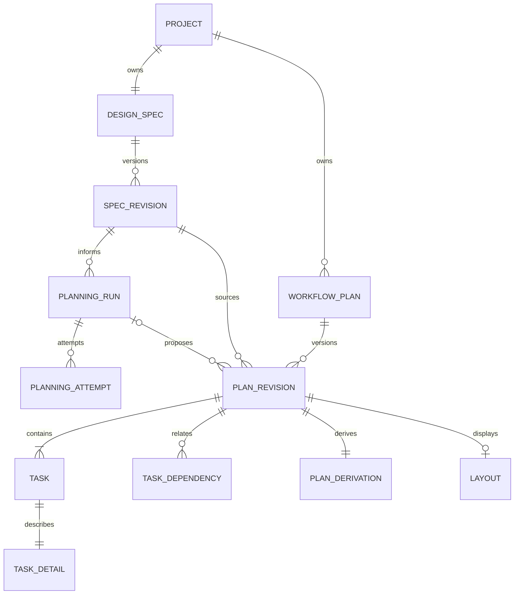

# 数据库设计
SQLite + SQLAlchemy + Alembic，foreign_keys=ON，WAL，busy_timeout=5000ms。短事务，模型调用在事务外。时间 UTC；UUID 存 TEXT；JSON 需应用 Schema 验证和 json_valid 检查。

## 当前表与约束
| 表 | 关键列与约束 / 索引 |
|---|---|
| projects | id PK, name, archived_at, created_at |
| specs | id PK, project_id FK UNIQUE, latest_revision |
| spec_revisions | id PK, spec_id FK, revision, content_json, hash, created_at；UNIQUE(spec_id,revision) |
| planning_runs | id PK, spec_revision_id FK, status CHECK, mode CHECK, fixture_id?, config_json, proposal_json?, report_json?, error_json?, usage_json?, attempt_count, created_at；索引(status,created_at) |
| planning_attempts | (planning_run_id,attempt_no) PK, request_hash, response_json/text, usage_json, error_json, timestamps；不保存 Key |
| plans | id PK, project_id FK, latest_revision |
| plan_revisions | id PK, plan_id FK, revision, spec_revision_id FK, planning_run_id FK nullable, parent_revision_id FK nullable, policy_json, source, origin_mode, confirmed_assumption_ids_json, hash, created_at；UNIQUE(plan_id,revision) |
| tasks | (revision_id,task_id) PK, name,description,category,stage,priority,assigned_role, rationale, effort_json?；按 revision_id/stage 索引 |
| task_dependencies | (revision_id,source_task_id,target_task_id) PK；两端复合 FK → tasks；CHECK source≠target |
| task_details | (revision_id,task_id) PK/FK, inputs_json,deliverables_json,acceptance_json,requirement_ids_json,assumptions_json；一对一结构化详情 |
| plan_derivations | revision_id PK/FK, stages_json,batches_json,order_json,report_json,rules_version；派生缓存 |
| layouts | plan_revision_id PK/FK, revision, positions_json, notes_json, viewport_json；notes_json 为 CanvasNote 数组（id/text/x/y/color?），不是 task_id→文本映射 |
| commands | (scope,idempotency_key) PK, request_hash,result_json,created_at；持久重试去重 |

任务和依赖单独关系表，以数据库约束保护引用；规格、规划配置和任务内部短数组使用 JSON，避免每条字符串都建表，也不把整个系统塞进一个 JSON。
完整候选 proposal_json 保留模型输出审计；正式任务从规范化表读取，候选不是第二个可编辑事实源。

## 保存事务
校验在事务外计算候选及 input_hash；事务内重查 spec 存在及配置合法、比较 expected_revision，插入快照、tasks/details、dependencies、derivations、layout 与 command，再 CAS 更新 head。
所有成功或全部回滚；UNIQUE 防并发同版本。409 返回 current_revision；数据库忙超过 5 秒返回 503 STORAGE_BUSY，不报告保存成功。
项目与规格归档不级联删除历史。P0 无硬删除接口。plan 与 spec 必须属于同 project，由服务校验。
任务依赖复合 FK 保证不能跨版本引用。环/需求 JSON 引用由纯验证器负责；库约束不能替代业务检查。

## ER

## 迁移与恢复
每次模型/索引变化单独 Alembic revision；测试空库升级和上一版本升级；发布前 SQLite backup API 备份，不能只复制活跃 WAL 主文件。
生产失败恢复备份，不承诺所有降级脚本可保留新数据。数据库、密钥和日志不提交 Git。
启动检测版本与完整性；旧 CLI 库独立保留，不能原地解释为新 Schema。
P2 新增 runs/task_runs/attempts/artifacts/events/approvals；规划表不迁移成执行表。

## 实现状态（E）
- 迁移脚本位于 [backend/migrations](../../backend/migrations)，首个 revision 建全部表与索引；`FLOWSTUDIO_USE_ALEMBIC=0` 时退化为 create_all，仅供测试/快速试跑。
- 连接参数在 [db.py](../../backend/app/persistence/db.py)：foreign_keys=ON、WAL、busy_timeout=5000ms；写冲突映射 503 STORAGE_BUSY。
- 正式任务从 tasks/task_dependencies/task_details 读取，`proposal_json` 只作模型输出审计；`report_json` 保存该次规划的报告，使 PlanningRun 可复核。
- Layout 的 notes 语义随契约调整见上表；导出时 `spec_snapshot` 取自 spec_revisions.content。
