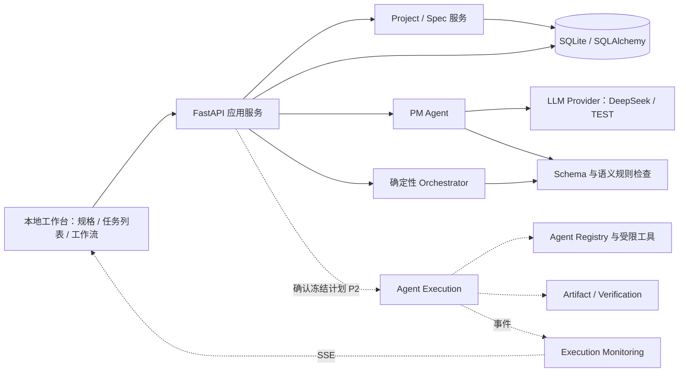
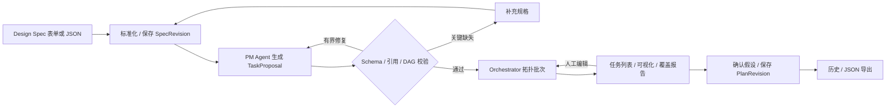

# 系统架构
[技术版系统架构](../../tech/docs/system-architecture.md)汇总统一契约及模块边界。现有前端的本地工作流和分支证据见[实现审计](../PROJECT_AUDIT.md)。下图表达目标架构，虚线表示 P2 扩展。

## 目标逻辑架构

## 作业 2 目标数据流

## 运行时与部署
Windows 浏览器 → Vite 开发代理或 FastAPI 静态前端 → 单 FastAPI 进程 → 本地 SQLite；仅 Provider 对外 HTTPS。
后端只监听 127.0.0.1，限制 Host/Origin；生产静态前端同源，开发只允许指定 Vite 来源。不开放 LAN 登录/权限系统。
PlanningRun 写 QUEUED 后由同进程有界队列单消费者领取；队列上限 10，超限 429。数据库持久化先于内存唤醒；进程中断按运行状态专篇显式失败，避免假装可靠任务队列。
REST 创建命令和读快照；规划页每 1 秒轮询，后台标签降为 5 秒，终态停止。当前不需要 WebSocket/SSE。
数据库短事务；模型网络调用不持有写锁。一个实例锁防止重复后端操作同一库。业务层依赖仓储接口，纯编排不读库。

## 状态与信任
客户端图仅投影，服务端为业务事实源。规格/模型输出/导入文件均不可信：尺寸限制、严格 Schema、依赖验证，不执行其代码。
前端无模型 Key；日志脱敏；模型只能得到本次规格/配置。规划和已有历史分离，断网不影响浏览保存。
领域/模块边界见 [模块](MODULE_DESIGN.md)；技术取舍见 [选型](TECH_STACK.md)。
