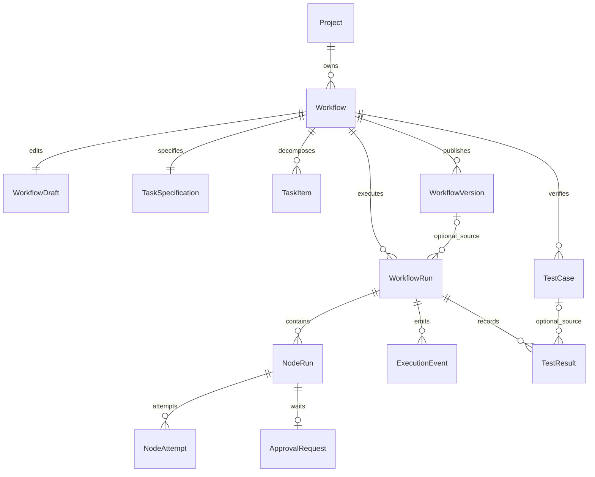

# 领域模型与数据库设计

SQLite 是 P0 唯一数据源；字段命名数据库为 snake_case，API 为 camelCase。所有表、约束与迁移为待实现设计。实体状态枚举以[执行设计](WORKFLOW_ENGINE_DESIGN.md)为准。

## 1. 领域生命周期

Project 聚合多个 Workflow。Workflow 是长期身份，WorkflowDraft 是唯一可变编辑版本；WorkflowVersion 是发布时的不可变规格/任务/图快照。WorkflowRun 固定一次输入和一次快照，即使没有发布也可以作为草稿测试运行。NodeRun 是逻辑节点的一次运行，NodeAttempt 是其具体重试尝试。ExecutionEvent 是已提交状态的事件记录，不是重新计算所有状态的 event-sourcing 系统。

TaskSpecification 与 TaskItem 属于 Workflow 的编辑上下文，写入时统一递增 WorkflowDraft.revision。WorkflowNode/WorkflowEdge 不是独立关系表，而是定义 JSON 内的值对象；避免数据库节点表、React Flow 对象、JSON 定义三份真相。历史内的 taskId/nodeId 必须依据运行快照解析，不能回查已变化的草稿。



## 2. 通用字段规则

主键 `id TEXT` 为 UUID，只有 app_setting 使用 key 主键。时间为 UTC epoch 毫秒 `INTEGER`，前端按用户时区显示。布尔用 `INTEGER CHECK IN(0,1)`；状态用 `TEXT CHECK IN(...)`；JSON 文本必须 `CHECK(json_valid(column))`，空值采用 SQL NULL 与 JSON null 严格区分。下表 `?` 表示可空；其他均 NOT NULL，除说明外不设隐含默认。created_at 默认由统一时钟提供，updated_at 显式更新。所有外键启用 `PRAGMA foreign_keys=ON`。

| 表 | 字段、类型与含义 | 关系/约束及索引 |
|---|---|---|
| project | id；name TEXT(1–80由应用校验)；description TEXT；created_at/updated_at INTEGER；deleted_at INTEGER? | 名称不强制全局唯一，列表索引(deleted_at,updated_at,id) |
| workflow | id；project_id TEXT；name/description TEXT；created_at/updated_at INTEGER；deleted_at INTEGER? | FK project RESTRICT；索引(project_id,deleted_at,updated_at,id) |
| workflow_draft | workflow_id TEXT PK；revision INTEGER>=1；definition_json TEXT；layout_json TEXT；updated_at INTEGER | FK workflow RESTRICT；每 workflow 恰一条 |
| task_specification | id；workflow_id TEXT；goal/description/rules/exception_policy TEXT；input_schema_json/output_schema_json/acceptance_json TEXT；updated_at INTEGER | FK workflow RESTRICT；UNIQUE(workflow_id)；acceptance 为带稳定 ID 的标准列表 |
| task_item | id；workflow_id TEXT；title/responsibility/completion_criteria TEXT；input_schema_json/output_schema_json/dependencies_json TEXT；required INTEGER；sort_order INTEGER | FK workflow RESTRICT；索引(workflow_id,sort_order,id)；依赖 JSON 中 taskId 需同工作流且无环，由服务事务校验 |
| workflow_version | id；workflow_id TEXT；version_number INTEGER>=1；source_revision INTEGER；snapshot_json TEXT；content_hash TEXT；created_at INTEGER；label TEXT | FK workflow RESTRICT；UNIQUE(workflow_id,version_number)、UNIQUE(workflow_id,source_revision)；发布不可 UPDATE，仅保留策略允许删除 |
| workflow_run | id；workflow_id TEXT；version_id TEXT?；source_kind TEXT；source_revision INTEGER?；snapshot_json TEXT；snapshot_hash TEXT；input_json TEXT；output_json TEXT?；status TEXT；generation INTEGER；terminal_intent TEXT?；error_json TEXT?；edge_states_json TEXT；next_event_seq INTEGER；event_floor_seq INTEGER；cancel_requested_at INTEGER?；created_at/updated_at INTEGER；started_at/finished_at INTEGER?；idempotency_key TEXT；request_hash TEXT | FK workflow/version RESTRICT；source_kind PUBLISHED/DRAFT_TEST/NODE_TEST/REPLAY；UNIQUE(idempotency_key)；索引(status,created_at,id)、(workflow_id,created_at,id) |
| node_run | id；run_id TEXT；node_id TEXT；node_type TEXT；node_type_version INTEGER；status TEXT；current_attempt INTEGER>=0；attempt_token TEXT?；revision INTEGER；input_json/output_json/error_json TEXT?；ready_at/started_at/finished_at/deadline_at/next_attempt_at INTEGER?；skip_reason TEXT? | FK run ON DELETE CASCADE；UNIQUE(run_id,node_id)；索引(run_id,status)、(status,next_attempt_at) |
| node_attempt | id；node_run_id TEXT；attempt_number INTEGER>=1；token TEXT；status TEXT；input_json TEXT；output_json/error_json TEXT?；started_at INTEGER；finished_at/deadline_at INTEGER? | FK node_run CASCADE；UNIQUE(node_run_id,attempt_number)、UNIQUE(token)；状态 RUNNING/SUCCEEDED/FAILED/CANCELLED/INTERRUPTED |
| execution_event | run_id TEXT；seq INTEGER；type TEXT；node_id TEXT?；node_run_id TEXT?；attempt INTEGER?；generation INTEGER；payload_json TEXT；created_at INTEGER | PK(run_id,seq)；FK run CASCADE；node_run_id FK SET NULL；索引(created_at)供终态清理 |
| approval_request | id；node_run_id TEXT；status TEXT；prompt TEXT；deadline_at INTEGER；decision TEXT?；comment TEXT?；decided_at INTEGER?；decision_request_key TEXT?；revision INTEGER | FK node_run CASCADE；UNIQUE(node_run_id)、UNIQUE(decision_request_key)；索引(status,deadline_at)；PENDING/APPROVED/REJECTED/EXPIRED/CANCELLED/INTERRUPTED |
| test_case | id；workflow_id TEXT；name TEXT；input_json TEXT；assertions_json TEXT；revision INTEGER；created_at/updated_at INTEGER；deleted_at INTEGER? | FK workflow RESTRICT；索引(workflow_id,deleted_at,id) |
| test_result | id；run_id TEXT；test_case_id TEXT?；test_case_revision INTEGER?；assertion_id TEXT；expected_json TEXT；actual_json TEXT?；status TEXT；reason TEXT? | FK run CASCADE、test_case SET NULL；UNIQUE(run_id,assertion_id)；PASS/FAIL/NOT_EVALUATED |
| app_setting | key TEXT PK；value_json TEXT；updated_at INTEGER | 仅已注册设置键；不存密钥；运行中更改并发在下一次调度 tick 生效 |

`workflow_run.snapshot_json` 包含 definition、layout、specification、tasks、nodeCatalogVersions、engineSemanticsVersion、以及本次 testCaseSnapshot（可空）。发布版本不含本次测试输入；运行快照独立持有测试断言，修改测试用例不会改变历史。`source_kind=PUBLISHED` 必须有 version_id，`DRAFT_TEST` 必须有 source_revision；REPLAY 保留 `replayOfRunId` 在 snapshot 元数据，使用同一快照且新 ID、新幂等键。NODE_TEST 是后端构造 Start→目标→End 的独立测试图，保留原节点 ID 与来源信息，仅允许纯计算节点。

## 3. 关键 SQL 约束与事务

以下为迁移设计片段，不是本轮数据库实现：

```sql
CREATE UNIQUE INDEX uq_node_run ON node_run(run_id, node_id);
CREATE UNIQUE INDEX uq_attempt ON node_attempt(node_run_id, attempt_number);
CREATE INDEX ix_ready_retry ON node_run(status, next_attempt_at);
CREATE UNIQUE INDEX uq_publish_revision
  ON workflow_version(workflow_id, source_revision);
```

| 操作 | 同一个短事务中的内容 | 事务外内容 |
|---|---|---|
| 保存草稿/规格/任务 | `WHERE revision=expected` CAS；更新相应数据；revision+1；失败回滚 | JSON/schema校验、变更diff、用户冲突选择 |
| 发布 | CAS检查 revision；读取完整规格/任务/图；写不可变 version；分配单调 version_number | 前置完整校验；事务内再确认 revision 未变，防校验后被改 |
| 创建运行 | 幂等键检查；取快照；写 QUEUED run、全部 PENDING node、UNRESOLVED 边、首事件 | 输入校验；调用调度器仅在 commit 之后 |
| claim 节点 | 检查 run状态/generation；READY→RUNNING 条件更新；新 attempt/token、deadline、事件 | 真正调用 execute；不占数据库事务 |
| 节点完成 | token/generation 双核对；输出校验已通过；attempt/node终态、边状态、后继 READY/SKIPPED、事件 | SSE 唤醒；数据库查询保证事件不丢 |
| 重试 | attempt FAILED；node RETRY_WAIT、next_attempt_at、失败事件 | 定时器只是唤醒提示，不是事实源 |
| 审批 | PENDING+revision CAS；写 decision、节点成功/失败、边状态、运行状态和事件 | 唤醒调度；HTTP 重试先查 request key |
| 取消/失败 | 先写 terminal_intent/generation、停止调度，再逐批收敛节点，最终终态 | AbortSignal，等待任务最长5s |
| 重启恢复 | 非终态 run、node、attempt、approval 标记中断；每 run 追加 recovery 事件 | UI提示人工重跑；不会自动调用 executor |

调度器维护单实例串行的命令入口，事务仍以 CAS/UNIQUE 防重复回调和并发 HTTP。不能用“单用户”省略多标签页竞争处理。version 的 immutable 属性由 repository 没有更新接口+测试保证；若将来增加手工管理工具，应考虑触发器或只读策略。

## 4. SQLite 配置与写入限额

采用 `journal_mode=WAL`、`synchronous=FULL`、`foreign_keys=ON`。单连接所有者负责写入；默认 busy timeout 100ms，BUSY 时在事务外异步退避 50/100/200ms 后最多3次重试，避免同步等待5秒冻结 API。重试使用相同幂等键/CAS；不能盲目重试已经有外部副作用的执行器。短事务目标 <20ms、分页默认50最大100；大范围清理分批100条，仅清理终态。

WAL 不创造多个写者；日志不逐字符写库。单日志消息最多4KiB，debug信息批量每100ms/50条提交；关键状态事件不能丢弃或采样。每运行事件预算10,000，其中预留2,000给状态/终止事件；诊断日志达到8,000条后记录一次截断并停止追加诊断日志。200节点×3尝试的最坏状态事件预算在实现时以测试断言不超过预留；超预算停止新调度并以 EVENT_LIMIT_EXCEEDED 失败，保证仍可保存终态。输入/输出各1MiB上限，拒绝而非静默截断语义数据。

## 5. 保存、清理和迁移

- 数据目录 `.flowstudio/` 包含 `flowstudio.db`、WAL/SHM、`logs/`、`backups/`、实例锁；Git 忽略整个目录。P0 全部结构化结果在 SQLite，暂不引入文件blob与跨文件事务。
- 诊断日志按10MiB轮转，最多5份；运行默认保留30天或最近1,000次（先满足容量限制，删除最老终态），未终态/用户固定记录不清除。达到固定记录容量时提示清理，不无限增长。设置页预览即将删除条数、确认后清理。
- 事件与输出随终态运行一起清理，不单独删除活动运行事件。已清理历史返回410；列表元数据不承诺永存。P0可在清理前导出运行JSON。
- 项目/工作流软删除需要无活动运行；软删除隐藏列表但历史按ID仍可查。版本有运行外键时不可删除；彻底删除项目属于带预览的后续维护功能，P0只软删除。
- 备份使用 SQLite backup API 生成一致文件，附 schema/app版本/hash清单；恢复在后端停止时进行，先保留当前备份并执行 integrity_check。运行时不能只复制 db 忽略 WAL。[官方备份说明](https://www.sqlite.org/backup.html)
- migrations 按有序编号+描述入 Git，已合并 migration 不改写；版本表存校验和，应用启动发现数据库高于代码版本则拒绝写入。数据库迁移与 definition.schemaVersion 迁移分开。迁移前备份、事务迁移；需要重建表时显式复制、验证计数/外键。不承诺通用 down migration，回滚以备份恢复。

## 6. 数据库支持核心场景的校核

历史重现依赖 run.snapshot，审批依赖 approval_request，重试依赖 node_attempt，断线补发依赖 execution_event，保存冲突依赖 draft.revision，测试对比依赖 test_result。所有模型均可落在 SQLite；P0不需要JSON全文索引，项目搜索采用受限 LIKE 与分页。数据库容量与清理策略的体验需实施验收，不把小规模可用性扩展成无限日志存储承诺。
