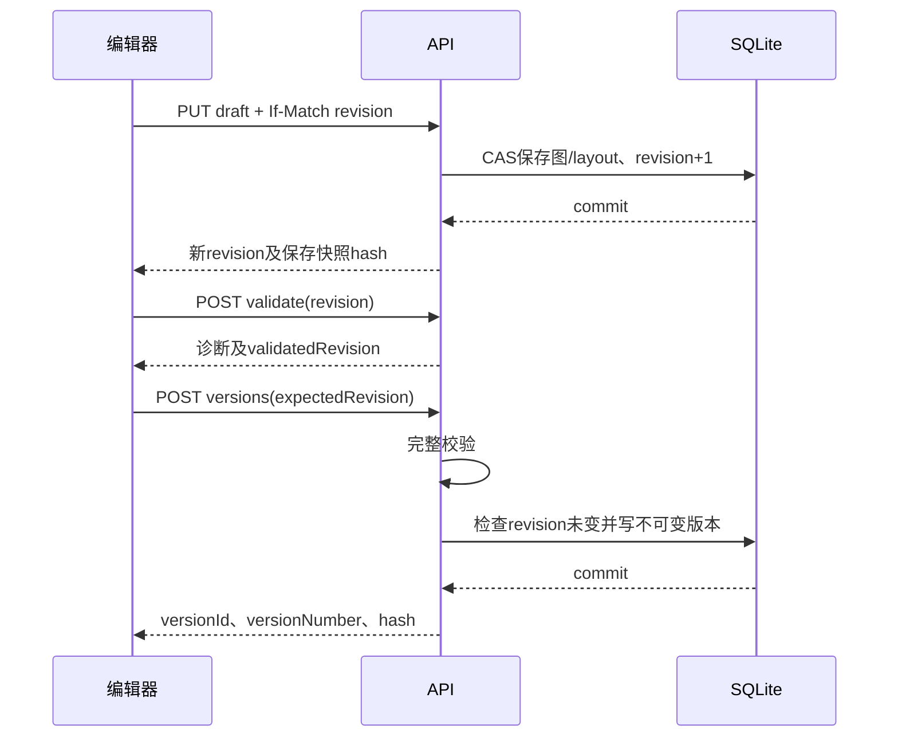
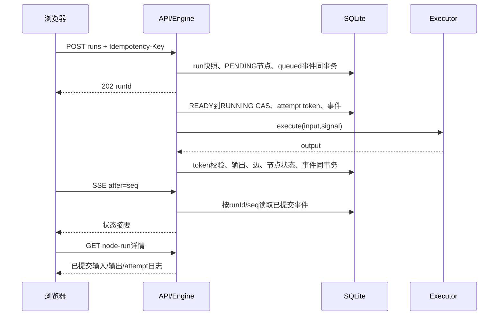

# 数据流与一致性

## 1. 保存与发布

画布编辑只有 Zustand 文档为可变真相，Query cache 是服务器已确认快照。自动保存防抖800ms，一次只有一个保存请求；发送时捕获 localEditSequence 与 revision。回包仅确认所发快照，若此间又编辑则仍dirty并发下一次；不得回写旧图覆盖新操作。保存失败保留本地修改；409显示比较/另存副本/显式重新载入，不自动last-write-wins。

规格/任务编辑也是同一draft revision命名空间；不同页面/标签写入需要同样CAS。先保存再发布/测试；校验结果与revision绑定，改动后变“需重新校验”。未通过静态校验的草稿允许保存，只有结构JSON不合法或超限时拒绝。

## 2. 运行与持久事件

事件流以数据库为真相，提交后通知只是降低延迟。每条stream最多维护一个“有新数据”唤醒信号，唤醒后循环查询`seq>cursor`批次。先注册唤醒再从DB排空，或使用无间隙的订阅+查询机制；另每1s轮询兜底，避免commit后进程未发内存通知导致永久丢事件。

## 3. SSE 补发协议

首屏 `GET /runs/:id` 在一个读事务内取run、node摘要、edgeStates、`lastEventSeq=S`。客户端先展示这个snapshot，再订阅`/events?after=S`。所有此后提交的事件都会从数据库补发。浏览器自动重连以Last-Event-ID优先，首次打开用after；游标只在同run内解释。

SSE `id` 是十进制seq、`event` 是业务type、`data` 是JSON，响应`text/event-stream; charset=utf-8`、`Cache-Control:no-cache`，每15s注释心跳。客户端只应用seq大于当前游标的事件；若出现跳号，暂停增量应用并重新取snapshot。客户端不以本地时间排序事件。

保留窗口不足（after<eventFloorSeq-1）、未知未来游标或schema不兼容时，服务端先发送不推进业务游标的`stream.reset`控制事件（包含reason和snapshotUrl），关闭连接；客户端关闭旧EventSource、读取snapshot、重新订阅。运行已删除使用HTTP410；API预检可以显示“历史已清理”，而非不断重连。终态且已发送最后seq后发`stream.end`并关闭，客户端主动close。

每个标签页只为当前运行建一个流；后台历史列表按需HTTP查询，不为每个卡片建流。慢客户端缓冲上限256KiB或1,000摘要事件，超出断开后依靠补发，不能无限占用内存。事件最终到达目标p95<500ms是验收目标，1s轮询是丢失唤醒时的降级路径。

## 4. 状态所有权与故障显示

| 内容 | 所有者 | 不允许的行为 |
|---|---|---|
| 可编辑图/布局/命令历史 | 前端editor store | 用运行事件写入草稿配置 |
| 未提交字段文本/即时错误 | 表单本地状态 | 每个按键复制整图到Query cache |
| 列表/已保存版本/运行详情 | Query cache服务端快照 | 视作本地未保存草稿 |
| 节点实际状态/边激活/输出 | 后端事务 | 根据动画或断网自行判成功/失败 |
| 当前运行增量投影 | 前端run store（按runId隔离） | 覆盖其他run历史或当前编辑中的图 |
| 保存/发布/取消/审批反馈 | API确认+事件 | 仅按钮点击就显示已持久成功 |

运行断线时保留最后确认状态，显示“连接断开，状态可能过期”；不要把节点改成FAILED。重新连接先补发再显示实时。服务中断重启产生INTERRUPTED记录，与普通HTTP断连明确区分。

## 5. 执行验证闭环

规格验收标准通过稳定ID映射到Assert或TestCase断言。测试冻结用例revision与输入，实际输出由executor持久化；比较支持JSON深相等、JSON Pointer值比较、数值容差、schema匹配。每断言保存expected/actual/status/reason，失败输出差异路径；未走到的断言为NOT_EVALUATED，不计通过。测试run在运行图成功后、终态提交之前执行测试断言；任何失败使run FAILED(VERIFICATION_FAILED)。

业务Run中的Assert失败直接fail-fast。人工文本标准展示“待人工验收”，不能由图成功自动盖章。P0测试样本与内部转换都可离线，P1外部HTTP测试必须标明网络依赖和不可复现风险。
