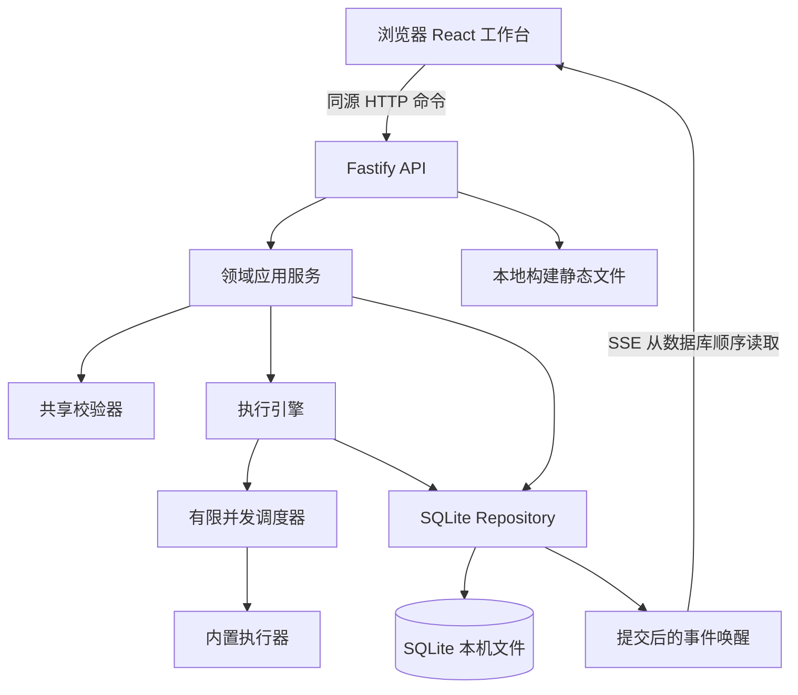

# 系统架构

本设计遵循[统一基线](../BASELINE.md)。这是待实现方案，不表示系统已存在。决策依据来自[竞品研究](../research/COMPETITOR_ANALYSIS.md)和[本地技术证据](../research/evidence/LOCAL_RUNTIME.md)。

## 1. 两种候选方案

| 维度 | A：API 与执行同一 Node 进程（选择） | B：API 与独立本地 Worker 进程 |
|---|---|---|
| 开发难度 | 函数调用、单生命周期、单数据库写者 | IPC 协议、进程启动/退出、任务认领、超时租约 |
| 本地启动 | 生产一次 npm start；开发另起 Vite | 可包装一次命令，但内部仍需监督两个后端进程 |
| 调度可靠性 | 内存唤醒+SQLite 状态，崩溃不续跑 | 可隔离 API 崩溃，但若需自动续跑仍必须处理重复副作用 |
| 一致性 | 状态、输出、事件短事务原子提交 | 若 Worker 直写 DB，写入竞争；若经 API 写，IPC 故障需确认协议 |
| 性能 | 异步 I/O 并发；CPU/同步 SQL 会阻塞事件循环 | CPU 可隔离，但多进程不自动提高 SQLite 写吞吐 |
| 崩溃影响 | API 和运行同时停止；重启标记中断 | Worker 崩溃时 API 可读历史；API 崩溃仍影响提交 |
| 维护 | 小团队可直接定位错误 | 增加日志关联、进程健康与进程树清理 |
| 扩展 | 通过 ExecutorAdapter 增加线程池/子进程 | 易扩本机 Worker 数量，但非首版需求 |

结论：A 满足有限并发、内置受控任务与本地单用户。以明确中断语义换取可理解的可靠性，不伪装自动恢复。B 的隔离收益不足以抵消首版协调成本。若测得内置转换持续阻塞主线程 >20ms 或后端 p95 超标，先优化数据限额和算法，再为 CPU 节点加固定线程池；只有需要进程级崩溃隔离时才评估 B。

## 2. 部署与逻辑结构

API、引擎、调度器、Repository 和事件分发均是一个后端进程的模块，不是独立服务。生产默认监听 `127.0.0.1:3000`；开发 Vite 监听 `127.0.0.1:5173` 并代理 `/api`，保持浏览器同源。自托管静态资源不使用 CDN、在线字体或第三方遥测。

拟议仓库：`apps/web`、`apps/server`、`packages/contracts`、`packages/workflow-core`、`packages/node-catalog`、`packages/test-fixtures`、`docs`。不要为每个领域单独创建 npm 包。包拆分只用于前后端共享与引擎独立测试。

## 3. 运行生命周期与所有权

1. 进程先监听端口，占用失败立即退出；此时健康状态为 STARTING，所有业务请求返回 503。随后对解析后的数据目录申请单实例锁（独占创建锁文件，记录随机实例 token/PID/进程开始时间）。不同端口也不能同时使用同一数据目录。
2. 发现已有锁先检查进程存活；无法可靠证明死亡时拒绝启动并给出诊断，不自动抢锁。明确死进程可清理陈旧锁；锁文件操作不能作为跨机器分布式锁。
3. 检查 schema 版本和驱动版本；迁移命令仅在无运行实例时执行。打开 SQLite，设置外键/WAL/同步级别，执行中断恢复事务。
4. 未终态记录全部中断后才置 READY、接受运行。调度器通过提交后唤醒和 250ms 本地扫描发现 READY/到期重试，不依赖内存队列持久性。
5. 正常退出先拒绝新命令，停止新调度，对活动任务发中止信号，最多等待 5s；未完成运行统一 INTERRUPTED，写入记录后关闭 DB 并释放锁。重启扫描覆盖强制退出窗口。

P0 不提供常驻 Windows 服务，不依赖系统任务计划程序。关闭后端即停止执行；关闭浏览器不影响执行。Windows 睡眠后定时器可能延后，唤醒按持久 `deadlineAt` 检查超时；不能保证睡眠期间准时触发。

## 4. 最小必要安全与资源边界

本地单用户不等于所有网页都可以控制本地 API。仅允许固定 loopback Host；变更请求校验精确 Origin 和本地会话 CSRF token；启动页面建立 SameSite=Strict、HttpOnly 本机会话 cookie，SSE 同源携带 cookie。没有注册、密码或权限矩阵。拒绝任意 CORS 通配、远程绑定与跨站命令。

请求限额、节点数、JSON 大小及并发数见基线。配置和值只能是 JSON，禁用 eval、任意模块加载、用户 Shell、文件路径执行。模板仅字段替换，条件仅结构化比较 AST；文本作为文本显示。未知节点版本拒绝发布和运行，不能静默降级。

P0 输入不支持凭据；UI 提醒不要录入密钥，日志仍按 password/token/authorization 等字段脱敏。后续 HTTP 节点需要主机策略、响应限额与凭据存储单独评审。没有将应用内校验宣称为不可信代码隔离。

## 5. 可用性与恢复承诺

SQLite 本身负责其事务恢复，应用负责业务中断标记；两者不是同一件事。数据库中已提交的运行结果可查询，未提交输出可能丢失。自动重试仅针对当前存活进程内的已知失败，绝不将服务重启转换为无条件重放。

磁盘满或 DB 写失败时，立即禁止新调度、中止活动执行并返回 `PERSISTENCE_UNAVAILABLE`；内存成功结果不展示为持久成功。如果连失败记录都无法落盘，健康接口标红、写 stderr/尽力文件日志，待数据库恢复并重启后由恢复扫描标记 INTERRUPTED。UI 明示“状态未确认”，不捏造 FAILED 已保存。

测试和可观测性边界见[测试策略](../development/TEST_STRATEGY.md)。版本兼容和原生 SQLite 驱动安装必须在 Phase 1 实证；当前设计评审不代替 Windows 真机验收。
