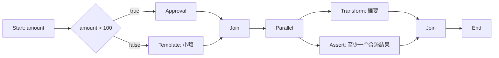
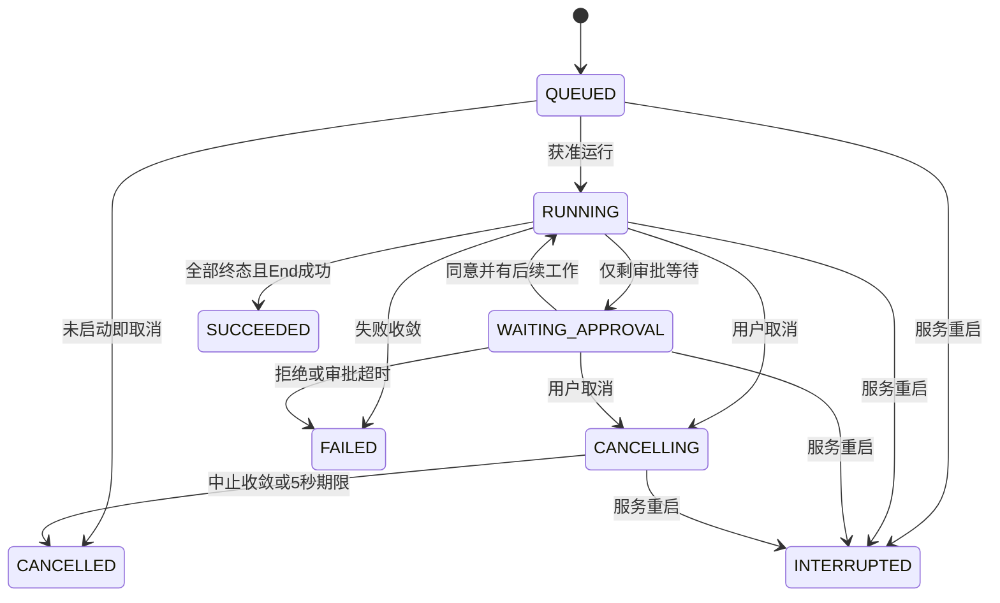
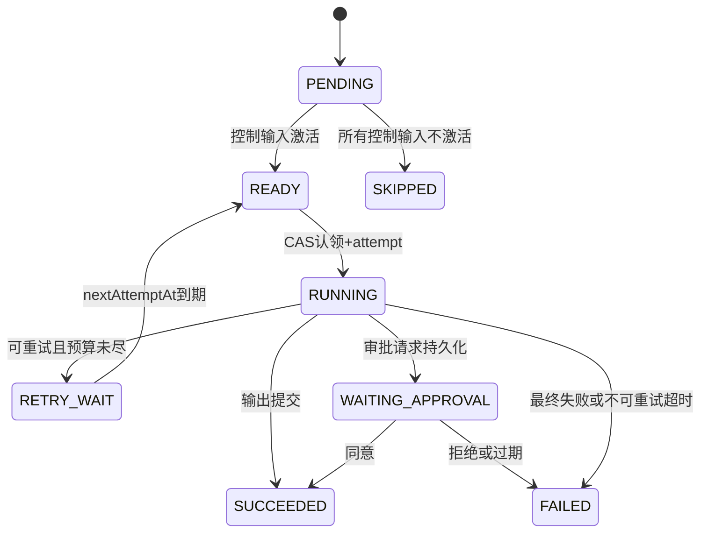

# 本地工作流执行引擎详细设计

本文件是执行语义的权威细则。P0 是有限节点的 DAG、单进程调度、真实服务端执行。没有前端定时器模拟成功，也没有未实现的故障自动恢复承诺。

## 1. 定义、计划和输入

`WorkflowDefinition` 与 layout 分离，结构见[模块契约](MODULE_DESIGN.md)。执行前：解析 schemaVersion → 注册表解析 type@version → 结构和类型校验 → Kahn 拓扑排序 → 计算 incoming/outgoing 索引及支配关系 → 生成不可变 ExecutionPlan。计划包含拓扑序、节点规格、控制邻接、引用依赖、重试/超时预算；不含坐标。发布/测试采用同一校验器，服务端结果权威。

图约束：恰一个 Start/End；Start无入边、End无出边；每节点从 Start 可达且可达 End；无自环/重复边/循环；普通节点恰一条入边，多入边仅 Join；Condition true/false 各一条；Parallel 2–8 出边；Join 2–8 入边。控制分叉仅 Condition/Parallel，其他节点单出边。视觉分组不参与任何约束。

校验诊断：`{code,severity,nodeId?,edgeId?,fieldPath?,message,suggestion}`。例如 `REF_NOT_DOMINATING / node=end / bindings.result`：“条件分支上的节点不保证运行，请使用 Join.activeInputs 或声明 fallback”。必填、类型、节点/端口、引用、条件算子、任务映射、规格输入输出契约均需检查；循环诊断返回实际环路径，不只报“非法图”。

类型系统采用有限 JSON Schema 子集，比较 number/string/boolean/object/array/null；不做字符串到数字的隐式转换。必需引用的源必须支配目标（从 Start 到目标的每条路径都经过源），可选引用仍必须是控制上游且有类型匹配 fallback。JSON Pointer 不能读 `__proto__`、`constructor`、`prototype`；缺失与 null 分开。引用不会暗中新增执行依赖。

## 2. 三态控制边与汇聚

每个 run 的边初始 UNRESOLVED；源成功后被选出口设 ACTIVE，未选设 INACTIVE。SKIPPED 节点将所有出边设 INACTIVE。边一旦 resolved 不反转。ACTIVE **表示源节点已成功且选择此路径**，不是“节点开始执行”。数据输出只在成功提交后可引用。

普通节点的唯一入边 ACTIVE → READY，INACTIVE → SKIPPED。Join 的处理如下：

| 入边组合 | Join 行为 |
|---|---|
| 至少一个 UNRESOLVED | 等待，不能执行 |
| 全部 resolved 且至少一个 ACTIVE | READY；收集 ACTIVE 的源输出 |
| 全部 INACTIVE | SKIPPED；传播 INACTIVE |
| 任一上游最终失败 | 全局停止调度并 FAILED；失败不能冒充跳过 |

统一的“等待全部已判定、执行被激活部分”使并行分支等待所有实际工作，互斥分支无需等待不存在的执行。P0 不提供 race/first-success、任意 n-of-m、并行部分失败继续或补偿事务。Join 输出按 edgeId 稳定排序的 activeInputs 数组，避免按完成顺序造成不确定结果。

具体案例（预算输入）:



输入50：C→A INACTIVE，A SKIPPED、A→J INACTIVE；T成功后T→J ACTIVE，J运行，不等待审批。P激活X/Y，两者都提交成功后K才能运行。输入200：T跳过，A等待审批；同意后J运行；拒绝触发FAILED，不让J收到伪造空结果。若整个包含J的子分支未激活，则J全部入边 INACTIVE，继续传播跳过。测试需覆盖嵌套互斥、嵌套并行、跳过路径多层传播和完成顺序颠倒。

## 3. 状态机



最终失败发生后先持久 `terminalIntent=FAILED` 与 generation+1，Run 暂留 RUNNING（若从 WAITING_APPROVAL 进入则先 RUNNING），UI 通过 intent 显示“失败，正在停止其他节点”；此阶段禁止任何新调度。最多5s后 FAILED。避免增加一个含义模糊的 PAUSED/STOPPED 状态。第一个终止意图事务获胜；取消先提交则后续失败不能将其改成 FAILED，失败先提交则取消返回已有失败处理结果。



任一非终态节点可在取消/其他节点fail-fast时转 CANCELLED，服务重启转 INTERRUPTED；已 SUCCEEDED/FAILED/SKIPPED/CANCELLED/INTERRUPTED 的节点不可覆写。NodeAttempt 在重试时保留 FAILED，逻辑 NodeRun 则 RETRY_WAIT。审批创建请求时 attempt 可保持 RUNNING 直到决策，但不占执行槽；active槽只计实际执行 executor 的调用，不能简单统计所有RUNNING attempt行。

## 4. 调度循环与原子性

进程内单调度循环串行处理状态命令，实际异步执行可并行。全局4槽、每run2槽、已接纳非终态run最多2（含WAITING_APPROVAL），等待队列最多20；按run创建顺序轮转、公平取READY拓扑序。审批不占节点槽但占已接纳run容量，UI显示此限制；不会因为审批存在而无限接纳新运行。

```text
onTickOrCommand():
  if persistenceUnhealthy: return
  process expired approval and retry deadlines
  admit oldest QUEUED runs while admitted < 2
  for each admitted run in round-robin:
    if terminalIntent or terminal: continue
    repeat until no change:              # 无 await 的有界图扫描
      for node in topological order with state PENDING:
        if inputs unresolved: continue
        if all inactive: persist SKIPPED and inactive outgoing
        else: persist READY
    while slot available and READY exists:
      transaction:
        verify run generation and no terminalIntent
        CAS node READY -> RUNNING; allocate attempt token
        insert attempt and state event; commit
      acquire in-memory slot (同一个串行调度入口，不跨 await)
      launch execute outside transaction with AbortSignal and deadline
    evaluate run waiting/success/deadlock

onExecutorResult(token, generation, result):
  try:
    schemaValidate(result) outside transaction
    transaction:
      reject if token/generation/state no longer current
      write node+attempt output, resolved outgoing edges and events
      propagate resolved skips/readiness; finalize run if appropriate
  catch executionError:
    transaction: schedule retry OR record failure and terminalIntent
  finally:
    release slot once (even stale result); wake scheduler
```

事务提交与启动 executor 之间崩溃：数据库里节点 RUNNING，重启标INTERRUPTED，不假定其是否已执行。executor成功与结果提交之间崩溃：同样中断，不能保证外部效果 exactly-once。重复完成回调由 attemptToken+generation+state CAS 拒绝。实现需区分 schema/执行异常与持久层异常，不能在DB坏掉时递归调用“记录失败”无限重试。

运行结束：SUCCEEDED 要求 End 成功、所有逻辑节点终态且无失败/取消/中断，测试断言全 PASS。图中可跳过节点允许 SKIPPED。若无READY/RUNNING/RETRY_WAIT/WAITING_APPROVAL但仍有 PENDING，写 ENGINE_DEADLOCK 和无法解析边清单并失败；该情况通常是校验器或引擎缺陷，应保留诊断。

## 5. 重试、超时、审批、取消

- 默认1次尝试，可配置最多3次。只有effect=pure、supportsRetry且ExecutionError.retryable=true才自动重试；校验失败、断言失败、审批拒绝永不自动重试。间隔1s、2s（支持上限30s）；持久nextAttemptAt，到期后回READY。等待不占节点槽，其他运行可推进。
- 每次尝试有独立timeout，默认30s；UI展示本次和累计耗时。超时先废止token再abort，不能Promise.race后让旧结果写库。P0内置计算有大小/步数上限并定期检查signal；同步死循环无法被同线程timer抢占，因此不开放用户JS。CPU超限应拒绝/分块，后续线程池另评。
- 审批executor只生成请求，不持有HTTP连接。请求与WAITING_APPROVAL同事务；默认24h截止，审批POST带revision+decisionRequestKey。先比较DB时钟截止再决策。同意/拒绝/取消/过期并发只许一个胜出，失败者409读取现状。重启未决审批INTERRUPTED，不可继续点击旧审批。
- 用户取消先写CANCELLING、generation+1、cancelRequestedAt；READY/PENDING/RETRY_WAIT/审批等待转CANCELLED，运行中的调用abort；5s后即使外部调用没有返回也封存CANCELLED，后续结果只计诊断不改业务状态。5s不是外部任务已被物理撤销保证。
- P0没有“任意时刻暂停”按钮。审批等待可持续保存，但重启恢复仍采取整run中断策略。精确暂停、检查点续跑、外部副作用补偿、从中间节点重放为P2，须额外幂等/恢复设计。

## 6. 事件、结果与可复现性

```json
{
  "schemaVersion": 1, "runId": "run-uuid", "seq": 18,
  "type": "node.succeeded", "occurredAt": 1794614400000,
  "nodeId": "transform-1", "nodeRunId": "nr-uuid", "attempt": 1,
  "generation": 1,
  "payload": {"status":"SUCCEEDED","durationMs":12,"outputAvailable":true}
}
```

事件只发摘要、节点状态和输出可用性，不重复广播1MiB输出；详情通过API分页/按节点读取。持久事件类型包括 run.queued/started/waiting/cancelling/completed/interrupted、node.ready/started/retry_scheduled/waiting_approval/succeeded/failed/skipped/cancelled/interrupted、approval.decided、log.appended、validation.completed。客户端不以未识别事件推动状态，遇未知schema提示升级并取snapshot。

JSON规范化后计算hash；对象键排序，数组保序，拒绝NaN/Infinity。每次运行保留 engineSemanticsVersion 与节点typeVersion；重跑遇旧版本执行器缺失返回422，不能静默用新版。重新运行产生新ID且保留replayOfRunId，原记录永不变为RUNNING。

## 7. 必测不变量

1. 每个(run,node)至多一个有效attempt；同时运行数从不超限。
2. 每条边恰好一次从UNRESOLVED变为ACTIVE/INACTIVE；失败不会写ACTIVE。
3. 互斥合流和嵌套跳过必然收敛；并行Join不能提前输出。
4. 事务回滚后既无成功状态也无成功事件；发送失败不撤销成功事务。
5. 取消、超时、重启使旧token无效；旧响应不能复活节点。
6. 审批双击、取消竞争、过期竞争有唯一决定；未通过审批不能调度下游。
7. 纯任务同快照同输入输出一致；历史不会被当前编辑器或测试用例改写。

这些是后续自动测试要求；本轮只进行设计走查，不声称引擎测试已经通过。
