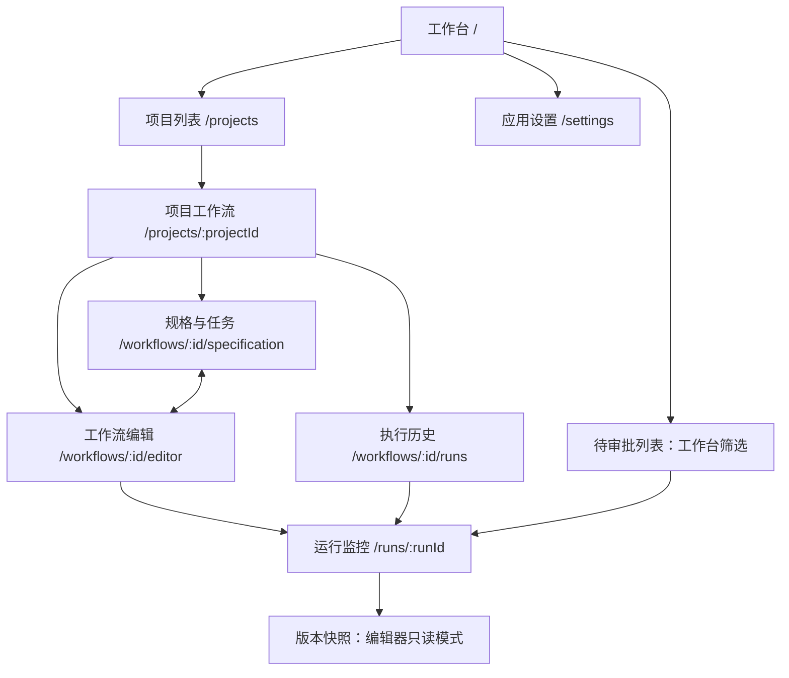

# 信息架构与页面关系

设计版本：2026-11-14；遵守 [统一基线](../BASELINE.md)。以下是产品设计，不代表页面已经实现。原参考截图未提供，界面基于用户文字描述及已核实的竞品机制设计。

## 1. 导航层级



主导航保留“工作台 / 项目 / 执行历史 / 设置”四项。编辑器进入专注模式，左侧保留 56px 图标导航，通过面包屑返回项目。执行历史全局入口可按项目/工作流筛选；项目内入口带预置筛选，避免做两套历史系统。

“工作空间”是本机数据目录的概念，不新增 Workspace 实体、组织/成员权限或工作空间切换页面。项目是业务容器，工作流是规格、任务、草稿、版本、运行的聚合入口。

## 2. 八类页面低保真布局

```text
① 工作台                 ② 项目管理              ③ 工作流管理
导航│最近项目/新建        导航│搜索│新建项目        导航│项目标题/编辑
    │待审批/失败待处理        │项目名称/说明/数量        │搜索│新建工作流
    │最近工作流表            │列表与操作菜单            │草稿/版本/最近运行
    │最近执行表              │空态与分页                │规格完整度/更新时间

④ 工作流编辑器（1920）
56 导航│240 节点面板│          画布           │360 属性
       ├────────────56 顶部：名称/保存/校验/发布/试运行────┤
       │分类与搜索  │ [视觉组A] → [视觉组B]    │基础/输入/重试
       │节点简述    │      边标签、节点摘要    │引用选择器
       │            │底部工具条 + 小地图     │校验问题
       └────────────可折叠 224px 问题/日志抽屉─────────────┘

⑤ 规格与任务              ⑥ 运行监控
导航│规格│任务│测试        导航│运行号/版本/状态│取消
    │目标/输入/输出            │只读运行画布     │节点详情
    │规则/验收/异常            │路径和耗时       │尝试/输入输出
    │任务依赖表/关联节点       │事件时间线/审批操作

⑦ 历史与日志详情          ⑧ 应用设置
导航│项目/流程/状态/时间   导航│本地运行状态
    │执行列表/游标分页        │默认并发（只读限制说明）
    │选中记录→详情抽屉        │日志保留/磁盘使用
    │快照/节点尝试/断言       │备份/恢复说明/诊断
```

这些布局并非组件规格的重复；精确尺寸和状态见 [UI/UX](UI_UX_SPECIFICATION.md) 与 [设计系统](DESIGN_SYSTEM.md)。可打开 [离线原型](prototype/index.html) 查看八页面设计示意；原型不连接后端，不执行任务。

## 3. 导航与上下文规则

| 场景 | 必须保留的上下文 | 返回行为 |
|---|---|---|
| 项目进入工作流 | projectId、列表搜索和分页 | 浏览器后退恢复原列表筛选 |
| 规格进入节点 | workflowId、taskId、nodeId | 编辑器聚焦节点，右面板展示关联任务 |
| 校验问题进入画布 | draft revision、issue nodeId/edgeId/fieldPath | 选中对象并定位表单字段；过期报告显示“草稿已变化” |
| 编辑页打开运行 | runId、不可变快照、原草稿dirty状态 | 新页面路由；回草稿不应用运行快照覆盖当前编辑 |
| 历史记录进入运行 | runId、筛选条件 | 监控页面按终态变为只读详情，无独立重复页面 |
| 待审批通知 | runId、approvalRequestId | 聚焦审批节点，显示本次输入与截止时间 |
| 断线/重连 | 当前 runId、lastSeq、用户选中节点 | 只刷新运行投影，不丢面板与滚动位置 |

路由中的 UUID 只作定位，不作权限或可信输入。找不到/已软删除对象显示可返回上一级的明确页面，不无穷加载。

## 4. 信息层级

1. 用户当前对象：项目名 → 流程名 → 草稿/版本/运行号；版本与运行号不能混用。
2. 当前可行动状态：保存失败、校验错误、待审批优先于普通统计。
3. 画布本身只保留标题、类型、一行配置摘要、执行状态/耗时；完整 JSON、日志放详情面板。
4. 列表采用表格和行操作，避免每条流程做大彩色卡片。工作台仅保留少量汇总数字与可处理事项。
5. 运行结果区分“执行成功”和“验收通过”；断言失败即运行失败，可展开预期/实际差异。

## 5. 页面可见性与范围

P0 页面均存在，功能随开发阶段逐步接通；未实现能力在开发版有清晰说明，正式 P0 不展示不可用占位按钮。P1 HTTP 节点、P2 任意脚本/LLM/子流程不放入 P0 节点面板。视觉分组不产生新的可执行流程或运行入口。
