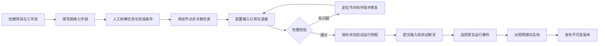
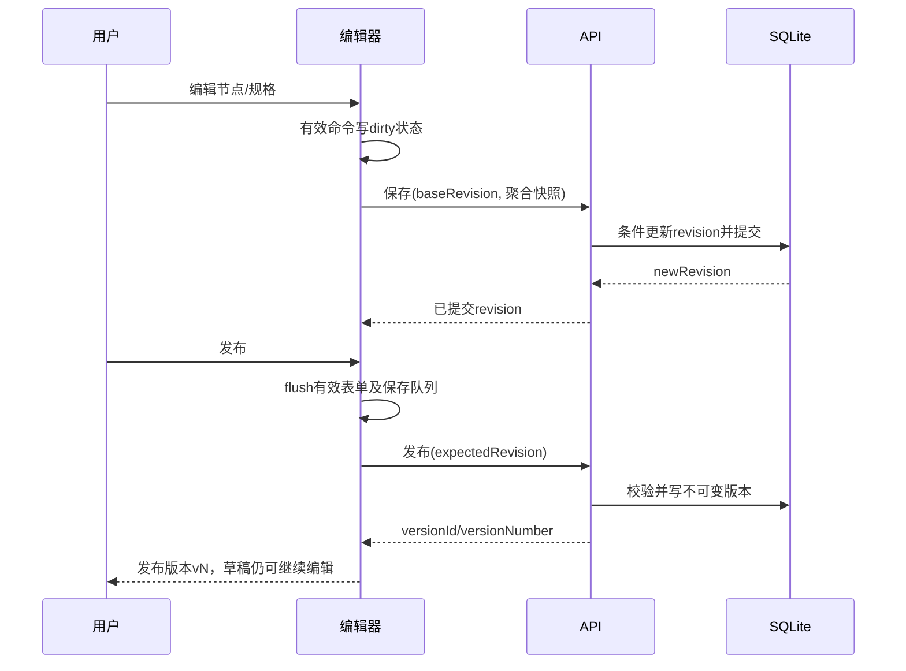
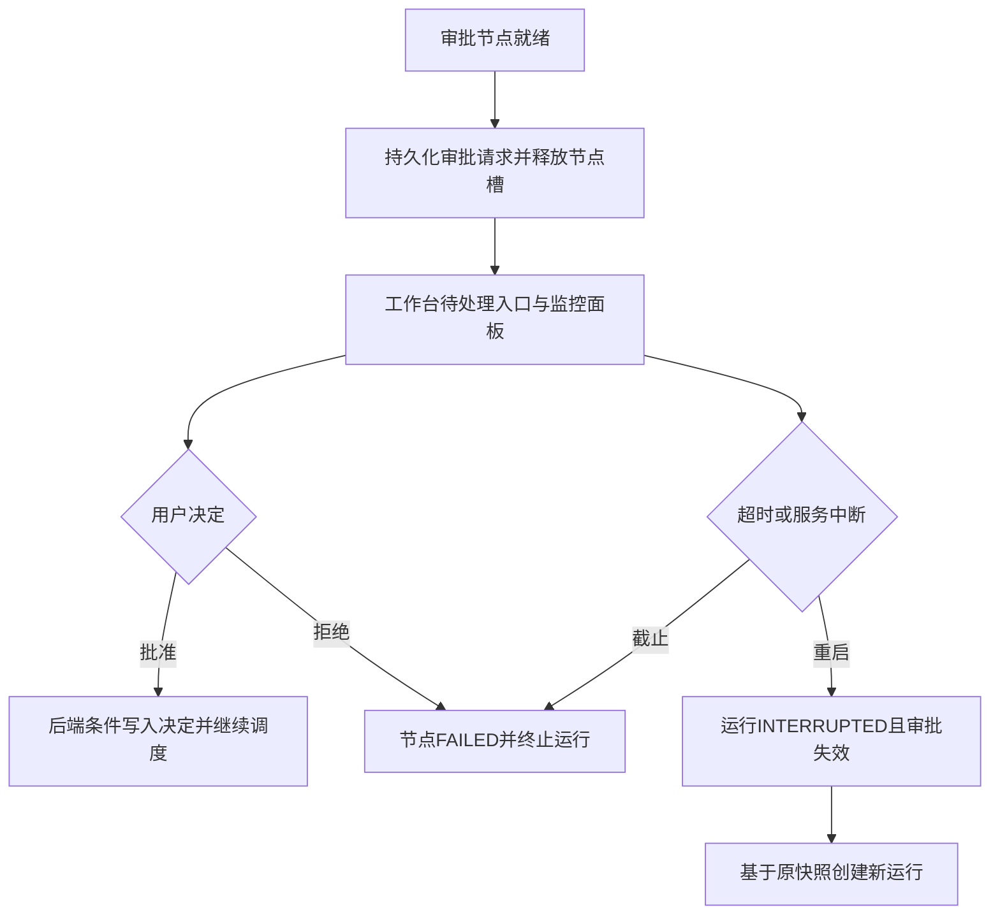

# 关键交互流程

以下流程对应P0真实业务与后端契约； [离线原型](prototype/index.html) 只展示固定状态和页面，不执行下面的持久化/调度流程。

## 1. 从规格到首次可验证运行

首次引导提供“订单摘要验证”纯离线示例：Start输入订单JSON → Transform提取金额 → Condition判断阈值 → 高金额走Approval、低金额走Template → Join → Assert → End。条件两条分支仅一条激活；被跳过路径经INACTIVE传播，Join等待全部入边解析后继续。另配Parallel分发两个纯计算节点再Join示例，避免将互斥分支误认为并行。

## 2. 保存、发布与草稿变更

出现409时停自动保存，保留本地内容并可导出；用户重新载入服务器版本前明确本地修改尚未保存。退出页面有dirty内容时显示“留在编辑 / 导出后离开 / 放弃离开”，浏览器原生beforeunload只作最后一道提示。服务端断线不能显示“已保存”。

## 3. 条件、并行、汇聚的用户解释

| 当前情况 | 画布反馈 | 用户可理解的说明 |
|---|---|---|
| Condition选择true | true实线、false虚线；被跳过节点显示SKIPPED | “条件为真；另一支路未激活” |
| Parallel两支路执行 | 两条活动路径；槽位不足支路显示READY | “已就绪，等待本地执行槽” |
| Join尚有UNRESOLVED | 待执行，详情显示1/2入边已解析 | “等待剩余支路确定结果” |
| Join一条ACTIVE一条INACTIVE | 执行一次，仅提供已激活输入 | “未选择的分支不会阻塞汇聚” |
| Join全部INACTIVE | SKIPPED并继续传播 | “没有激活的上游路径” |
| 任一任务最终失败 | 运行停止新调度，其余取消收敛 | “流程因节点错误终止”，失败不是跳过 |

Join配置面板默认解释“等待所有入边确定是否激活，再汇总成功的活动输入”。不提供含糊的“等全部节点成功”勾选框。

## 4. 审批、取消与重启

审批只暂停到达此节点的路径；其他已激活分支可能继续。Run仅在无执行/可运行/重试计时任务、剩余活动都是审批时显示WAITING_APPROVAL。不要用全屏“流程已暂停”误导用户。

取消操作：点击取消 → 显示当前运行号与效果说明 → 后端提交CANCELLING → UI禁重复操作 → 最多5秒收敛终态CANCELLED。已完成节点保留，未执行节点取消，迟到事件不能覆写终态。UI文案“已停止后续执行；已发生的外部操作无法自动撤销”。首版离线纯计算节点大多没有外部副作用，但语义仍必须一致。

服务重启：原有所有未终态运行成为INTERRUPTED，未决审批撤销；历史保留。按钮叫“基于快照重新运行”，先显示输入和新run确认，不叫“继续”或“恢复”，并产生新的runId。

## 5. SSE断线与事件重复

1. 首次获取run快照和`lastSeq`；按协议从该游标后订阅。
2. 事件小于等于已应用seq直接去重；遇到缺口先补齐，不让完成节点倒回运行中。
3. 连接断开显示连接状态条，保留最后可信时间；任务仍可能在后端执行。
4. 重连携带游标，服务补发持久事件；游标已不在保留范围则重新读取完整快照。
5. 新快照应用后恢复用户选中节点/面板页签；只有用户打开“跟随当前节点”时才移动镜头，此功能可P1。

## 6. 错误修复与验证

静态错误路径：顶部“3项错误” → 问题抽屉 → 选中错误 → 聚焦节点/字段 → 修复 → 重校验。运行错误路径：失败状态 → 失败节点 → 当前尝试错误/输入 → 查断言差异 → 返回草稿修订 → 新运行。旧run快照和日志不因修复而改变。

错误示例文案：

- `REFERENCE_NOT_GUARANTEED`：“该值来自可能跳过的分支。请设为可选并提供默认值，或引用汇聚结果。”
- `DRAFT_REVISION_CONFLICT`：“此流程已在另一处修改。当前编辑已保留，请导出或重新加载。”
- `NODE_TIMEOUT`：“此节点超过30秒未完成。查看输入规模或调整超时后重新运行。”
- `ENGINE_DEADLOCK`：“剩余节点无法继续。运行已结束，请查看依赖诊断；不会无限等待。”

测试用例包含输入、断言、说明；点击执行后保存并冻结本次用例断言。结果对照显示期望/实际路径值与通过状态；无断言只证明执行完成，不能默认显示“业务验收通过”。

## 7. 原型评审脚本

打开prototype/index.html；依次切换八个页面，核对目标对象和返回路径；进入编辑器选择Condition/Join/Approval节点，检查属性说明；切换运行监控查看固定成功/等待/跳过示意；在1366×768与1920×1080下检查画布宽度、面板滚动、按钮焦点。原型中“示例状态”不是执行按钮，任何按钮反馈必须说明仅展示设计，不伪造保存成功或真实运行。
