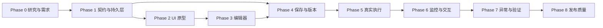

# 开发路线图

状态：设计阶段计划。当前交付只有研究与设计文档；下列应用、命令、测试和性能结果均待后续实现。范围依据 [设计基线](../BASELINE.md)，任务详见 [任务分解](TASK_BREAKDOWN.md)。Phase 编号是交付顺序，P0/P1 是功能优先级，两者不是同一概念。

## 阶段约束与依赖

核心路径为“契约与 Windows 安装验证 → 编辑与保存 → 真实执行 → 可观测与故障验证”。UI、领域和执行模块可以在契约稳定后并行，但每个阶段只宣称已验收的能力。Phase 2 的原型不作为执行功能验收；Phase 3 的画布不作为完整工作流平台验收。

## Phase 0：研究与需求分析

- **目标与范围**：用可核查来源约束产品，确定离线单用户、有限 DAG、结构化规格、手动任务分解和最小执行节点集合；不实现应用。
- **依赖与模块**：用户任务及五个参考项目；修改 `docs/research`、`docs/product`、设计基线。
- **交付**：事实/推断/建议分开的竞品报告、来源表、P0/P1/P2/Out of Scope、需求追踪编号。
- **验收**：五个项目均有具体来源；缺失截图、源码访问限制如实记录；没有把复杂部署设为条件。
- **测试/检查**：核查文档链接、优先级一致性、每项核心需求的验收出口；不是运行测试。
- **风险**：动态分支源码可能变化、许可证范围差异；实施前锁定真正使用的依赖版本。

## Phase 1：架构、契约与数据库基础

- **目标与范围**：建立最小 npm workspaces，冻结定义/状态/事件/错误契约；实现数据目录、迁移和持久化接口，不提前做复杂后台。
- **依赖与模块**：Phase 0；`packages/contracts`、`apps/server/src/persistence`、`apps/server`、根开发脚本。
- **交付**：Windows 安装验证记录、类型化契约、初始迁移、健康检查、数据库初始化/检查命令。
- **验收**：全新 Windows 10/11 x64 + Node 24 在无本地 C++ 工具链条件下完成锁定驱动安装；内嵌 SQLite 满足 WAL 修复版本门槛；迁移可重复执行且不清空已有数据。
- **测试**：真实临时 SQLite 的约束/事务/迁移测试，schema 示例验证；模拟打开失败与只读目录。
- **风险**：better-sqlite3 原生预编译包不匹配。若失败，暂停技术栈固化并更新 ADR，可评估另一受支持 Node 补丁或 SQLite 驱动；不能把“额外安装复杂构建工具”偷偷作为用户必需步骤。

## Phase 2：设计系统与八类核心页面原型

- **目标与范围**：实现主题 token、组件状态、导航与静态页面原型，覆盖工作台、项目、工作流、编辑器、规格任务、监控、历史详情、设置。
- **依赖与模块**：Phase 1 契约；`apps/web` 的 shell、design-system 和页面；原型使用明确标记的 fixture。
- **交付**：可查看原型、1920×1080 与 1366×768 布局记录、键盘操作清单。
- **验收**：主要动作有可理解的流程，失败/空/加载/禁用状态有设计；原型运行按钮不得表现成真实引擎成功。
- **测试**：人工视觉检查、关键组件可访问性检查、窄桌面面板折叠；不为每个间距写单元测试。
- **风险**：参考截图仍未提供、布局精度没有用户反馈；保持设计 token 易调，不能据原型声称成熟产品质量已验证。

## Phase 3：可视化编辑器

- **目标与范围**：新增/删除/拖动/连线、属性配置、引用选择、多选复制、非嵌套分组、撤销重做、自动布局和定位错误。
- **依赖与模块**：Phase 1 契约、Phase 2 UI；`apps/web/features/editor`、节点描述、共享校验器。
- **交付**：可编辑离线定义 fixture、命令式编辑历史、两级分组布局、前端即时校验。
- **验收**：一次拖动/批量删除/自动布局各是一条撤销操作；复制重建节点 ID 和内部引用；分组不进入执行拓扑；输入框中快捷键不误删节点。
- **测试**：序列化往返、复制/撤销不变量、Playwright 键盘/连线/布局场景；200 节点性能先测量不扩功能。
- **风险**：React Flow 对象污染领域定义、分组布局跨边失真、Zustand 重复状态。用适配层和唯一编辑草稿状态解决。

## Phase 4：工作空间、保存与版本

- **目标与范围**：项目/工作流 CRUD 与搜索、规格任务编辑、草稿乐观锁、发布版本和历史只读快照。
- **依赖与模块**：Phase 1 持久层、Phase 3 可序列化定义；API、项目/工作流/规格页面。
- **交付**：从创建项目到编辑规格、拆解任务、保存并发布的完整流程；统一 revision API。
- **验收**：刷新可恢复；另一标签页的旧 revision 写入返回冲突而非覆盖；发布后编辑草稿不会改变原版本；软删除保留历史。
- **测试**：API 与 SQLite 集成测试、并发保存/发布竞争、规格和任务与定义快照的一致性。
- **风险**：规格独立保存造成快照不一致，发布前前端未 flush。所有修改共享 draft revision，发布由后端事务取快照。

## Phase 5：本地真实执行引擎

- **目标与范围**：执行计划、有限并发、条件和显式 Join、内置 Transform/Template/Assert、尝试记录、重试、超时和持久审批等待。
- **依赖与模块**：Phase 4 快照、Phase 1 事件契约；`packages/workflow-core`、`packages/node-catalog`、运行 API/持久层。
- **交付**：通过 API 执行离线实例并查询真实结果；调度器与业务执行器可独立测试。
- **验收**：互斥分支后 Join 不阻塞；两个并行有效支路均结束后才 Join；全局最多4个执行节点、每 run 最多2个；非幂等执行器不自动重试。
- **测试**：虚拟时钟与可控 executor 的调度测试、真实数据库原子提交测试、运行路径和断言结果检查。
- **风险**：将“节点成功”与“运行成功”混淆、晚到回调覆盖终态、等待占满执行槽。以状态机、attempt token 与 generation 约束。

## Phase 6：监控、历史和人工交互

- **目标与范围**：SSE 真实事件映射、断线补发、只读运行画布、节点尝试/日志/输出、审批决策与取消。
- **依赖与模块**：Phase 5 的数据库事件；`apps/server` runtime-events、`apps/web/features/runs`。
- **交付**：从点击执行到查看输出、审批、取消、历史回看的 UI 闭环。
- **验收**：关闭浏览器不停止运行；断线重连无重复副作用；状态只由已提交后端事件推进；取消5秒内收敛，过期审批不能继续运行。
- **测试**：SSE 断点/缺口/慢客户端、重复审批、取消竞态、重启后全部未终态变 INTERRUPTED。
- **风险**：以动画推断状态、事件先发后写库、SSE 历史与 live 交接丢事件；使用持久游标、快照和同事务 outbox 式事件记录。

## Phase 7：结果验证与异常闭环

- **目标与范围**：节点测试、工作流测试、冻结断言、期望/实际差异、故障注入、备份/恢复与清理；P0 安全与资源上限落实。
- **依赖与模块**：Phase 4–6；测试用例 API/UI、故障处理、设置与维护脚本。
- **交付**：可复现的离线验收案例、带错误定位的失败报告、独立目录备份恢复演练记录。
- **验收**：不会出现“断言失败但运行显示成功”；磁盘/数据库故障不显示假成功；恢复到新目录后快照及历史可读。
- **测试**：见 [测试策略](TEST_STRATEGY.md) 的故障矩阵；连接外部服务不是必测前提。
- **风险**：仅走快乐路径、清理仍活跃运行、直接复制在线 WAL 数据库；使用持久层备份能力、终态筛选与恢复校验。

## Phase 8：测试、性能和展示完成

- **目标与范围**：修复已有 P0 缺陷、测量目标性能、校验离线启动、审查可访问性、补用户文档；不借此扩大到 P1 节点。
- **依赖与模块**：Phase 7 全闭环；按测量结果限定优化文件。
- **交付**：本地可执行全量检查、Windows 双系统验证记录、版本化展示数据、已知限制清单。
- **验收**：所有 P0 验收项有证据；200 节点拖动目标≥30fps、保存 p95<500ms、状态提交至 UI p95<500ms；门槛未达则报告原因，不能静默改数字。
- **测试**：fresh clone 安装、生产构建离线完整案例、性能采样、回归关键故障；检查无需 GitHub Actions。
- **风险**：为大规模性能过度拆进程、机器差异误判。先查渲染订阅、同步事务时长和索引，只有测量支持才开启独立 Worker ADR。

## 团队节奏与估算边界

建议3–5人，每周至少演示一个可验收纵向切片。初步估算为10–14个日历周，假设每人稳定投入且不增加联网节点；这是规划估算，不是交付承诺。Phase 1 安装、Phase 3 复杂画布、Phase 5/6 调度故障语义是关键不确定项，完成各自技术验证后重新估算。后续 P1 的 HTTP GET、模板复用和增强管理应另开计划，不占用 P0 完成标准。
