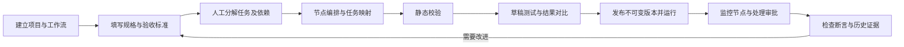

# 产品愿景与边界

版本：设计稿 1.0，2026-11-14。范围以 [设计基线](../BASELINE.md) 为准；本文不代表应用已实现。

## 产品定位

FlowStudio 是面向 Windows 个人电脑的本地可视化任务编排与执行工具。用户把目标写成结构化规格、拆成可验收任务，再用有依赖关系的节点执行和验证；运行结果能够回溯到当时的规格、图、输入和节点尝试。

产品价值不是“画出流程”，而是让用户能够回答：为什么要执行这一步、它读了什么、实际产生了什么、为什么失败、结果是否满足原先的验收条件。专业程度体现在确定的语义、清楚的反馈和可维护性；安装复杂度不构成专业程度。

## 目标用户与使用情境

| 用户 | 核心任务 | 首版支持方式 |
|---|---|---|
| 个人开发者 | 在本机组织 JSON 数据处理、条件判断、模板输出和断言 | 内置确定性节点，不依赖外部账号和网络 |
| 技术产品设计者/演示者 | 展示规格、拆解与真实执行之间的对应关系 | 规格与任务面板、节点关联、运行快照与验证报告 |
| 3～5 人研发团队 | 并行开发产品源码并稳定集成 | Git、共享契约、本地测试；不是多人共同操作同一运行时 |

不把本产品定位为云集成市场、通用脚本执行沙箱、LLM Agent 平台、企业 BPM 或分布式调度服务。首版也不承诺处理任意大文件或保证外部系统副作用恰好一次。

## 完整使用闭环

## 首个标准场景

“订单摘要核验”使用本地 JSON 订单作为输入：Transform 提取总金额；Condition 判断是否超过阈值；高额分支等待本地人工审批，普通分支执行模板处理；Join 消除未激活支路阻塞；Parallel 同时生成摘要与校验字段；Join 后 Assert 验证结果；End 输出。任何人均能通过输入 fixtures 复现普通订单、需要审批、拒绝、断言失败、取消和中断场景。

这里的“审批”是当前本机用户的明确决定，既不是多角色授权，也不提供独立审计人的身份保证。该场景验证机制完整性，不假称首版已对接真实订单系统。

## 成功标准

- 首次获取依赖后可断网完成上述闭环，重启仍可查看已落盘历史。
- 任何运行均绑定不可变快照；修改草稿不改变正在运行或历史中的行为。
- 条件未选分支显示“已跳过”，汇聚不无限等待；重试、审批、取消和重启结果可说明、可测试。
- 画布操作在 1366×768 仍可完成，错误可直接定位到节点和字段。
- 团队可在本地执行全部核心检查；新增内置节点不要求改写调度器。

200 节点等容量与时延指标是 [SRS](SRS.md) 中待测的验收目标，不是本轮实测结论。

## 取舍依据

研究确认了 Dify 的定义/运行分离、n8n 的数据与历史闭环、Flowise 的节点元数据组织、Node-RED 的本地运行思想以及 React Flow 的编辑能力边界。详见 [竞品研究](../research/COMPETITOR_ANALYSIS.md)。FlowStudio 借鉴这些机制，独立实现界面；不直接移植受限制许可的产品代码。

首版优先把纯本地执行做好；HTTP GET、导入导出和更丰富调试随后增强。任意代码、循环、子工作流及 AI 能力需要重新论证成本和隔离边界，不默认纳入下一迭代。
