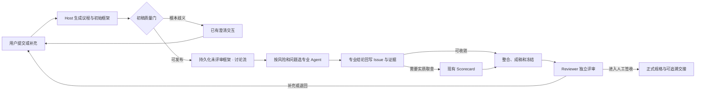

# 阶段 2.1 · 第一版草稿工作流调研与架构设计

调研日期为 2026-11-27。当前项目以提交 `32591b239ca9b0239d973969fdfb0edd53539e7e` 为历史基准，同时阅读了含阶段 2 初始框架与 Agent 自主决策改动的本地工作树。报告区分源码行为、历史记录、本次模拟复测和设计估算。

**推荐把 C「先展示初始框架，再按需组织专业协作」设为默认。** Host 在开题时给出项目全貌，用户可以立即在讨论工作台继续提意见。后续由专业 Agent 围绕可定位的模块、风险和问题补充证据。只有会根本改变项目、且无法从已有信息判断的歧义，才阻断初始框架。正式候选稿仍通过现有冻结、独立评审和人工签收。

## 1. 现有初稿生成机制

| 检查项 | 历史基准及当前工作树 |
| --- | --- |
| 开题与前置条件 | 用户提交实质输入后会话为 `CLARIFYING/HOST_AGENDA`。Host 给出 Agenda 或关键澄清。阶段 2 的 `HostAgendaOutput` 在 `DISCUSS` 时须同时给出通过校验的 `initial_outline`，`ASK_USER` 时必须省略；需要澄清则保留第 0 轮。 |
| 初始框架调用链 | `AgentExecution._jobs → RoleRunner → HostAgendaOutput → 议程提交 → DiscussionEngine 落初始框架 → 进入 DISCUSSING 并派发发言`。初始框架带用户输入与议程消息来源，写入 `session.initial_draft`，复用 `DraftRevision` 的包装，使用版本 0、`current=False`。在首轮专业 Agent 调用前，持久化状态已可读取。 |
| 专业协作与收敛 | 角色按议题范围并行发言，Critic 可提出带证据的 Issue；事实走定向回应，重大用户取舍走澄清，可逆细节走 Host 默认决定，权衡事项可走 Scorecard。没有活跃问题时进入 Host 整合，随后推进议题或成稿。 |
| 首次冻结的前置条件 | `submit_candidate_draft` 要求 DISCUSSING、等待 Host 且无未完任务。`draft_blockers` 检查必需发言、议题质疑、当前输入的开放阻断项及未关闭价值分歧。开放权衡先评分。成稿校验引用、变更和交付预检，`_finalize_draft` 以正式版本 1 起步，然后进入 `REVIEWING`。阶段 2 提前的是框架，正式候选稿仍有完整前置条件。[门禁代码](../../discussion_orchestration/validation.py#L203) |
| 独立评审与签收 | Reviewer 获得冻结稿及预检相关证据、问题与历史评审，阶段 2 工作树明确排除 `initial_outline`。PASS、REVISE、NEEDS_INPUT 分别由现有校验和状态机处理，保留评审后退回、必要澄清及用户显式签收。当前 REVISE 可由用户直接签收并保留评审记录。签收校验当前版本与并发状态，正式交接用 `DraftSpec`、来源与内容哈希；框架 ID 不具备签收或导出资格。 |
| 存储、工作台 | 仓储将会话快照、消息、版本投影与幂等记录在决策事务中提交。初始框架目前只在会话快照和详情投影内，实质输入更新会清除当前框架，历史候选稿另存。工作台在讨论流渲染 `InitialOutlineCard`，正式规格、评审记录与签收留在 `DiscussionSpec`。 |

源码索引：[调度与角色请求](../../backend/discussions/agent_execution.py#L175)、[Agenda 及输出校验](../../backend/roles/contracts.py#L592)、[领域对象](../../discussion_orchestration/models.py#L43)、[引擎](../../discussion_orchestration/engine.py#L179)、[状态转换](../../discussion_orchestration/state_machine.py#L11)、[仓储提交](../../backend/discussions/repository.py#L294)、[签收](../../spec_handoff/signoff.py#L89)、[DraftSpec](../../spec_handoff/draft.py#L155)、[工作台](../../frontend/src/Workbench.tsx#L626)、[正式规格面板](../../frontend/src/DiscussionSpec.tsx#L12)。

**可复用的边界。** Agenda 继续表达议题和主持调度，Issue 承接可验证缺口，Scorecard 只用于有实质竞争的候选，DraftRevision 承接不可变发布快照，Reviewer 继续独立判断。现有引用序号、议题 ID、问题 ID、快照和有序消息已经能支撑逐条追溯。当前框架是七类内容加产品名的扁平文本字段，缺逐项状态、模块引用关系、版本来源及逐项证据，后续可渐进补齐。现状的专业角色选择仍主要受题目范围和既有枚举约束。

## 2. 外部参考项目

以下版本用于固定源码快照。滚动发布的官方说明单独列出，机制以对应源码为准。调研阅读源码和测试断言，未安装或运行上游框架。

### GitHub Spec Kit

版本 **v1.4.5**，提交 `6ba8beefff8d6408cadd62038e92d459093e33a8`。specify 先按模板写 Draft，面向用户行为、可测试场景、功能需求和成功标准。可以推断的细节写作假设，只有重要且无合理默认值时才加澄清标记，上限 3 个。clarify 针对现有稿逐个问高影响问题，总上限 5 个，接受答案后回写相关章节。两处数字对应不同阶段。Constitution 单独维护原则、修订与合规审查规则，按修订性质递增版本。[specify 命令](https://github.com/github/spec-kit/blob/6ba8beefff8d6408cadd62038e92d459093e33a8/templates/commands/specify.md#L120) · [clarify 命令](https://github.com/github/spec-kit/blob/6ba8beefff8d6408cadd62038e92d459093e33a8/templates/commands/clarify.md#L113) · [规格模板](https://github.com/github/spec-kit/blob/6ba8beefff8d6408cadd62038e92d459093e33a8/templates/spec-template.md) · [Constitution 命令](https://github.com/github/spec-kit/blob/6ba8beefff8d6408cadd62038e92d459093e33a8/templates/commands/constitution.md#L75) · [原则模板](https://github.com/github/spec-kit/blob/6ba8beefff8d6408cadd62038e92d459093e33a8/templates/constitution-template.md)

Preset 按优先级覆盖同名模板、命令与脚本。Workflow 负责编排步骤，内置 SDD 流程有规格与计划两个独立评审关口，可暂停并恢复。Bundle 负责把已有扩展、Preset、Workflow 和步骤类型一起分发。适合团队统一产物与规范，依赖命令、文件和分支上下文，对实时讨论和逐条证据关联需要另行设计。建议仅借用假设先行、澄清预算、模板与规则分离。[Preset](https://github.github.com/spec-kit/presets/overview.html) · [Workflow](https://github.github.com/spec-kit/workflows/overview.html) · [Bundle](https://github.github.com/spec-kit/bundles/overview.html)

### BMad Method

版本 **v6.12.4**，提交 `bab9082c3e884e0d72c759bcd1a6d90bcc01be84`。源码中的 PRD Coach 有 Create、Update、Validate 意图，读取已有 Brief、研究和访谈。Fast 把剩余缺口压成一两问后成稿并标假设，Coaching 按章节引导，额外细节进入 addendum。Product Brief 先描述产品愿景和价值，可馈入 PRD，两个技能可以独立启动。清晰的小型意图可用短规格，完整产品路线再加 UX、架构和拆分。Analyst 抓方向，PM 主责 PRD，后续 UX、架构师、PO 各有交付；组织指南建议把既有审批放在有明确书面交付的检查点，审批权仍来自组织本身。适合产品规模分层和职责设计，逐节 Coaching 会增加交互，对本项目只借鉴可选深度与签收责任。[PRD Coach Prompt](https://github.com/bmad-code-org/BMAD-METHOD/blob/bab9082c3e884e0d72c759bcd1a6d90bcc01be84/web-bundles/prd-coach/SKILL.md) · [Brief 与 PRD 实现指南](https://github.com/bmad-code-org/BMAD-METHOD/blob/bab9082c3e884e0d72c759bcd1a6d90bcc01be84/docs/plan/define-requirements-and-a-specification.md) · [路线及角色](https://github.com/bmad-code-org/BMAD-METHOD/blob/bab9082c3e884e0d72c759bcd1a6d90bcc01be84/docs/plan/choose-a-planning-path.md) · [组织治理与审批](https://github.com/bmad-code-org/BMAD-METHOD/blob/bab9082c3e884e0d72c759bcd1a6d90bcc01be84/docs/plan/plan-inside-an-organization.md)

另核对官方 `bmad-plugins` 仓库快照 `d009608292d8a2ea4df846de7dca2f0d78a9e22d` 的 Brief Skill。Create 使用可调整模板并写入 Brief 与工作记忆。Update 读取旧稿和原始输入，先提出与旧决定的冲突。无交互模式依据已有材料继续，仍有关键歧义才返回阻塞。这份插件快照与上面的 v6.12.4 分开记录。[Product Brief Skill](https://github.com/bmad-code-org/bmad-plugins/blob/d009608292d8a2ea4df846de7dca2f0d78a9e22d/plugins/method/skills/bmad-product-brief/SKILL.md#L29)

### OpenSpec

版本 **v2.2.0**，提交 `f1cd852f4edce22b8df9548a4df889172ca8ff25`。实际默认 Schema 的依赖图为 `proposal → [specs, design] → tasks`，specs 与 design 共享 proposal 前驱。图按已完成集合计算可执行节点，同层用声明顺序稳定输出。自定义 Schema 声明 artifact、模板、指令和 `requires`，可用更轻的图。每个 change 保存增量规格，按新增、修改、删除等动作应用到主规格。这里的版本追溯依赖变更产物与仓库，和本项目的签收版本体系职责不同。适合确定变更后并行细化。建议借用小型依赖图和修订差量，不把聊天迁移为文件驱动。[默认 YAML](https://github.com/Fission-AI/OpenSpec/blob/f1cd852f4edce22b8df9548a4df889172ca8ff25/schemas/spec-driven/schema.yaml) · [依赖图实现](https://github.com/Fission-AI/OpenSpec/blob/f1cd852f4edce22b8df9548a4df889172ca8ff25/src/core/artifact-graph/graph.ts#L144) · [图测试](https://github.com/Fission-AI/OpenSpec/blob/f1cd852f4edce22b8df9548a4df889172ca8ff25/test/core/artifact-graph/graph.test.ts) · [增量应用](https://github.com/Fission-AI/OpenSpec/blob/f1cd852f4edce22b8df9548a4df889172ca8ff25/src/core/specs-apply.ts) · [自定义解析优先级](https://github.com/Fission-AI/OpenSpec/blob/main/docs-lab/customize/schemas.md)

### Microsoft Magentic-One

AutoGen **python-v0.7.5**，提交 `83afbf5857aac683340d4c692194e548b1e8edda`。Orchestrator 外层生成、更新事实和计划（Task Ledger），内层用结构化 Progress Ledger 判断目标满足、是否循环、进度、下一位 speaker 和指令。它从已注册的 participants 中选下一位，检测连续停滞后更新事实与计划并重启内层，另有轮次上限。逐步模型调度适合探索，但会把每步判断变成新开销，也不自带企业审批。建议用 Agenda、Issue 和进度元数据承接 ledger 思路，默认按规则路由，连续无进展才升级给 Host。[编排执行](https://github.com/microsoft/autogen/blob/83afbf5857aac683340d4c692194e548b1e8edda/python/packages/autogen-agentchat/src/autogen_agentchat/teams/_group_chat/_magentic_one/_magentic_one_orchestrator.py) · [Prompt 与 Ledger 契约](https://github.com/microsoft/autogen/blob/83afbf5857aac683340d4c692194e548b1e8edda/python/packages/autogen-agentchat/src/autogen_agentchat/teams/_group_chat/_magentic_one/_prompts.py#L59) · [官方架构说明](https://microsoft.github.io/autogen/dev/user-guide/agentchat-user-guide/magentic-one.html)

### Anthropic Building effective agents

固定参考为 **2024-12-19 发布的文章**，文章无软件版本或提交号。Prompt Chaining 用于清楚可拆的固定阶段，Routing 根据任务分类选专门路径，Parallelization 可拆分独立任务或用多次评估。Orchestrator-Workers 用于运行时才能确定子任务的情况，Evaluator-Optimizer 需要清晰反馈标准及改进收益。这些是设计模式，性能取决于任务与模型。建议分别映射到开题和冻结、按风险选专家、独立问题并行、复杂议题动态分解、受限的评审修订循环。依赖耦合时先解决前置问题，评分分歧应保留证据和人工裁决边界。[文章工作流章节](https://www.anthropic.com/research/building-effective-agents#building-blocks-workflows-and-agents)

### OpenAI Agents SDK

版本 **v0.26.0**，提交 `0ad2d63a9371a23333a95ea6878141a826c9cdda`。Manager 持有面对用户的最终输出，`Agent.as_tool()` 把专业 Agent 包为可调用工具，官方例子由前台 Agent 选用翻译 Agent 并汇总。与 handoff 把对话交给下一 Agent 的选择独立。输出层按 `output_type` 构建严格 JSON Schema 并解析、校验。适合职责与展示分离；工具式动态选择会引入嵌套调用和调度可变性，结构校验也无法判断业务正确性。建议沿用本仓库 Host 与 RoleRunner，给专业结果独立契约及证据校验。[Manager 文档](https://openai.github.io/openai-agents-python/multi_agent/) · [可运行示例](https://github.com/openai/openai-agents-python/blob/0ad2d63a9371a23333a95ea6878141a826c9cdda/examples/agent_patterns/agents_as_tools.py) · [工具适配实现](https://github.com/openai/openai-agents-python/blob/0ad2d63a9371a23333a95ea6878141a826c9cdda/src/agents/agent.py#L646) · [输出校验](https://github.com/openai/openai-agents-python/blob/0ad2d63a9371a23333a95ea6878141a826c9cdda/src/agents/agent_output.py#L85)

已核对同版本测试的嵌套 Agent 工具用例，验证父运行从检查点恢复后仍保存该工具的上下文决策。这为本项目恢复测试提供了用例设计参考。[Agent 工具测试](https://github.com/openai/openai-agents-python/blob/0ad2d63a9371a23333a95ea6878141a826c9cdda/tests/test_agent_as_tool.py#L83)

### LangGraph

核心包 **1.2.24**，提交 `58a6e1cc5b7dfc3619fc6e7e7573b040d554649b`。条件边做状态驱动路由，`Send` 给动态 fan-out 节点各自送入状态，引擎按步推进并用 reducer 汇合并行结果。checkpointer 按 thread 保存状态，`interrupt` 暂停等待外部输入，`Command(resume=...)` 恢复时重跑节点起始代码，因此中断之前的副作用要幂等。适合长任务恢复和人工加入。建议借用稳定合并、快照恢复、迟到结果防护，复用现有 SQLite 快照、租约与状态版本，保持迁移范围可控。[状态图实现](https://github.com/langchain-ai/langgraph/blob/58a6e1cc5b7dfc3619fc6e7e7573b040d554649b/libs/langgraph/langgraph/graph/state.py#L982) · [Send、Command 与中断类型](https://github.com/langchain-ai/langgraph/blob/58a6e1cc5b7dfc3619fc6e7e7573b040d554649b/libs/langgraph/langgraph/types.py#L748) · [持久化](https://docs.langchain.com/oss/python/langgraph/persistence) · [中断与恢复](https://docs.langchain.com/oss/python/langgraph/interrupts)
同版本中断用例覆盖响应 Schema 校验及无效恢复值，支持在本项目将「暂停点可恢复」与「输入可接受」分别验证。[中断测试](https://github.com/langchain-ai/langgraph/blob/58a6e1cc5b7dfc3619fc6e7e7573b040d554649b/libs/langgraph/tests/test_interruption.py#L150)

## 3. 候选工作流比较

下表以**首次看到可用框架**为等待终点。调用数按一次开题、无重试和人工等待估算，专业角色默认示例为 3 位。A–D 都保留后续正式评审与签收。

| 维度 | A · 单 Host 快速成稿 | B · 专业并行后成稿 | C · 框架先行、按需完善 | D · 多方案评分后成稿 |
| --- | --- | --- | --- | --- |
| 首份等待 | 1 个模型阶段 | 开题 → 并行 → 汇总，3 阶段 | 1 个模型阶段，其余后台推进 | 开题 → 探索 → 立场 → 评分 → 成稿，示例 5 阶段 |
| 调用示例 | 1 | 1＋3＋1＝5 | 1，后续按命中策略派发 | 1＋3＋3＋1＋1＝9 |
| Token 开销 | 首份低 | 多份角色上下文，汇总再读证据 | 首份低，全程取决于分流与重复上下文 | 首份高，候选及立场在多次请求间传递 |
| 整体框架质量预期 | 叙述统一，领域盲点集中 | 多视角，更依赖合并质量 | 快速建立骨架，逐条补强，可显式保留未知 | 取舍可追溯，容易过早展开细节 |
| 专业参与 | 展示前无，后续现有评审和协作 | 展示前高 | 展示后按模块、风险和责任人参与 | 展示前高，围绕选择与证据 |
| 用户交互成本 | 少，缺口可能推迟暴露 | 初稿前可能有针对性的问题 | 默认 0 次前置确认，根本歧义才暂停 | 有实质价值冲突时可能需要选择 |
| 复杂项目 | 较弱，适合边界明确的低风险需求 | 适合已知必须同时检查的高依赖项目 | 适合混合规模，可切换加深和评分 | 适合尚未决定路线且候选真实可比的项目 |
| 企业配置 | 独立模板与审查底线 | 可指定必需专家与并行规则 | 模板、质量门、路由和预算均可配置 | 增加候选数、权重和授权者配置 |
| 现有兼容性 | 高，与已实现开题框架同形 | 高，复用并发和整合，增加发布门槛 | 高，复用当前展现，路由逐步收敛 | 较高，复用 Scorecard，须控制触发和输出进度 |
| 实现复杂度 | 低 | 中，处理专家失败和完整合并 | 初始低，逐项证据及动态路由中等 | 中高，涉及比较证据、预算与停滞退出 |

A 用于明确、低风险、需要快速做方向原型且专业缺口很少的项目，正式门禁保留。B 用于组织要求首次对外展示前已有跨领域输入，或数据、权限、集成边界必须联合核实的项目。D 由重大、可举证的架构或业务取舍触发，候选不足两项时回到 C；能先展示共同框架时仍先展示，评分决定后续候选稿。只有政策明确要求选定路线才发布时，D 才在首份之前完整运行。

## 4. 推荐架构与选择理由

- 默认复用阶段 2 的同次 Host 输出。结构校验失败复用 RoleRunner 的有界修复，模型失败展示真实任务状态并允许重试。质量门通过后即提交成果，再派发专业调用。前端沿用讨论流的独立卡片与底部输入框，通过来源和 Issue 跳转继续讨论。
- 专业 Agent 领取具体问题，例如「角色越权路径」「外部依赖的失败分支」，提交新增发现、证据、影响、建议和可关闭条件。互不依赖的任务并行，同一问题归属一个主责 Agent，异议保留各自来源。共识、无新增观点或已关闭的重复议题不再自动开轮。
- 对可逆细节优先自主选择，沿用已确认规则并记录理由与重开条件。例如除法规则已定时，实取整才显示提示。根本歧义包括无法确定目标、关键业务规则确有互斥解释或只有授权用户能提供的硬约束。用户未回答时保持明确的待确认状态。
- 用新证据、问题状态变化、已定方案或实质草稿变更作为进展信号。同一输入下若连续两次没有任何信号，由 Host 选择缩小任务、合并重复问题、提交可评审部分或解释阻塞。该默认阈值为策略参数，重试失败与业务停滞分别计量。

## 5. 初稿数据契约与生命周期

建议继续复用 `DraftRevision` 的身份、输入版本和来源字段，在正式候选稿存储域之外定义 `WorkingDraftContent`。已有 `OutlineContent` 通过读取适配器投影为第一版契约。下列字段是接口设计。

| 层 | 字段与约束 |
| --- | --- |
| 版本包装 | `draft_id, revision, input_version, schema_version, template_ref, policy_ref, source_seqs, created_at`。服务端生成，配置引用带 ID、版本和摘要。每次发布有独立 ID，当前框架指针可替换，历史快照可追溯。 |
| 目标、范围 | `product_name, positioning, goals[], scope.in[], scope.out[]`。目标说明用户与可观察结果，首版范围包含明确边界。 |
| 用户与场景 | `actors[{id,name}], scenarios[{id,actor_ids,trigger,outcome}]`。未知角色可暂定，并关联待确认项。 |
| 功能与关系 | `modules[{id,parent_id,goal}], relations[{from,to,kind}], flows[{id,steps[{actor_id,module_id,action,outcome}]}]`。模块层级无环，关系和步骤引用有效 ID，流程覆盖入口到结果。 |
| 约束与依赖 | `boundaries[], external_dependencies[], constraints[]`。说明负责范围、依赖状态和失败影响，区分用户明确约束、企业规则与推断。 |
| 不确定性 | `assumptions[], risks[], open_questions[]`。逐项带稳定 ID、影响与后续验证方式。问题可关联 `issue_id`，标明是否阻断、责任角色和为什么需要人工。允许明确空数组。 |
| 逐项来源 | 可核验元素带 `status: confirmed | assumed | open`、`source_seqs[]`，可关联配置条款和 Issue。confirmed 需要当前可访问的来源，推断来源只解释依据。模型不可任意分配全局 ID、确认状态或授权。 |

生命周期为 **未评审框架 → 工作修订 → 正式候选稿 v1 → 独立评审 → 签收或退回**。前两者使用工作草稿 ID。冻结时由现有成稿链构建独立的正式内容与 `source_map`，必要时在内部记录 `origin_outline_id`，保持现有候选稿 `parent_id` 专用于正式版本链。工作草稿即使有逐项证据，也不进入正式导出与候选签收。正式候选稿只能通过现有当前版本、预检、评审和签收校验，Review 继续独立读取冻结快照。旧历史若没有逐项引用，保留可验证的全稿来源。

## 6. 企业可定制化接口

| 接口 | 建议签名和默认行为 | 可配置边界 |
| --- | --- | --- |
| `DraftTemplate` | `resolve(project_profile) → TemplateSnapshot`。默认按第 5 节内容渲染，正文优先关系和流程，风险与未验证项可展开。 | 章节顺序、展示文案、领域扩展及必填字段可配置。ID、版本、来源和正式稿隔离由平台保留。 |
| `DraftPolicy` | `select(input, profile) → WorkflowPlan`。默认 C，明确放行可逆事项。初稿前默认 0 问，根本歧义每批最多 2 问，最多 1 个自动澄清批次后报告具体阻塞，允许用户继续补充。 | A–D 路径、问答预算、何时先引入专家、超时和回退。预算耗尽不能由 Agent 伪造确认。 |
| `QualityGate` | `evaluate(stage, snapshot) → GateResult`。结果含 `allow | warn | block`、规则 ID、目标 ID、原因与来源。初稿检查结构、引用完整和不确定性，正式稿继续执行当前校验。 | 企业可增加规则，如隐私、安全、采购审批。本地规则只能收紧平台的正式底线。 |
| `AgentRoutingPolicy` | `plan(snapshot, open_issues, capabilities, budget) → TaskPlan`。用角色能力与议题范围匹配主责，按优先级分配可并行任务，默认并行上限 3。 | 能力标签、必需角色、预算、升级条件及最大轮数。缺少强制角色须明确阻塞，可选角色可跳过并记录缺口。 |

解析顺序为平台默认 → 组织 → 项目 → 单次运行的允许覆盖项。强制规则取并集，预算取有效上限，覆盖字段显式白名单。解析后冻结配置快照并记录规则命中原因，旧会话使用原快照，恢复不读取最新配置。配置先采用静态注册和受控版本，后续再设计权限与审批平台。工作流图变体须检查无环、角色存在、预算以及冻结到评审再到签收的可达性。

## 7. 状态机兼容方案

| 事件 | 现有状态与建议处理 |
| --- | --- |
| 开题通过 | 现有 `CLARIFYING/HOST_AGENDA → DISCUSSING`，在同一事务保存工作草稿、Agenda 和派发决策。初始产物状态使用独立字段或投影。 |
| 必要澄清 | 沿用 `CLARIFYING/USER_INPUT`，根本歧义期间为第 0 轮。已进入讨论的澄清继续走旧路径。 |
| 专业协作、评分、合并 | 保持 `DISCUSSING` 的等待状态及任务类型。C 的路由策略只决定议题内哪些任务必需，其他分支沿用工件发布条件。 |
| 正式冻结及评审 | 保持 `DISCUSSING → REVIEWING → AWAITING_CONFIRMATION/CLARIFYING`。`AWAITING_CONFIRMATION → COMPLETED` 继续依赖人工触发，退回复用现有修订。 |
| 新输入、暂停或重试 | 新输入使旧工作草稿失去当前资格，历史只读。重试按逻辑任务 ID、输入版本和幂等键合并。会话版本与 worker 租约共同阻挡延迟提交，暂停/恢复和并发保护沿用现有机制。 |

前端消费新增可选字段。旧工作草稿、旧会话、已签收导出分别加回归样本。应用侧可以通过策略开关恢复现有路径，数据库只加可选数据。

## 8. 上下文和模型调用成本

当前调度为角色构建带输入版本的请求。必需用户输入、Issue 引用以及按任务收集的冻结稿来源优先保留，议题检查点与近期消息受额外字符预算限制。RoleRunner 对请求快照求摘要，每个逻辑任务最多 2 次尝试。候选稿输入容易被聚合上下文放大。建议按任务装配「用户目标和硬约束＋相关框架条目＋当前 Issue＋必要证据」，只让 Host 整合与 Reviewer 看到各自所需的更完整快照。角色专用预算先删重复讨论，强制证据超限时缩小任务或明确失败。将模板版本、策略摘要、消息高水位和引用来源留在快照里。[上下文选取](../../backend/discussions/agent_execution.py#L397) · [快照与重试](../../backend/roles/runner.py#L45)

**模拟实测。** 阶段 1 的三条历史模拟路径在第 1 轮用 7 次尝试进入首次成稿、8 次到 v1 冻结，首份冻结前均未收到人工补充。阶段 2.1 对当前工作树重跑两个现有初始框架用例，两项通过，总测试时间 2.135 秒。明确需求在 1 次 Host 调用后已持久化框架，三位专业角色尚未给出发言。注入根本歧义时先等待在第 0 轮，用户补充一次后由第二次 Host 调用发布框架。现有用例同时验证框架无法通过候选详情、签收或导出入口。测试耗时含两个场景，不能作为首份等待时间。模拟没有可比较的输入/输出 Token。[阶段 1 模拟口径](../architecture-audit.md#92-默认模拟与受控分支实测) · [阶段 2 用例](../../tests/test_initial_outline.py#L24)

**历史真实模型记录。** 阶段 1 匿名六角色样本达到首个冻结稿用 16 次尝试、2 轮、1 次人工补充，累计 56,251 输入、15,028 输出 Token。该样本存在历史配置差异。本阶段未发起新的真实模型调用，缺少同输入、同模型的延迟、Token 和质量对照。[历史真实计量](../architecture-audit.md#93-真实-api-与历史模型用量)

**理论估算。** 到首份框架的输入与输出分别为各 Provider 尝试实际报告用量的总和。令每次请求输入包含系统指令、角色契约和工作上下文，增加 3 个并行角色会增加约 3 份共享上下文，并附加其专用证据。并行阶段的墙钟时间近似为各角色调用的最大值，再加队列、汇合与重试。串行阶段取和。C 将专业阶段从首份关键路径移到后台，全程成本仍依赖实际选中角色、上下文与返工。A 与 C 首份 1 次，B 5 次，D 示例 9 次均为无重试估算。它们与阶段 1 的 8 次冻结口径不同。

记录 `input_received`、`outline_committed`、`outline_visible`、`candidate_frozen` 和 `review_delivered`，并保存同一输入版本的 Provider 尝试、失败重试、分项 Token 与状态。分别报告创建到帧可见、到候选冻结的 p50/p95，单列人工等待、失败样本及 usage 缺失率。完整用户等待和扣除人工后的自动处理耗时一起保留。

## 9. 风险与兼容性

| 风险 | 对策及验证 |
| --- | --- |
| 一次开题输出过长或不合规 | 初次只要求整体方向、流程和边界。失败走有界修复，验证坏 JSON、引用错误、预算不足、恢复后无重复发布。 |
| 可逆默认误判成核心规则 | 规则优先依据来源与用户授权，直接展示假设和影响。以计算器提示为低风险样本，以运算语义及权限策略为反例。 |
| 工作草稿与冻结稿混用 | API 区分 ID 命名域、类型和生命周期。正式导出与签收拒绝工作草稿，Reviewer 仍按冻结稿检查。 |
| 漏选专家或扩展范围失控 | 策略声明必需能力和执行预算，给出缺失原因。把必要覆盖与正式收敛门槛联动，严禁将未执行标为已核实。 |
| 并发覆盖、证据丢失 | 按输入版本、任务快照和仓储并发检查校验，记录稳定 Issue 和消息来源。用恢复、旧 worker 与旧浏览器样本验证。 |
| 配置覆盖削弱治理或影响历史 | 版本快照、硬约束合并、可回滚开关。应用新配置前保留影响预览，已有会话和签收哈希可回读。 |

## 10. 分阶段实施建议

1. **2.2 · 契约与观测。** 确认工作草稿字段、历史适配、发布事件与埋点定义。复用已存在的开题框架，先以默认 C 跑前后模拟和可控 A/B 对照，不调整正式后半段门禁。
2. **2.3 · 专业协作分流。** 从现有角色能力标签、Issue 分类、可逆默认和并行配额起步，增加停滞判定与路由解释。先影子比较现有派发与策略输出，再逐步启用。
3. **2.4 · 模板与策略变体。** 引入静态版本化配置与回滚，验证 B 和 D 选择条件及坏配置的拒绝。后续再评估组织配置界面、权限、审批流程及复杂治理。

各阶段沿用讨论工作台与现有模型适配器，保持原评审与交接路径作为回归基线。阶段 2.2 由用户确认后启动。

## 11. 可量化验收标准

以下为设计目标。确定性模拟要求全通过，真实性能与质量另行测量。

| 指标 | 验收方法及目标 |
| --- | --- |
| 明确输入的首份框架 | 构建 30 个明确输入样本，覆盖小型工具、跨部门系统和集成项目。默认 C 在正常响应 fixture 上 30/30 仅 1 次 Provider 尝试、0 次前置询问，并先于任何专业发言持久化。 |
| 根本澄清和可逆细节 | 各 10 个边界样本。根本歧义 10/10 有理由地暂停、单批不超过配置上限，可逆细节 10/10 不阻断且写明依据。另覆盖真实业务规则未知与已确认两种计算器输入。 |
| 框架质量 | 按目标、角色场景、模块关系、流程、边界、约束、风险、待确认 8 项，每项按缺失、笼统、可用评 0–2 分。双人盲评至少 30 份，明确样本中至少 90% 达到 12/16，无未标注的关键假设。分歧由第三位评审裁定。复杂项目额外核验必需专家覆盖率为 100%。 |
| 耗时与 Token | 使用同输入、同模型及并发限额，按场景分层至少 30 对运行，标记失败、预热和重试。候选冻结仍单独计量。默认 C 首份可见 p95 相比原先首份可见 p95 下降至少 30%，首份 Token 中位数下降至少 40%，全程 Token 中位数相对基线增加不超过 10%。用量缺失单列，不填零。 |
| 正式门禁和版本 | 全套回归通过。工作稿签收与交接成功数为 0。相同快照的已签收导出哈希相同，每份进入签收的冻结稿均有对应 REVIEW 记录，所有 Reviewer 尝试均关联冻结稿 ID。 |
| 恢复与可追溯性 | 分别模拟暂停恢复、租约过期、两 worker、编辑输入、重复请求。每个输入版本同一发布键最多一份工作稿，旧结果写入数为 0，所有 confirmed 条目来源可打开。 |

本报告仅设计和复测现有行为。A–D 性能目标、质量阈值及企业配置规则尚待阶段 2.2 起验证。

## 阶段 2.2 实施记录

工作草稿 v1 继续复用 `DraftRevision`。新增版本、默认模板和策略标识，以及产品目标、场景、范围、模块关系、外部依赖、约束和风险字段。输入变更后，旧框架可从独立的 `GET /api/v1/discussions/{id}/working-drafts/{draft_id}` 读取。旧数据按 v0 解读，新增章节可为空，来源仍为原有消息。模块关系和风险目前以条目文字表达。逐项来源、稳定模块 ID 和可验证的关系图仍属于后续契约扩展。

`GET /api/v1/discussions/{id}/draft-metrics` 提供发布里程碑和脱敏的尝试计量。已有 SQLite 会话新增一张幂等里程碑表。输入、框架保存、候选冻结、评审交付随状态事务记账。浏览器在前台标签页实际渲染出框架正文后发送可见回报，每个工作稿只记首次回报，过期输入回报被拒绝。历史会话缺失的里程碑不回填。用里程碑的 `attempt_high_water` 与 `input_version` 选择之前的尝试，缺失用量为 `null`，没有实际 Provider 结果的记录与已计量尝试分开。回报时间包含浏览器观察及网络传输。

五组受控模拟均使用同一会议室预约需求，每组使用独立临时 SQLite。对照通过测试夹具只屏蔽初始框架发布，其余候选稿路径相同。以下时间测量从输入收到到首份成果服务端落库。

| 模拟路径 | 首份尝试 | 首份讨论轮次 | 首份落库中位数 | 到候选冻结的尝试 |
| --- | ---: | --- | ---: | ---: |
| 对照，等候选稿 | 8 | 第 1 轮 | 656 ms | 8 |
| 默认，先展示工作草稿 | 1 | 专业讨论前 | 65 ms | 8 |

可复现命令为 `python -m unittest discover -s tests -p test_initial_outline.py -k controlled`。本次模拟用量无真实输入、输出 Token，耗时样本仅用于校验差异方向。生产端的真实模型、浏览器可见 p95 与盲评质量留待独立基准。
