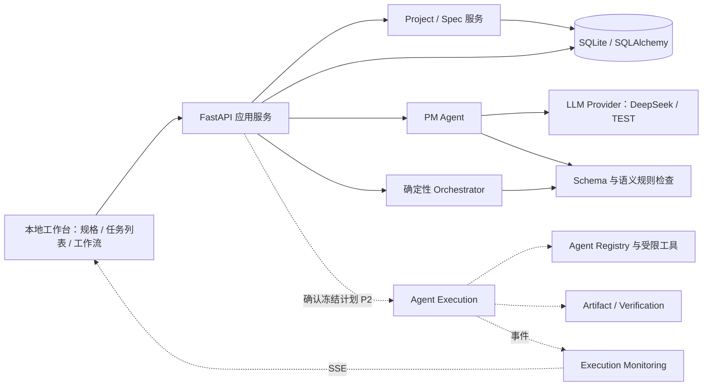
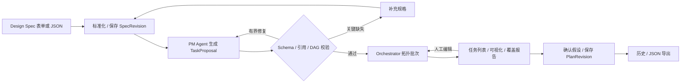
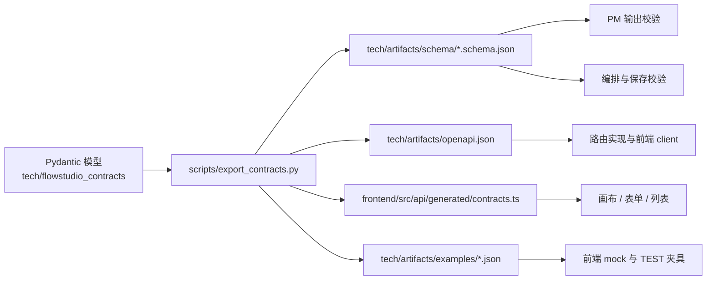
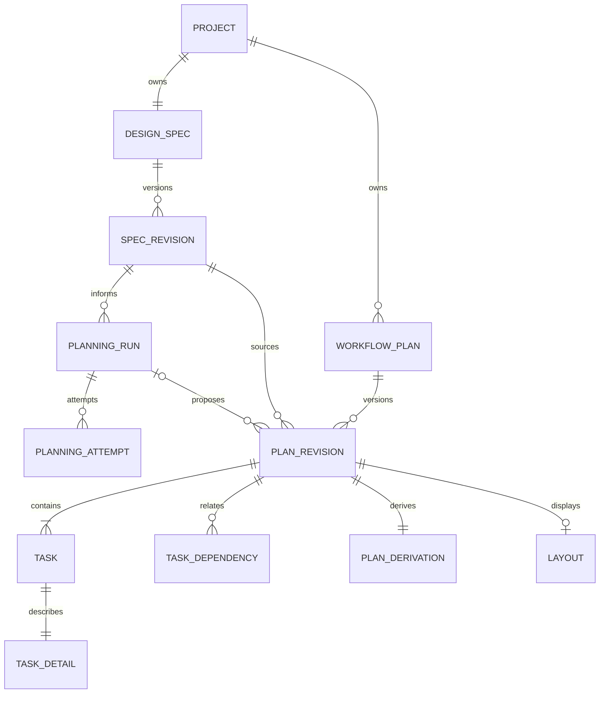

# 系统架构

> 合并自 `docs/architecture/` 下 15 篇设计文档（系统架构、模块设计、领域模型、规格模型、任务分解、
> 编排引擎、校验协议、PM Agent、接口规范、数据库、状态管理、多 Agent、通信、P2 扩展）
> 更新于 2026-11-18。契约协作见 [工程组织与契约管理](../../docs/development/PROJECT_STRUCTURE.md)。
>
> 本文描述"应该怎样"，不等于"已经跑通"。真实实现状态集中在第 14 节。

## 目录

1. [架构总览](#1-架构总览)
2. [分层与依赖规则](#2-分层与依赖规则)
3. [模块划分](#3-模块划分)
4. [领域模型与数据契约](#4-领域模型与数据契约)
5. [规格输入与规划参数](#5-规格输入与规划参数)
6. [任务分解与质量控制](#6-任务分解与质量控制)
7. [编排算法](#7-编排算法)
8. [校验与错误协议](#8-校验与错误协议)
9. [PM Agent](#9-pm-agent)
10. [接口层](#10-接口层)
11. [持久化与数据库](#11-持久化与数据库)
12. [状态管理与恢复](#12-状态管理与恢复)
13. [运行时、部署与信任边界](#13-运行时部署与信任边界)
14. [实现现状与边界](#14-实现现状与边界)
15. [P2 扩展](#15-p2-扩展)

---

## 1 架构总览

### 1.1 目标逻辑架构（虚线为 P2）



### 1.2 作业 2 目标数据流



### 1.3 契约流水线（T01 已落地）



---

## 2 分层与依赖规则

### 2.1 依赖方向

`api → application → domain/ports`；adapters 实现 ports 并由入口注入，domain 不依赖 adapters。
Validation / Orchestration 不导入 FastAPI、ORM 或 LLM SDK。

四条硬规则：

1. **单向生成**：模型 → 产物。禁止手改产物，也禁止从产物反推模型（`--check` 会失败）。
2. **契约层是叶子**：不导入 FastAPI、ORM、LLM SDK；PM、编排、API、前端只依赖契约，彼此不互相导入。
3. **派生字段服务端权威**：`edges` / `execution_stages` / `parallel_batches` / `ordered_task_ids` /
   `validation_report` 由编排器重算并随 `PlanRevision` 冻结；前端只投影，不自行推导业务顺序。
4. **布局与业务隔离**：`Layout` 独立版本、独立接口，坐标/注释/视口不参与业务顺序与计划 hash。

### 2.2 四段接口（课堂作业 2 的流程即按此切分）

| 阶段 | 冻结的 DTO | 负责 | 证据 |
|---|---|---|---|
| 输入设计规格 | `DesignSpecContent` / `SpecRevision` | A 定义，T03 入口、T02 落库 | `schema/design-spec.schema.json` |
| PM 任务分解 | `TaskProposal`+`PlanningRun` | C 实现，A 冻结结构 | `schema/task-proposal.schema.json` |
| 编排生成 | `PlanDerivation`（边/阶段/批次/报告） | D 实现，A 冻结结构 | `schema/plan-derivation.schema.json` |
| 可视化与保存 | `PlanRevision`+`Layout` | B 投影，E 落库 | `schema/plan-revision.schema.json`、`schema/layout.schema.json` |

### 2.3 数据流节点到 Schema 的映射

数据流中每个节点都落到一份已冻结的 Schema，产物一致性由 `export_contracts.py --check` 保证：

| 数据流节点 | 契约模型 | Schema 文件 | 当前状态 |
|---|---|---|---|
| Design Spec 表单或 JSON → 标准化 | `DesignSpecContent` | `design-spec.schema.json` | 前端入口、API 校验和 SpecRevision 保存已实现 |
| 保存 SpecRevision | `SpecRevision` | `spec-revision.schema.json` | SQLite 不可变版本、CAS 与幂等已实现 |
| PM Agent 生成 TaskProposal | `TaskProposal` | `task-proposal.schema.json` | DeepSeek REAL、显式 TEST fixture、预算与修复已实现 |
| 规划运行与失败 | `PlanningRun`、`PlanningRunCreated`、`ErrorEnvelope` | `planning-run.schema.json`、`planning-run-created.schema.json`、`error-envelope.schema.json` | 路由、队列、轮询、失败与重启恢复已实现 |
| Schema / 引用 / DAG 校验 | `ValidationReport` | `validation-report.schema.json` | 前后端共用规则，T05 服务端实现与坏图验收通过 |
| Orchestrator 拓扑批次 | `PlanDerivation` | `plan-derivation.schema.json` | T05 纯函数与 HTTP 编排已实现，Q02 实测通过 |
| 保存 PlanRevision | `PlanRevision` | `plan-revision.schema.json` | CAS、事务、来源和假设确认已实现 |
| 布局与视口 | `Layout` | `layout.schema.json` | 独立 revision、读取、PUT 与 409 冲突已实现 |
| 历史导出 | `ExportBundle` | `export-bundle.schema.json` | JSON 快照、规格和 policy 导出已实现 |
| 规划参数 | `PlanningPolicy` | `planning-policy.schema.json` | 参数解析、快照与规则应用已实现 |
| 项目容器 | `Project` | `project.schema.json` | 创建、分页读取与项目隔离已实现 |

接口层同一份契约导出为 `artifacts/openapi.json`（OpenAPI 3.1.0，6 个 tag、18 个操作、60 个组件），
引用无悬空、无未使用组件。

---

## 3 模块划分

| 模块 | 职责 / 输入 → 输出 | 接口 / 内部数据 | 依赖 | 异常 / 测试 |
|---|---|---|---|---|
| Project | 工作区和归档 | create_project(name)→Project；UUID+名称 | Repository | 空名/重复请求；两项目隔离 |
| Design Spec | 规范化/版本/校验；content→SpecRevision | normalize/validate/save(expected_revision)；Requirement map | Validation、Repository | 必填/重复 ID/409；往返和版本测试 |
| PM Agent | 规格语义→TaskProposal | plan(spec,config)；Prompt、尝试账本 | Provider、Validation | 缺信息/非法 JSON；fixture+REAL 评审 |
| Task Decomposition | 候选质量与覆盖 | assess(tasks,spec,policy)→Report；需求反向索引 | domain DTO | 漏需求/重复；变异案例 |
| Orchestration | 合法任务→DAG 批次 | build_plan(...)；邻接表/入度表 | Validation | 环/非法阶段；菱形/多根/环性质测试 |
| Workflow Validation | 可复用硬规则与 warning | validate(...)->ValidationReport；rule registry | domain DTO | 字段路径；规则边界测试 |
| Visualization | 业务 DTO→React Flow 投影及草稿命令 | toCanvas/fromDraft；稳定 task map、layout | generated types、REST client | 陈旧响应/冲突；组件及 E2E |
| Persistence | 原子快照/CAS/历史/迁移 | UnitOfWork、SpecRepo、PlanRepo、PlanningRepo | SQLAlchemy/SQLite | 锁/事务回滚；临时库集成 |
| LLM Provider | 传输/错误/usage 标准化 | complete_json(...)->LLMResponse | HTTPS SDK | 401/429/timeout/empty；模拟传输 |
| PlanningPolicy | 解析可选规划限制 | resolve(optional_policy)→snapshot；缺省不限制业务阶段/角色 | Validation | 配置矛盾；参数约束测试 |

**P2 扩展接口**（只保留设计，不新增空运行框架占位代码）：

- `AgentRegistry.resolve(role_id,version)→{capabilities,input_schema,output_schema,tool_policy}`
- `AgentExecution.execute(task,input_manifest,context)→ArtifactRef[]`
- `ArtifactStore.put(attempt_id,content,schema)→{id,hash}`
- `Monitoring.append(event)→seq`
- `Verification.check(plan,artifact_refs)→{verdict,findings,evidence_refs}`

业务应用层连接接口，不允许 Agent 反向调用数据库修改 Run 状态。工具能力未定义前不开放任意 shell。

---

## 4 领域模型与数据契约

本节为字段、状态和版本的唯一语义来源；结构约束由 `tech/flowstudio_contracts` 的 Pydantic 模型
执行并导出 Schema，业务图约束见第 8 节。

### 4.1 实体

| 实体 | 标识和主要字段 | 生命周期/关系 |
|---|---|---|
| Project | id(UUID), name, archived_at?, created_at | 本地产品工作区 |
| DesignSpec | id, project_id, latest_revision | 逻辑规格身份 |
| SpecRevision | id, spec_id, revision(int≥1), content:DesignSpecContent, hash, created_at | 不可变；DesignSpecVersion 同义名 |
| PlanningPolicy | schema_version, rules_version, allowed_stages?, allowed_roles?, allowed_categories?, allowed_stage_edges?, required_categories | 可选值对象；默认无额外限制，随请求保存快照 |
| PlanningRun | id, spec_revision_id, config_snapshot, mode:REAL/TEST, status, attempt_count(0–3), fixture_id?, usage?, error?, proposal?, validation_report?, created_at, started_at?, finished_at? | 单次规划请求及诊断；状态与 proposal/report/error 的一致性由契约强制 |
| WorkflowPlan | id, project_id, latest_revision | 计划身份 |
| PlanRevision | id, plan_id, revision, spec_revision_id, planning_run_id?, parent_revision_id?, policy_snapshot, source:AI/TEST/MANUAL, origin_mode:REAL/TEST/NONE, confirmed_assumption_ids, tasks, edges, execution_stages, parallel_batches, ordered_task_ids, validation_report, hash, created_at | WorkflowVersion 同义名；不可变已保存快照 |
| Task | 计划内稳定 task_id；详见第 6 节 | 不携带真实执行状态 |
| TaskDependency | revision_id, source_task_id, target_task_id | 由 tasks.dependencies 派生 |
| ValidationReport | valid:boolean, errors:Issue[], warnings:Issue[], coverage:{covered_ids,uncovered_ids}, rules_version, input_hash | 报告只适用于给定输入 |
| Layout | plan_revision_id, revision, positions, notes, viewport | 独立可更新，不改变计划 hash |
| Run / TaskRun / Artifact | 绑定 PlanRevision；实际执行和产物 | 仅 P2，不能与 PlanningRun 合并 |

所有全局 ID 为 UUID，task/requirement 内 ID 是受约束字符串；UTC RFC3339 时间；
业务 JSON 按键排序、无多余空格、UTF-8 规范化后 SHA-256。

hash 包括规格引用、任务、规划约束快照、来源、origin_mode、confirmed_assumption_ids；
排除 ID、创建时间、layout、报告生成时间和运行信息。

建议 JSON 导出同时带 spec_snapshot、policy_snapshot，便于离线解释；导入为新项目/计划时新建全局 ID，
保留内部 task_id 和原始来源信息。

### 4.2 关系事实源

`tasks[].dependencies` 是输入唯一事实源：`B.dependencies=["A"]` 表示 A→B；
响应 edges 为 `{source:"A",target:"B"}`。客户端不能提交派生 edges/order 作为权威，服务端重新计算。

`execution_stages=[{stage_id,task_ids}]` 来自任务 stage；`parallel_batches` 是拓扑层，可跨多个业务阶段。
批次内 task_id 排序；`ordered_task_ids` 为逐层展平。

P0 不定义通用条件边、循环边和 handoff 边。注释、阶段容器、虚拟起止标记均非业务任务，
不能计入覆盖率/拓扑。

输入引用使用直接依赖，一致性校验拒绝仅有祖先关系的隐式取值；需补充直接依赖再保存。

### 4.3 状态定义

PlanningRun：`QUEUED → RUNNING → SUCCEEDED / NEEDS_INPUT / FAILED`。

- SUCCEEDED 代表候选通过结构与图校验，**不代表**用户接受假设或任务已执行。
- NEEDS_INPUT 保存问题；FAILED 保存原始诊断。重试新建 PlanningRun，旧记录不变。

UI 草稿状态：`dirty / validating / valid / invalid`；来源是否旧版是独立 `outdated` 标识。
PlanRevision 只保存有效且假设已确认的版本。无效草稿可保留在本地但不能成为正式 PlanRevision。

后续 Run 状态见第 15 节，当前画布绝不给未执行节点标 COMPLETED。

### 4.4 版本与并发

- 保存新规格/计划用 `expected_revision`。事务 compare-and-swap `latest_revision`，失败返回 409 并携当前版本；不自动覆盖。
- 重新生成的 PlanningRun 不自动移动计划 head，用户确认保存才新建版本。网络重复命令由 `Idempotency-Key` 去重。
- 修改布局用独立 layout revision；历史业务只读，编辑历史先复制成新候选；以当前 head 为 `expected_revision`、历史为 `parent_revision_id`。
- 规格变更不自动把已有任务改名；旧计划仍可读，重新生成并人工比较。
- 旧前端 `id/title/depends_on` 映射到 `task_id/name/dependencies`；缺角色、需求和交付字段的旧草稿进入待补全候选，禁止直接判定为有效计划。

### 4.5 保存与来源不变量

PlanRevision 同时保存 `confirmed_assumption_ids` 和 `origin_mode`（REAL/TEST/NONE）；
MANUAL 只表示经过人工编辑，不能抹掉 TEST 起源。保存请求携 `planning_run_id` 时核对项目、规格和 policy 一致。

阶段展示顺序按该阶段最早拓扑层、再 `stage_id` 稳定排序，不把阶段名当算法枚举。
所有输出排序确定；无额外 policy 时允许 PM 提出不同阶段/角色。

---

## 5 规格输入与规划参数

### 5.1 规格输入契约

实体 `Project → DesignSpec → SpecRevision`。一个项目当前一个主规格；未来可多个。
SpecRevision 即 DesignSpecVersion，不另设表。机器可读定义见
`tech/artifacts/schema/design-spec.schema.json`（由 `flowstudio_contracts/spec.py` 生成），
不附产品案例或预设模板。所有写接口拒绝未知字段，字符串 trim 后检查非空。

| 字段 | 类型与限制 | 含义 |
|---|---|---|
| schema_version | const "1.0" | 导入格式版本 |
| product_name | string 1–120 | 产品名仅作为背景，不路由固定任务 |
| background | string 1–4000 | 业务背景 |
| goals / target_users | string[]，1–20 | 目标与用户 |
| requirements | Requirement[]，1–200 | 功能与非功能统一追踪 |
| technical_constraints / development_constraints | string[]，0–30 | 技术及人员/时间约束 |
| delivery_requirements / acceptance_criteria | string[]，1–30 | 交付及整体验收 |
| supplemental_text | string，0–12000 | 补充原文，不自动覆盖结构化字段 |
| confirmed_assumptions | string[]，0–30 | 用户确认后的假设原文 |

`Requirement = {id: string 1–64，pattern ^[A-Za-z][A-Za-z0-9_-]*$; kind: functional/nonfunctional;
text: 1–2000; priority: must/should/could; acceptance_criteria: string[1..20]}`。
ID 在同一版本唯一，修改正文保留 ID，新增需求新 ID；删除需求不能让旧计划引用漂移。

提交规范化前后均限制请求体 1 MiB；长度按 Unicode 字符计，禁止控制字符，换行可保留。
无文件路径、代码执行和密钥字段。

### 5.2 编辑和质量

1. 空表单可以作为浏览器本地草稿；保存正式 SpecRevision 需通过结构校验。
2. 导入仅接受 UTF-8 JSON，先预览字段差异再保存；拒绝重复 JSON key、不支持的版本和超限。
3. 确定性检查必填、ID 唯一、验收项；自然语言模糊/冲突用建议问题和人工审查，不宣称规则能理解全部矛盾。
4. 关键冲突（例如同时要求"完全离线"与"只用云 API"）由 PM 返回 `blocking_questions`，阻止形成正式计划。
   用户补充后保存新规格并发起新 PlanningRun。
5. 非关键假设随候选显示；确认保存必须提交确认的 assumption ID。用户拒绝则修改规格重规划或人工改计划，
   不自动补业务功能。
6. 重新规划不覆盖旧版。当前规格变更只使旧版来源显示 outdated，不改变旧版 validity。

### 5.3 通用规划参数（无预设模板）

`PlanningConfig = {model:string, granularity:coarse/standard/fine, planning_constraints:string[],
policy?:PlanningPolicy}`。

`PlanningPolicy = {schema_version:"1.0", rules_version:"1.0", allowed_stages:string[]|null,
allowed_roles:string[]|null, allowed_categories:string[]|null, allowed_stage_edges:{from,to}[]|null,
required_categories:string[]}`。

policy 省略时使用通用规则：字段合法、引用完整、DAG、需求覆盖；所有 `allowed_*` 为 null，
`required_categories` 为空，不内置业务阶段、角色链或具体任务。

- null 表示不额外限制，非 null 空数组表示不允许任何值，若配置导致无法生成任务则报 `POLICY_UNSATISFIABLE`。
- 同阶段依赖仍允许；跨阶段在设置 `allowed_stage_edges` 后检查允许集合。
- PM 依据用户规格提出 stage/category/assigned_role，均为稳定非空标识；前端展示原标签，未知标签使用中性色。
- 粒度 coarse/standard/fine 为不同任务拆分详细度，不强制固定数量，硬上限 100。
- 完整解析后的配置快照进入 PlanningRun/PlanRevision。Prompt/规则版本随记录保存，旧历史不被新配置覆盖。
- 未来可增加 `WorkflowTemplate.resolve(id,version)→PlanningPolicy` 适配器；本轮只保留此扩展边界，
  不建立模板库、模板接口或预设模板文件。

**后续输入**：Markdown、PDF、Word 仅在 P2 作为解析器输出本契约的候选；解析器必须附缺失信息和来源段落，
用户确认后保存，不能绕过同一校验。

---

## 6 任务分解与质量控制

### 6.1 Task 严格结构

机器定义见 `tech/artifacts/schema/task-proposal.schema.json`（由 Pydantic 生成）；
所有属性 required，只有 `estimated_effort` 可 null。数组上限见 Schema，任务总数 1–100。

| 字段 | 类型 / 校验 |
|---|---|
| task_id | string 1–64，字母起始，仅字母数字下划线横线，计划内唯一 |
| name / description | string 1–120 / 1–4000，trim 后非空 |
| category / stage / assigned_role | string 1–64，未设置枚举限制时接受非空标识；设置限制时须在允许集合内；角色只是建议 |
| priority | high / medium / low（区别需求 P0 和 must） |
| dependencies | task_id[]，唯一，无自己，均存在 |
| inputs | InputRef[]：kind=spec 时 `{kind,requirement_id}`；kind=task 时 `{kind,task_id,deliverable_id}` |
| deliverables | `{id:string,text:string}[]`，至少 1；id 在任务内唯一 |
| acceptance_criteria | string[]，至少 1，描述可观察结果 |
| source_requirement_ids | 需求 ID[]；引用必须存在；允许为空仅限有明确过程依据的任务 |
| rationale | string，空需求引用时必须非空，解释过程依据 |
| assumptions | `{id,text,impact:low/critical}[]`；全计划 ID 唯一 |
| estimated_effort | null 或 `{min_hours,max_hours,basis,is_estimate:true}`；0<min≤max，有依据 |

InputRef 是规划阶段的成果引用，非实际文件地址。未来运行适配再补 `schema_id`、`artifact_key`、
`json_pointer`，不把尚不存在的成果当已生成。

`TaskProposal = {schema_version:"1.0", tasks:Task[], blocking_questions:string[]}`；
有阻断问题可 `tasks=[]`。任务合理性并非 JSON Schema 自动保证。

### 6.2 质量流水线

1. 严格解析 JSON/Schema；禁止未知字段、运行状态和脚本字段。
2. 结构：唯一 ID、依赖、阶段、角色、输入引用、交付 ID、DAG。
3. 覆盖：构建 `requirement_id→task_ids`。must 无引用为阻断；should/could 无引用为 warning。
   引用存在只是"已关联"，不等于实质完成。
4. 重复：名称标准化后完全相同或交付文本相同给 warning；相似语义由人工确认，不按相似度自动删任务。
5. 粒度：一个任务应有单一主要交付及可验收目标。跨多个无关领域或"完成整个产品"由人工标记过大；
   只改一个词无独立交付标过细。
6. 规划约束 `required_categories` 均需出现；过程任务需 rationale，不强制伪造需求 ID。
7. 模型修复携原始规格、候选和字段错误，调用数总计最多三次。即使修复成功仍需用户查看覆盖和假设。
8. 人工增加、删除、改依赖沿用相同验证器，不得给 UI 建立宽松旁路。

不以固定节点数要求不同规格产生一样计划；任务数量仅辅助观测。结构错误为硬失败，语义评审见测试标准。

---

## 7 编排算法

### 7.1 定位

当前编排器是无模型、无数据库副作用的纯函数：

```text
build_plan(tasks, spec, policy) -> {edges, execution_stages, parallel_batches, ordered_task_ids, validation_report}
```

只有通过校验的结果可形成 PlanRevision。未来调度器消费冻结计划，见第 15 节；不在此混入 LangGraph 执行。

### 7.2 图语义和阶段

每个 Task 为顶点，依赖 A→B 表示 B 必须等待 A。多个父节点为 AND 汇合。无条件、循环或 OR 分支。

阶段是开发活动分类，拓扑层是依赖计算结果；阶段标签不隐式产生依赖。若提供跨阶段关系约束则必须满足，
用户需改 stage 或依赖，不能通过布局修复。

支持多个根/叶节点和独立组件；不要求全部任务从某个业务起点可达。孤立任务有规格/过程依据则合法，
缺依据给警告；选定交付目标时才检查其祖先覆盖，不随意删除未关联任务。

### 7.3 算法伪代码

```text
build(tasks, spec, policy):
  validate_sizes_and_schema()
  id_map = unique_map(tasks.task_id)     # 重复立即返回带字段路径错误
  indegree = {id: 0}; outgoing = {id: []}
  for task in tasks:
    validate_role_stage_category_and_requirement_refs(task)
    seen = set()
    for dep in task.dependencies:
      reject missing / self / duplicate dependency
      validate_allowed_stage_transition(dep, task)
      outgoing[dep].append(task.id)
      indegree[task.id] += 1
    validate_inputs_and_deliverables(task, id_map) # task 输入须直接依赖
  if errors: return invalid_report
  frontier = sorted(all ids whose indegree == 0)
  batches = []; count = 0
  while frontier:
    batch = frontier                     # 本轮集合冻结
    batches.append(batch); count += len(batch)
    next_frontier = []
    for u in batch:
      for v in outgoing[u]:
        indegree[v] -= 1
        if indegree[v] == 0: next_frontier.append(v)
    frontier = sorted(next_frontier)
  if count != len(tasks):
    cycle = iterative_three_color_DFS(unprocessed_subgraph)
    return CYCLE with actual cycle task_ids and edges
  check_requirement_coverage_and_required_categories()
  check_orphans_and_duplicate_titles_as_warnings()
  return edges, group_by_stage(tasks), batches, flatten(batches), report
```

Kahn 未处理集合包含环的下游，不得全部标为"环上的节点"；三色 DFS 只报告回边及栈内实际环，UI 定位那组边。

一个菱形：A→B、A→C、B→D、C→D，结果 `[[A],[B,C],[D]]`；不能把逐个入队序列误当并行批次。
空任务（无阻断问题）非法；仅一个有据任务合法。

### 7.4 复杂度与重建

建图/Kahn/DFS `O(V+E)`，稳定排序使总上界 `O(V log V + E)`，空间 `O(V+E)`；
引用及覆盖额外 `O(R+I)`，R 为需求数、I 为引用数。精确重复文本散列 `O(文本总长)`，不做全对全 LLM 比较。

P0 上限 100 tasks / 1000 edges；编辑后全量重算，避免增量缓存失效复杂度。前端立即检查连线错误，
服务端最终全量检查。

修改 task/依赖标 dirty，旧批次显示"待重新编排"。请求携草稿 hash，响应 hash 不匹配当前草稿则丢弃显示，
避免慢请求覆盖新图。

模型提出的顺序不是事实源；无耗时依据不显示关键路径时间。批次是静态依赖并行机会，不是资源调度承诺。

---

## 8 校验与错误协议

`Issue = {code, severity:error/warning, path, message, task_ids:string[], edges:{source,target}[], suggestion}`。

`path` 使用 JSON Pointer，例如 `/tasks/2/dependencies/0`。报告绑定 `input_hash` / `rules_version`，
过期报告不能作为保存凭证。

| 错误码 | 示例 | 处置 |
|---|---|---|
| SPEC_REQUIRED | goals=[] | 规格页定位字段；阻止模型调用 |
| DUPLICATE_ID | 两个 task_id=A | 人工或模型重命名并更新引用 |
| MISSING_DEPENDENCY | B 依赖不存在的 X | 修正 ID 或补任务，不静默删边 |
| SELF_DEPENDENCY | A 依赖 A | 高亮自环并删除错误关系 |
| DUPLICATE_DEPENDENCY | B=[A,A] | 提示去重后重编排，不静默覆盖原输入 |
| CYCLE | A→B→A | 返回实际环，人工修复 |
| INVALID_STAGE / ROLE / CATEGORY | stage 不满足显式约束 | 改任务或规划约束，不编造新配置 |
| STAGE_EDGE_FORBIDDEN | 跨阶段依赖不满足显式约束 | 修依赖/阶段；不改变显示位置掩盖错误 |
| MISSING_INPUT | B 引用 A 不存在的 deliverable | 选择现有交付 ID 或更新生产者 |
| INPUT_NOT_DEPENDENCY | B 读取 A 成果但未依赖 A | 原子添加直接依赖并重校验 |
| UNKNOWN_REQUIREMENT | 引用旧版删除的需求 | 选择来源规格中的合法 ID |
| REQUIRED_UNCOVERED | must 需求没有任何任务引用 | 增补任务；是否实质覆盖需人工评审 |
| REQUIRED_CATEGORY | 指定必需类别却未出现 | 增补带验收任务 |
| UNCONFIRMED_ASSUMPTION | 保存未确认 low 假设 | 显示假设并请求确认 |
| CRITICAL_ASSUMPTION | 缺关键权限/范围仍推断 | 返回 NEEDS_INPUT，要求新规格 |
| POSSIBLE_DUPLICATE / ORPHAN | 标题相同或孤立任务 | warning；人工解释或修正 |
| REVISION_CONFLICT | expected_revision 过期 | 409；保留本地编辑，比较后重提 |

`validation.valid` 仅指 `errors=[]`；warnings 可存在。缺陷位置、字段名可定位，错误不只写"规划失败"。

结构/图/输入引用失败不可用户强制忽略。语义合理性以人工评审记录体现，不让模型评分覆盖硬错误。

规则用版本化纯函数注册表 `{rule_id,version,severity,check}`，规划参数仅配置已注册规则及参数，
不执行导入字符串。

---

## 9 PM Agent

### 9.1 边界与接口

PM 理解已有规格并提出开发任务、交付、依赖、角色及假设，不执行工具、不写项目代码、不决定最终合法性。

```text
async plan(spec: SpecRevision, config: PlanningConfig, provider: LLMProvider) -> TaskProposal
Provider.complete_json(messages, model, max_tokens, timeout) -> {content, usage, provider_request_id, finish_reason}
```

编排与持久化不依赖具体 SDK；DeepSeekAdapter 与 TestFixtureProvider 实现接口，
TEST 请求只能选择明确 `fixture_id`，未知 fixture 拒绝。

### 9.2 Prompt 合成

通用系统指令（版本 pm-v1）：

> 你是软件开发规划 PM。输入是已经提供的设计规格，不重新替用户定义产品。只输出符合 TaskProposal Schema 的 JSON。
> 逐需求安排可验收任务，source_requirement_ids 引用输入 ID。可选规划配置只能限制过程，不能替代产品功能。
> 不要编造重要需求，关键缺失放 blocking_questions；非关键推断放 assumptions。dependencies 只引用候选任务。
> 建议并行关系由独立编排器验证。不得输出执行结果或真实运行状态。

用户消息包含 JSON 编码 `spec.content`、可选规划约束快照、粒度、规划限制和输出 Schema；
不注入固定产品任务或预设流程。

规格与补充文本视为数据，不能覆盖系统输出约束；不使用 eval 或从模型输出导入代码。

记录完整输入快照与 Prompt hash，而不记录隐藏推理；模型名、参数、provider request ID、响应、usage
和校验诊断可追踪。密钥不进入快照。

### 9.3 编排调用与失败

创建 PlanningRun 持久化 QUEUED 后进入本进程单规划队列；领取为 RUNNING。模型请求在数据库事务外。

先验证 TaskProposal 结构；合法结构中存在 `blocking_questions` 或 critical assumption 时直接 NEEDS_INPUT，
不对空任务集做正式 DAG 校验。没有阻断问题时再做任务/图校验，通过后 SUCCEEDED；
格式/网络/预算失败或有界修复耗尽则 FAILED。

候选不自动保存正式 PlanRevision。保存时重新验证 hash 和假设确认；编辑后由 MANUAL 来源保留 `planning_run_id`。

- 规划调用硬上限三次（首次+修复/传输重试共享），单次超时 60 秒，从领取开始总截止 180 秒
  （每次请求超时取 60 秒与剩余截止时间的较小值）；429/暂时 5xx 可退避一次 1–3 秒，401 不重试。
- 取消当前 HTTP 查询不取消后台请求。
- 输出上限默认 8192 token，输入按模型能力预检；总预留 40000 token/PlanningRun。
  请求前预留，usage 未返回按预留扣账并显示未知。模型/价格配置可修改，未配置价格不报精确费用。
- 超限、截断、空白响应、非法 JSON 分别输出 `MODEL_BUDGET` / `MODEL_TRUNCATED` / `MODEL_EMPTY` / `MODEL_SCHEMA`。
  网络失败不能伪造 fixture 结果。
- 进程退出导致未终结 PlanningRun 在重启时 `FAILED(PROCESS_INTERRUPTED)`，不自动再次产生费用；手动重试新 ID。

### 9.4 可配置与验证

参数只来自已验证的规划配置和请求快照，模型名从服务端 allowlist 选择；API Key 服务端环境变量读取。

P0 直接 Provider+Pydantic；LangChain 为需要多模型兼容时的备选，不同时装两套编排运行时。

[DeepSeek 官方 JSON 输出](https://api-docs.deepseek.com/guides/json_mode/) 说明格式模式与截断/空内容处理；
业务 Schema 和语义质量由本系统额外校验。

实施阶段对用户实际提供的不同规格做 REAL 验证，并改变单项需求和粒度做变异检查；不新增产品案例或预设模板。
保存真实响应，不要求同一模型重复生成字节相同。

---

## 10 接口层

### 10.1 通用协议

前缀 `/api/v1`；JSON UTF-8；最大请求 1 MiB。下表已实现为可执行契约（`tech/artifacts/openapi.json`），
FastAPI 路由、事务/CAS、幂等和错误信封均已接入，并由运行时 OpenAPI 漂移检查守卫。

UUID 路径必须合法，版本整数 ≥1；分页 limit 默认 20 / max 100，cursor 不透明；未知字段 422。

错误体 `{error:{code,message,issues:Issue[],request_id}}`；404 NOT_FOUND，403 ORIGIN_FORBIDDEN，
409 REVISION_CONFLICT / IDEMPOTENCY_CONFLICT / RESULT_NOT_READY，413 PAYLOAD_TOO_LARGE，
422 VALIDATION_FAILED，429 QUEUE_FULL，503 STORAGE_BUSY。

异步模型错误写 `PlanningRun.error`，查询仍 200；不存在记录才 404。客户端不得把查询 200 当规划成功。

写命令携 `Idempotency-Key`（UUID 字符串）。同 scope/key 与规范化 body hash 返回原结果；同键异内容 409。
校验失败不占用键；提交后断线可同键重试。

scope 为 HTTP 方法+资源路径。GET 不产生新版本。无用户鉴权系统，loopback + Origin/Host 检查，不作为公网服务。

### 10.2 资源接口

| 方法与路径 | 请求 | 成功响应 / 失败条件 |
|---|---|---|
| POST /projects | `{name:string 1..120}` | 201 Project |
| GET /projects | `?limit&cursor` | 200 `{items:Project[], next_cursor:null/string}` |
| POST /projects/{id}/spec-revisions | `{expected_revision:int≥0, content:DesignSpecContent}` | 201 SpecRevision；初次 expected=0，冲突 409 |
| GET /projects/{id}/spec-revisions | 分页 | 200 `{items:SpecRevision[], next_cursor}` |
| GET /spec-revisions/{id} | 无 | 200 SpecRevision |
| POST /spec-validations | `{content:DesignSpecContent}` | 200 ValidationReport；不能解析请求则 422 |
| POST /planning-runs | `{spec_revision_id, mode, config:{granularity, model, planning_constraints, policy?}, fixture_id?}` | 202 `{id, status:"QUEUED", poll_url}`；TEST 必须 fixture，REAL 禁止 fixture |
| GET /planning-runs/{id} | 无 | 200 PlanningRun，proposal/report 可空，终态附结果或 error |
| GET /planning-runs/{id}/tasks | 无 | 200 `{tasks:Task[]}`；未 SUCCEEDED 返回 409 RESULT_NOT_READY |
| POST /orchestrations | `{spec_revision_id, policy?, tasks:Task[]}` | 200 `{input_hash, edges, execution_stages, parallel_batches, ordered_task_ids, validation_report}`；无效仍 200 `report.valid=false`，派生结果空 |
| POST /workflow-validations | 同上 | 200 ValidationReport（复用同一 build，不复制规则） |
| POST /projects/{id}/plans | `{spec_revision_id, planning_run_id?, policy?, tasks, confirmed_assumption_ids:[], layout?}` | 201 `{plan_id, revision:PlanRevision}`；来源服务端推导，重算后不合法 422 |
| POST /plans/{id}/revisions | 上述字段+`{expected_revision, parent_revision_id}` | 201 PlanRevision；409 冲突 / 422 不合法 |
| GET /plans/{id}/revisions | 分页 | 200 `{items:PlanRevision 摘要[], next_cursor}` |
| GET /plan-revisions/{id} | 无 | 200 PlanRevision，包含 Task 与派生结果 |
| GET /plan-revisions/{id}/layout | 无 | 200 Layout，缺省 `layout revision=0` |
| PUT /plan-revisions/{id}/layout | `{expected_revision, positions, notes, viewport}` | 200 Layout，独立 CAS；坐标有限数、task 必须存在 |
| GET /plan-revisions/{id}/export | `?format=json` | 200 ExportBundle，Content-Disposition attachment；含 Schema 版本、来源与规格/规划约束快照 |

`ExportBundle = {schema_version:"1.0", spec_snapshot, policy_snapshot, plan_revision, layout}`。

P0 导入规格 JSON 和导出计划 JSON；完整计划包的再次导入为 P1，走校验并重建全局 ID，
不能直接信任包内派生字段。

### 10.3 请求示例与回放

以下 UUID 为示例，实际使用前一步返回值。规格 body 由用户输入并符合 DesignSpecContent Schema。

```json
{"spec_revision_id":"11111111-1111-4111-8111-111111111111","mode":"REAL","config":{"granularity":"standard","model":"configured-default","planning_constraints":[]}}
```

`model="configured-default"` 是本系统解析的配置别名，服务端解析并持久化实际模型名，不直接发给供应商。

```json
{"id":"22222222-2222-4222-8222-222222222222","status":"QUEUED","poll_url":"/api/v1/planning-runs/22222222-2222-4222-8222-222222222222"}
```

终态 SUCCEEDED：响应含 proposal（TaskProposal）、validation_report、mode、spec_revision_id、
config_snapshot、attempt_count、usage。NEEDS_INPUT 的 proposal 含 blocking_questions；
FAILED 的 error 包含 code/message，可返回部分响应仅供诊断，不能保存为正式计划。

图校验示例：

```json
{"valid":false,"errors":[{"code":"MISSING_DEPENDENCY","severity":"error","path":"/tasks/1/dependencies/0","message":"任务 B 引用了不存在的 X","task_ids":["B"],"edges":[{"source":"X","target":"B"}],"suggestion":"修正引用或补充任务 X"}],"warnings":[],"coverage":{"covered_ids":[],"uncovered_ids":["FR-01"]},"rules_version":"1.0","input_hash":"0000000000000000000000000000000000000000000000000000000000000000"}
```

`input_hash` 示例为 64 个 0，真实响应使用规范化输入的 SHA-256。

保存请求只提交任务与来源，不提交 validity/batches/source。服务端比对 `PlanningRun.proposal`：
相同且 mode=REAL→AI，相同 TEST→TEST，发生人工变化→MANUAL，同时保留 origin_mode 和 planning_run_id，
不能洗掉 TEST 来源。

网络失败先以同幂等键重发；409 展示最新版本及本地差异；422 保留草稿并定位。

SpecRevision、Task 和派生字段以第 4 节领域模型为唯一结构定义。

### 10.4 保存一致性补充

若携 `planning_run_id`，服务端验证其状态、项目、spec_revision_id 及解析后的 policy 与请求一致；
不一致 422 `SOURCE_MISMATCH`。未携时来源 MANUAL、origin_mode=NONE。人工修改旧 TEST 候选仍保留 origin_mode=TEST。

所有 derived 字段服务端重算，用户提交的确认 ID 必须与当前候选 low 假设集合精确对应，critical 假设阻断。

---

## 11 持久化与数据库

SQLite + SQLAlchemy + Alembic，`foreign_keys=ON`，WAL，`busy_timeout=5000ms`。短事务，模型调用在事务外。
时间 UTC；UUID 存 TEXT；JSON 需应用 Schema 验证和 `json_valid` 检查。

### 11.1 表与约束

| 表 | 关键列与约束 / 索引 |
|---|---|
| projects | id PK, name, archived_at, created_at |
| specs | id PK, project_id FK UNIQUE, latest_revision |
| spec_revisions | id PK, spec_id FK, revision, content_json, hash, created_at；UNIQUE(spec_id,revision) |
| planning_runs | id PK, spec_revision_id FK, status CHECK, mode CHECK, config_json, proposal_json?, error_json?, usage_json?, attempt_count, created_at；索引(status,created_at) |
| planning_attempts | (planning_run_id,attempt_no) PK, request_hash, response_json/text, usage_json, error_json, timestamps；不保存 Key |
| plans | id PK, project_id FK, latest_revision |
| plan_revisions | id PK, plan_id FK, revision, spec_revision_id FK, planning_run_id FK nullable, parent_revision_id FK nullable, policy_json, source, origin_mode, confirmed_assumption_ids_json, hash, created_at；UNIQUE(plan_id,revision) |
| tasks | (revision_id,task_id) PK, name, description, category, stage, priority, assigned_role, rationale, effort_json?；按 revision_id/stage 索引 |
| task_dependencies | (revision_id,source_task_id,target_task_id) PK；两端复合 FK → tasks；CHECK source≠target |
| task_details | (revision_id,task_id) PK/FK, inputs_json, deliverables_json, acceptance_json, requirement_ids_json, assumptions_json；一对一结构化详情 |
| plan_derivations | revision_id PK/FK, stages_json, batches_json, order_json, report_json, rules_version；派生缓存 |
| layouts | plan_revision_id PK/FK, revision, positions_json, notes_json, viewport_json |
| commands | (scope,idempotency_key) PK, request_hash, result_json, created_at；持久重试去重 |

任务和依赖单独关系表，以数据库约束保护引用；规格、规划配置和任务内部短数组使用 JSON，
避免每条字符串都建表，也不把整个系统塞进一个 JSON。

完整候选 `proposal_json` 保留模型输出审计；正式任务从规范化表读取，候选不是第二个可编辑事实源。

### 11.2 保存事务

校验在事务外计算候选及 `input_hash`；事务内重查 spec 存在及配置合法、比较 `expected_revision`，
插入快照、tasks/details、dependencies、derivations、layout 与 command，再 CAS 更新 head。

所有成功或全部回滚；UNIQUE 防并发同版本。409 返回 `current_revision`；数据库忙超过 5 秒返回
503 STORAGE_BUSY，不报告保存成功。

项目与规格归档不级联删除历史。P0 无硬删除接口。plan 与 spec 必须属于同 project，由服务校验。

任务依赖复合 FK 保证不能跨版本引用。环/需求 JSON 引用由纯验证器负责；库约束不能替代业务检查。

### 11.3 ER



### 11.4 迁移与恢复

每次模型/索引变化单独 Alembic revision；测试空库升级和上一版本升级；发布前 SQLite backup API 备份，
不能只复制活跃 WAL 主文件。

生产失败恢复备份，不承诺所有降级脚本可保留新数据。数据库、密钥和日志不提交 Git。

启动检测版本与完整性；旧 CLI 库独立保留，不能原地解释为新 Schema。

P2 新增 runs/task_runs/attempts/artifacts/events/approvals；规划表不迁移成执行表。

---

## 12 状态管理与恢复

当前 PlanningRun 和计划草稿状态唯一来源见第 4.3 节。

PlanningRun 持久化后异步处理；重启将 QUEUED/RUNNING 标为 `FAILED(PROCESS_INTERRUPTED)`，
不自动重发模型请求。SUCCEEDED/NEEDS_INPUT/FAILED 不可再变更，重试创建新请求。

**P2 执行状态**

Run：`CREATED → RUNNING → REVIEWING → COMPLETED`；RUNNING/REVIEWING 可进入 WAITING_HUMAN，
批准后恢复原阶段，拒绝/超时为 FAILED；所有活动状态可 CANCELED；异常退出为 FAILED(PROCESS_INTERRUPTED)。

TaskRun：`PENDING → READY → RUNNING → COMPLETED`，失败 FAILED，下游 BLOCKED，取消 CANCELED，
在途中断 INTERRUPTED。重试新 Attempt，不覆盖旧结果。

终态不可覆盖。取消递增 generation 并停止派发；晚到响应不得将取消改为成功，费用仍可能产生。

修订新 PlanRevision 和新 Run，使用 `parent_run_id` 关联，不在运行中替换计划。

**事件与恢复（P2）**：状态/成果/事件同事务。SSE `id=run_id:seq`；GET 快照含 `snapshot_seq`，
再补发之后事件；重复去重、缺口重取快照、游标过期 reset；心跳 15 秒。

跨重启 checkpoint 需与业务库对账，不能假设两库存储原子一致。采用 LangGraph 时恢复节点可能重入，
因此审批节点不能包裹不可重复副作用，须用 `operation_key`。

当前 P0 无 SSE/运行恢复，后续实验通过才声明跨重启继续执行。

---

## 13 运行时、部署与信任边界

### 13.1 运行时

Windows 浏览器 → Vite 开发代理或 FastAPI 静态前端 → 单 FastAPI 进程 → 本地 SQLite；
仅 Provider 对外 HTTPS。

后端只监听 127.0.0.1，限制 Host/Origin；生产静态前端同源，开发只允许指定 Vite 来源。
不开放 LAN 登录/权限系统。

PlanningRun 写 QUEUED 后由同进程有界队列单消费者领取；队列上限 10，超限 429。
数据库持久化先于内存唤醒；进程中断按运行状态专篇显式失败，避免假装可靠任务队列。

REST 创建命令和读快照；规划页每 1 秒轮询，后台标签降为 5 秒，终态停止。当前不需要 WebSocket/SSE。

数据库短事务；模型网络调用不持有写锁。一个实例锁防止重复后端操作同一库。业务层依赖仓储接口，
纯编排不读库。

### 13.2 信任

客户端图仅投影，服务端为业务事实源。规格/模型输出/导入文件均不可信：尺寸限制、严格 Schema、
依赖验证，不执行其代码。

前端无模型 Key；日志脱敏；模型只能得到本次规格/配置。规划和已有历史分离，断网不影响浏览保存。

技术取舍与实测版本见 `tech-stack.md`；模块边界见本文第 3 节。

---

## 14 实现现状与边界

### 14.1 已实现：统一契约层（T01）

字段与可执行约束来自 `tech/flowstudio_contracts/` 下的 Pydantic 模型。`docs/contracts/` 保留为早期设计附件，前端分支使用 `tech/artifacts/` 生成物。

| 模块 | 内容 | 主要消费者 |
|---|---|---|
| `base.py` | 严格模型基类、受限字符串、ID/时间类型、枚举取值、规范化 JSON 与 SHA-256 | 全部模块 |
| `codes.py` | `IssueCode`、`RunFailureCode`、`ErrorCode` 与 HTTP 状态映射 | PM、编排、API、前端 |
| `constants.py` | Schema/规则/Prompt 版本，规模上限，规划预算与分页默认值 | PM、编排、存储、UI |
| `spec.py` | `DesignSpecContent`、`Requirement` | T03 规格入口、PM 输入 |
| `tasks.py` | `TaskProposal`、`Task`、输入引用、交付、假设、工时估算 | PM 输出、人工编辑 |
| `validation.py` | `Issue`、`Coverage`、`ValidationReport`、`TaskEdge` | 编排、保存校验 |
| `planning.py` | `PlanningPolicy`、`PlanningConfig`、`PlanningRun`、`RunError` | T04 运行协调 |
| `workflow.py` | `SpecRevision`、`PlanRevision`、派生结果、`Layout`、`ExportBundle` | T02/T07 存储与导出 |
| `api.py` | 请求/响应 DTO、错误体、分页、`OPERATIONS` 表 | T02/T07 路由与前端 client |
| `registry.py` | 对外导出的 Schema 清单 | 导出脚本 |
| `samples.py` | TEST 夹具（契约样例），非产品模板 | 契约测试、前端 mock、`fixture_id` |
| `export.py` | JSON Schema / OpenAPI / TS 生成与漂移比对 | 构建与 CI |

交付包结构：

```text
tech/
  README.md                 # 交付说明与验收入口（人工维护）
  docs/                     # 技术选型与系统架构设计文档
  flowstudio_contracts/     # Pydantic 模型（唯一事实源）
  scripts/                  # export_contracts.py：生成与漂移校验
  artifacts/                # 生成物：schema/、examples/、openapi.json、manifest.json
  requirements.txt
frontend/src/api/generated/contracts.ts   # 前端消费的类型（生成物，禁止手改）
```

生成的 TypeScript 位于 `frontend/src/api/generated/contracts.ts`，供前端直接导入。其余产物统一在 `tech/artifacts/`。分支合并状态见[实现审计](../../docs/PROJECT_AUDIT.md)。

`artifacts/examples` 是**契约样例**，不构成产品模板库：默认规划仍只依据用户规格，
`fixture_id` 只能显式选择已登记的 TEST 夹具。

### 14.2 命令

```powershell
python -m pip install -r tech/requirements.txt

# 生成产物（改完模型必须执行并提交产物）
python tech/scripts/export_contracts.py

# 只检查漂移：产物与模型不一致时返回 1，可直接用于 CI
python tech/scripts/export_contracts.py --check
```

开发版另有 `tests/`（73 个契约测试）、`scripts/verify_deliverables.py`（一键验收）、
`scripts/validate_contract.py`（单文件 JSON 校验）与 `requirements-dev.txt`。
本交付包按交付要求不含测试与验收脚本，由 F 在 T08 统筹；测试结论见第 14.6 节。

提交纪律：改模型 → 重新生成 → 同一个 PR 内提交产物。CI 只跑 `--check` 与测试，
不接受"先生成物、后改模型"的偏离状态。

### 14.3 各模块如何只用契约

- **C（PM Agent）**：输入 `SpecRevision.content`，输出 `TaskProposal`；结构不允许的字段一律不产生。
  `blocking_questions` 非空即 NEEDS_INPUT；critical 假设不得进入 SUCCEEDED（契约已强制）。
- **D（编排）**：只消费 `Task[]`，产出 `PlanDerivation`。缺陷用 `Issue` 携带 JSON Pointer 与 `IssueCode`，
  不新增私有错误码。
- **E（数据与平台）**：持久化 `SpecRevision`/`PlanRevision`/`Layout`；散列统一用 `canonical_json` + `sha256_hex`。
  版本冲突返回 `ErrorCode.REVISION_CONFLICT`（409）并附当前版本。
- **B（前端）**：消费生成 TypeScript 与 JSON Schema，使用契约样例做回归。草稿 UI 状态和注释布局经适配，在正式提交时分别映射业务 DTO 与 Layout。
- **F（测试）**：`--check`、Schema 元校验、样例回放、文档端点同步测试都是现成证据。

### 14.4 契约层强制 / 非强制边界

契约层（可执行 Pydantic）强制：

- 未知字段拒绝、严格类型（不做 `"1" → 1` 之类强转）、字符串 trim 后非空、拒绝控制字符（保留 Tab/LF/CR）。
- 规模上限：需求 200、任务 100、边 1000、依赖 99、输入引用 200 等，与 `constants.py` 同源。
- 规格内需求 ID 唯一；任务内依赖/交付/假设/需求引用各自唯一；工时 `min ≤ max` 且 `is_estimate` 恒为真。
- `ValidationReport.valid == (errors 为空)`；`POSSIBLE_DUPLICATE`/`ORPHAN` 只能是 warning，其余只能是 error。
- `PlanningRun` 状态一致性：SUCCEEDED 必须带通过的 validation_report 且无 critical 假设；
  NEEDS_INPUT 必须带 blocking_questions；FAILED 必须带 error；未终结不得有 finished_at。
- `PlanRevision` 不可变来源：`origin_mode=NONE` 只能是 MANUAL 且无 planning_run_id；
  `source=TEST/AI` 必须对应 `origin_mode=TEST/REAL`，TEST 来源不能被洗成 REAL。

**留给编排器/PM 的规则（本层刻意不实现，避免两处漂移）**：

- 任务 task_id 跨任务唯一、依赖存在性、自环、环检测、输入引用的直接依赖一致性与需求覆盖率；
- 阶段迁移合法性、必需类别、孤立任务；
- 语义质量（是否真正实现需求）与关键缺失判断。

### 14.5 P0 交付与联调结果

前端支持手动或导入 TaskProposal、浏览器预检和拓扑批次，并已接入后端 PlanningRun、计划版本、布局和 ExportBundle。会议室预约仍是显式 PRESET，不参与默认规划。当前证据见[实现审计](../../docs/PROJECT_AUDIT.md)。

- **已完成**：契约与生成物、18 个 API 操作、SQLite/Alembic、事务/CAS/幂等、
  Host/Origin 校验、静态前端托管、PM REAL/TEST、计划版本与导出。
- **跨模块验收**：P0 HTTP、真实进程重启、浏览器同源联调、真实模型和 B/C/D/E/F 的接口闭环均通过。
- **质量测量**：Q01–Q08 已完成，报告见 `docs/testing/QUALITY_ACCEPTANCE_REPORT.md`。
- **约定**：`backend/tools/export_openapi.py` 持续比对 FastAPI 与操作表；契约变更仍必须改模型后重新生成产物。

### 14.6 已验证与已知限制

已验证（2026-11-18，Windows 11，Python 3.13.5 / pydantic 2.13.5 / Node.js 26.13.0）：

- 25 个产物与模型零漂移，OpenAPI 18 个操作与 FastAPI 一致。
- 后端 197 项通过、1 项 REAL 守卫测试跳过，T05 另有 53 项通过。
- 前端构建、浏览器、真实 HTTP、P0 重启、REAL/变异和质量基准均通过。

限制：

1. **JSON Schema 是投影，Pydantic 是权威**：受限键字典（如 `Layout.positions`）导出为 `patternProperties`，
   未附 `additionalProperties: false`；数组内唯一性、跨字段不变量只在 Pydantic 中生效。
2. **OpenAPI 由 operation 表生成**：FastAPI 的实际 `app.openapi()` 由 `backend/tools/export_openapi.py`
   与操作表比对；差异以契约为准修改路由。
3. 契约层本身仍不含 HTTP 服务、数据库与模型调用；可运行 API 由 backend 组合根连接。
4. `format: date-time`/`uuid` 只做注解，跨语言校验需各自实现（Pydantic 侧已强制）。

---

## 15 P2 扩展

### 15.1 角色职责

当前 P0 只有独立 PM Agent（见第 9 节）。Orchestrator 不用模型，是独立确定性模块。最终多 Agent 为 P2。

| 可配置角色示例 | 输入 | 输出 | 边界 |
|---|---|---|---|
| PM | 规格+可选规划参数 | TaskProposal | 不写库、不决定合法性 |
| Architect | 规格+架构任务 | 架构决策/接口成果 | 不自行新增范围 |
| Developer | 明确任务+上游成果 | 代码或实现成果 | 只能用批准工具/工作区 |
| QA | 验收条件+代码成果 | 测试结果与证据 | 未运行测试不得声称通过 |
| Reviewer | 规格+成果+机器检查 | 缺陷/修订建议 | 不能覆盖确定失败 |

角色 ID 来自注册表；一个任务与角色绑定不代表一个长期聊天进程。上下文按任务输入最小化，
历史只传需要的产物引用。

不采用无界 Agent 互聊、自动无限返工或大模型唯一调度；所有调用预算、验证、终止由应用服务控制。

### 15.2 Agent 通信（P2）

当前 PM→编排器传递 TaskProposal JSON，不需要消息总线。

未来消息由单体应用服务存储：`{message_id,run_id,task_id,attempt_id,sender,receiver,type,payload,timestamp,correlation_id,causation_id}`。

类型：TASK_DELEGATION 指向输入 manifest；ARTIFACT_HANDOFF 指向产物 ID/hash；TASK_RESULT 指向结果；
REVIEW_FEEDBACK 指向证据。

dependencies 是计划关系，InputRef 是预期成果引用，Message 是实际发生的交接记录；
画布连线不能冒充已发生消息。

消息按 ID 去重、日志脱敏，只传必要字段；接收 Agent 不能直接访问其他项目成果。

不引入 Kafka、RabbitMQ 或第二套消息系统。

### 15.3 规划图与运行图

PlanRevision 是冻结的业务任务 DAG；运行图是如何调度、调用工具、持久化、审批和验证这些任务的控制流程。

一个任务可有多次 Attempt、多份 Artifact；不能将一个 React Flow 节点等同于一次模型调用。
一个计划可创建多次 Run。

角色注册可包含 PM、Architect、Developer、QA、Reviewer，也可配置其他角色；没有永久固定的五角色主链。

### 15.4 扩展顺序与候选方案

Phase 7 先以受限、可观察的 Agent 执行任务和传递成果；Phase 8 增加并行、监督、人工门控和验证；
Phase 9 故障恢复、质量与性能。

候选 A：固定 LangGraph 主图 `load→dispatch→collect→verify→review`，动态任务作为数据；
候选 B：普通 Python 状态机。

推荐先做 A/B 小实验，若 LangGraph 的持久等待及状态恢复收益超过依赖/对账成本，则选择 A。
当前没有预先强制执行框架。

每次将计划编译为独立图会加重版本恢复与动态修改成本，不作为首选。

### 15.5 执行契约

```text
Run = {id, plan_revision_id, status, graph_version, generation, budget, last_seq, parent_run_id?}
TaskRun = {run_id, task_id, status, agent_version, active_attempt_id?}
Attempt = {id, task_run_id, number, input_manifest, started_at, ended_at, error?}
Artifact = {id, attempt_id, deliverable_id, schema_id, hash, content_ref}
ExecutionBinding = {task_id, agent_id, agent_version, input_bindings, output_schema_ids, tool_policy}
```

ExecutionBinding 编译时补齐；不能直接执行只有建议角色的计划。

输入 manifest 明确源 Artifact ID/hash 和读取范围；同一计划里的 deliverable_id 只是一项预期成果。

Reviewer 返回 `{verdict:pass/revise/fail, findings:[{task_id,requirement_id,evidence_ref,reason,suggestion}]}`；
确定性检查失败不可覆盖。

### 15.6 调度和人机协作

就绪任务的所有依赖须 COMPLETED 且输入可解析。按固定 task_id 顺序领取，初始并发上限 2（待测参数）；
事务写 Attempt 后调用 Provider，结果按 generation 和 attempt_id 去重入库。

失败下游 BLOCKED，独立分支可完成；失败、取消、重试都保留证据。预算在派发前预留，不因修订重置。

执行前确认精确计划 hash 和工具权限。修订须生成新 PlanRevision，并创建关联的新 Run；
旧 Run 不原地换图，避免 v3 `active_revision_id` 的双重语义。

工具先支持只读材料及隔离成果写入；代码执行、构建和网络访问需定义工作区边界与人工授权，
禁止把任意 shell 当默认能力。

人工作出决定检查 `approval target_hash`、期限和当前状态。输出审查、工具授权和执行批准是不同门控，
不互相替代。

### 15.7 生命周期配置

PlanningPolicy 定义活动阶段及约束，AgentRegistry 定义角色能力，ExecutionBinding 决定实际角色映射；
流程模板不包含固定业务任务。

跨次反馈通过新规格/新计划/关联运行表达。当前计划是 DAG，不通过增加回边实现返工循环。
